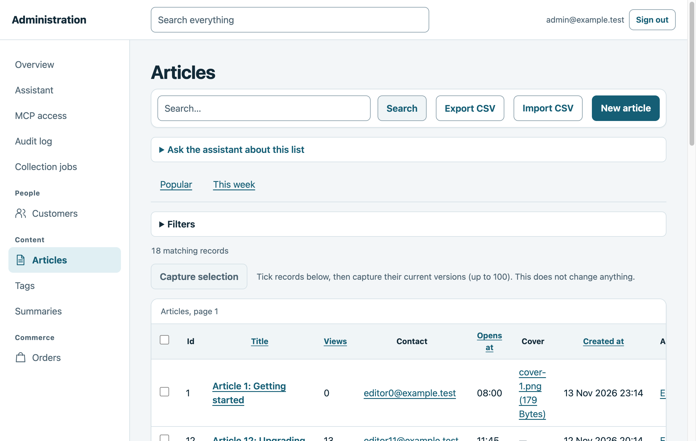
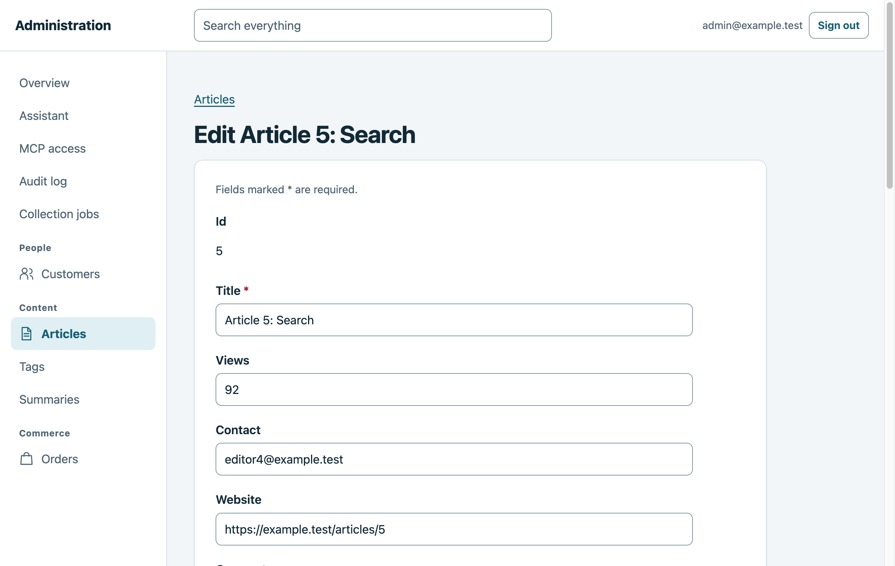
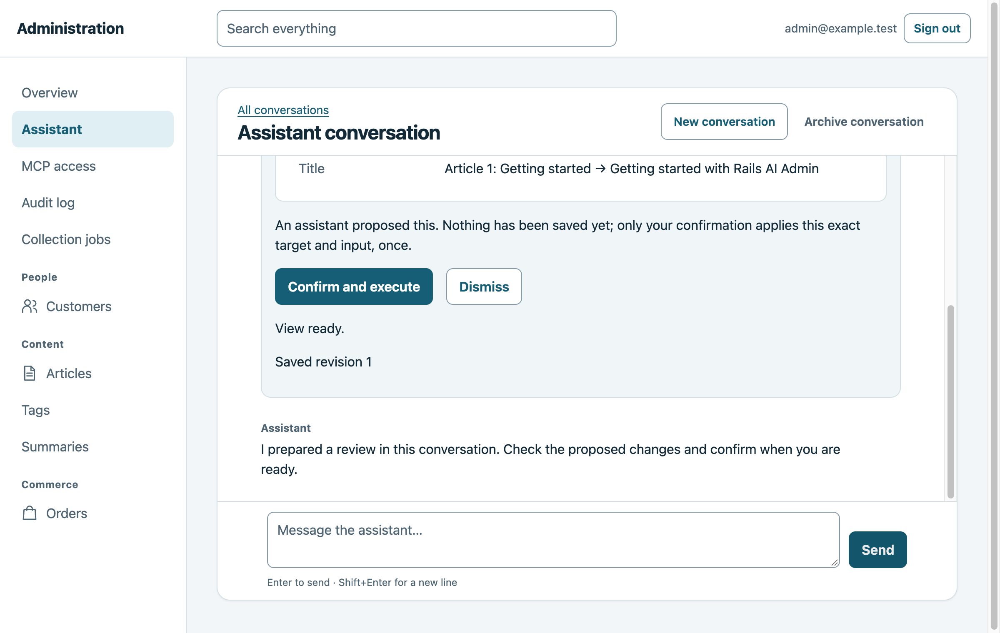

# Rails AI Admin

Rails AI Admin is a self-hosted admin engine for Rails. Give your team an admin
for the models you choose, then add a RubyLLM-powered assistant that can answer
questions about records and prepare changes for review.

**0.3.0 Public Preview** · [Documentation](https://rails-ai-admin.wangyaodi.com/) ·
[Quickstart](https://rails-ai-admin.wangyaodi.com/quickstart/) ·
[RubyGems](https://rubygems.org/gems/rails_ai_admin)



| Edit records through typed forms | Review a change the assistant proposes |
| --- | --- |
|  |  |

## What you can do

- **Manage records.** Configure forms, associations, searchable and filterable
  lists with saved views and bulk actions, soft delete with restore, dashboards,
  and CSV import and export for explicitly registered resources.
- **Keep access in your app.** Use the host's authentication, tenant scoping, and
  policies to decide who can see records, fields, and actions. Track changes
  with record history and an audit log.
- **Ask questions and review changes in chat.** The optional assistant searches
  records using the signed-in admin's permissions. When it proposes a change,
  a review card shows the details before a person confirms it. An optional MCP
  endpoint exposes the same permission-checked tools.

## How it compares

Most Rails admin gems show your models first and add permissions on top. Rails
AI Admin starts closed, and its optional assistant follows the same permissions
and audited write path as the forms.

| | Rails AI Admin | ActiveAdmin | Avo | Administrate | RailsAdmin | Madmin | Trestle |
| --- | --- | --- | --- | --- | --- | --- | --- |
| License | MIT | MIT | LGPL-3.0 or commercial | MIT | MIT | MIT | LGPL-3.0 |
| Rails versions | 8.1 | 6.1+ | 6.1+ | 6.0 to 8.x | 6.0 to 8.x | 7.0+ | 6.0+ |
| Models shown by default | Registered only | Registered only | Generated only | Generated only | All models | Generated only | Registered only |
| Authorization | Required, closed by default | Optional adapter | Paid add-on | Optional | Optional adapter | Your own code | Your own code |
| Audit log and history | Built in | Other gems | Enterprise plan | Other gems | PaperTrail adapter | Other gems | Other gems |
| AI chat and MCP | Built in, free, optional | No | Paid add-ons | No | No | No | No |

Choose another gem if you need Rails 7 or 8.0, an established plugin ecosystem,
or an admin for every model without connecting sign-in and policies first. The
[full comparison](https://rails-ai-admin.wangyaodi.com/next/comparison/) has
sources and more detail. Data as of November 2026.

## Install in a Rails app

Add the gem to your Gemfile and run `bundle install`:

```ruby
gem "rails_ai_admin", "~> 0.3.0"
```

Requires Ruby 3.3+ and Rails 8.1.4.1+ (below 8.2). Rails 7 and 8.0 are not supported. See the [installation guide](https://rails-ai-admin.wangyaodi.com/getting-started/)
for supported Rails patch versions. The [quickstart](https://rails-ai-admin.wangyaodi.com/quickstart/)
walks through connecting sign-in and policies, then registering your first
resource. Conventional admin pages work without a model provider or API key.

For an app with Rails authentication or Devise already migrated:

```sh
bin/rails generate rails_ai_admin:install --full-access
bin/rails db:migrate
bin/rails generate rails_ai_admin:resource --all
bin/rails rails_ai_admin:doctor
```

Review the generated files before use. The opt-in full-access preset grants all
rows and declared capabilities to people admitted by `AdminContext`; add tenant
scoping for account-based apps. Omit `--full-access` to keep policy access closed.
The assistant remains off until explicitly enabled.

## Try the local demo

From a clone of this repository:

```sh
bundle install
bin/demo --assistant
```

Open `http://127.0.0.1:3917/login`, choose **Sign in as Admin**, then select
**Assistant → New conversation**. Try `search articles for upgrading`, followed
by `set articles 1 title to Hello` to see a change review. The demo uses seeded
data and an offline model. Follow the [demo walkthrough](https://rails-ai-admin.wangyaodi.com/demo/)
for more examples.

[MIT License](LICENSE) · [Contributing](CONTRIBUTING.md) · [Security](SECURITY.md)
