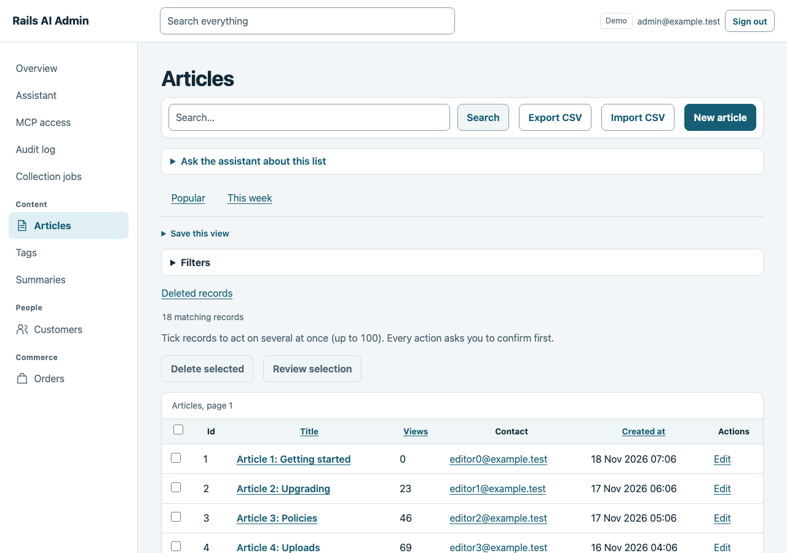
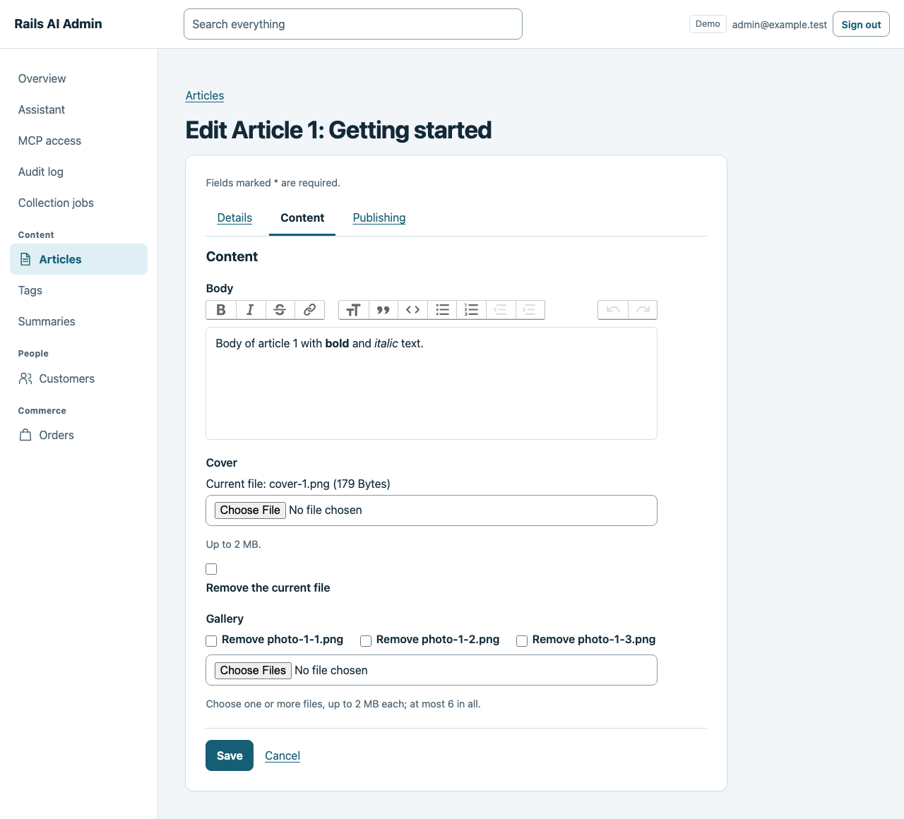
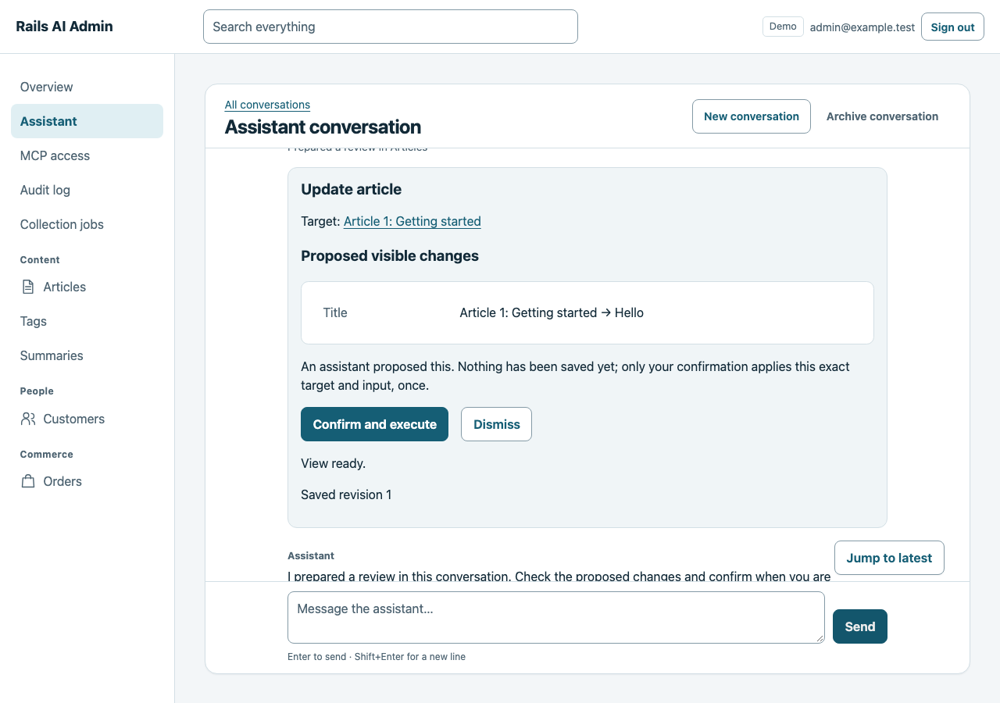

# Rails AI Admin

Rails AI Admin is a self-hosted admin engine for Rails. Give your team an admin
for the models you choose, then add a RubyLLM-powered assistant that can answer
questions about records and prepare changes for review.

**0.5.0 Public Preview** · [Documentation](https://rails-ai-admin.wangyaodi.com/) ·
[Quickstart](https://rails-ai-admin.wangyaodi.com/quickstart/) ·
[RubyGems](https://rubygems.org/gems/rails_ai_admin)



| Edit records through typed forms | Review a change the assistant proposes |
| --- | --- |
|  |  |

## What you can do

- **Manage records.** Configure forms, associations, searchable and filterable
  lists with saved views and bulk actions, soft delete with restore, dashboards,
  and CSV import and export for explicitly registered resources.
- **Keep access in your app.** Use the host's authentication, tenant scoping, and
  policies to decide who can see records, fields, and actions. Track changes
  with record history and an audit log.
- **Ask questions and review changes in chat.** The optional assistant searches
  records and calculates totals using the signed-in admin's permissions. When it
  proposes a change, for one record or up to 100 at once, a review shows the
  details before a person confirms it. Per-person token and cost limits and a
  retention period keep it in check, and an optional MCP endpoint exposes the
  same permission-checked tools. Its tests replay conversations recorded with
  real OpenAI, Anthropic and Google models through OpenRouter.

## How it compares

Most Rails admin gems show your models first and add permissions on top. Rails
AI Admin starts closed, and its optional assistant follows the same permissions
and audited write path as the forms.

| Gem | Rails | Default model exposure | Authorization | Audit and history | AI chat and MCP | License |
| --- | --- | --- | --- | --- | --- | --- |
| **Rails AI Admin** | 8.1 | Registered only | Required, default deny | Built in | Built in, optional and free | MIT |
| ActiveAdmin | 6.1+ | Registered only | Optional adapter | Other gems | None | MIT |
| Avo | 6.1+ | Generated only | Paid add-on | Enterprise plan | Paid add-ons | LGPL-3.0 or commercial |
| Administrate | 6.0–8.x | Generated only | Optional | Other gems | None | MIT |
| RailsAdmin | 6.0–8.x | All models | Optional adapter | PaperTrail adapter | None | MIT |
| Madmin | 7.0+ | Generated only | Host application | Other gems | None | MIT |
| Trestle | 6.0+ | Registered only | Host application | Other gems | None | LGPL-3.0 |

Choose another gem if you need Rails 7 or 8.0, an established plugin ecosystem,
or an admin for every model without connecting sign-in and policies first. The
[full comparison](https://rails-ai-admin.wangyaodi.com/next/comparison/) has
sources and more detail. Data as of November 2026.

## Install in a Rails app

Add the gem to your Gemfile and run `bundle install`:

```ruby
gem "rails_ai_admin", "~> 0.5.0"
```

Requires Ruby 3.3+ and Rails 8.1.4.1+ (below 8.2). Rails 7 and 8.0 are not supported. See the [installation guide](https://rails-ai-admin.wangyaodi.com/getting-started/)
for supported Rails patch versions. The [quickstart](https://rails-ai-admin.wangyaodi.com/quickstart/)
walks through connecting sign-in and policies, then registering your first
resource. Conventional admin pages work without a model provider or API key.
If you already use the engine, follow the [upgrade guide](https://rails-ai-admin.wangyaodi.com/upgrading/) to copy and run the new migration.

For an app with Rails authentication or Devise already migrated:

```sh
bin/rails generate rails_ai_admin:install --full-access
bin/rails db:migrate
bin/rails generate rails_ai_admin:resource --all
bin/rails rails_ai_admin:doctor
```

Review the generated files before use. The opt-in full-access preset grants all
rows and declared capabilities to people admitted by `AdminContext`; add tenant
scoping for account-based apps. Omit `--full-access` to keep policy access closed.
The assistant remains off until explicitly enabled.

## Try the local demo

From a clone of this repository:

```sh
bundle install
bin/demo
```

Open `http://127.0.0.1:3917/login` and choose **Sign in as Admin**. Explore the dashboard and Articles, then ask the offline **Assistant** `set articles 1 title to Hello`. Review and confirm the change, then find it in **Audit log**. No API key is needed. Follow the [demo walkthrough](https://rails-ai-admin.wangyaodi.com/next/demo/) to save a chat chart to Overview, review a recipe as a second operator, track a 125-row import, and try MCP.

[MIT License](LICENSE) · [Contributing](CONTRIBUTING.md) · [Security](SECURITY.md)
