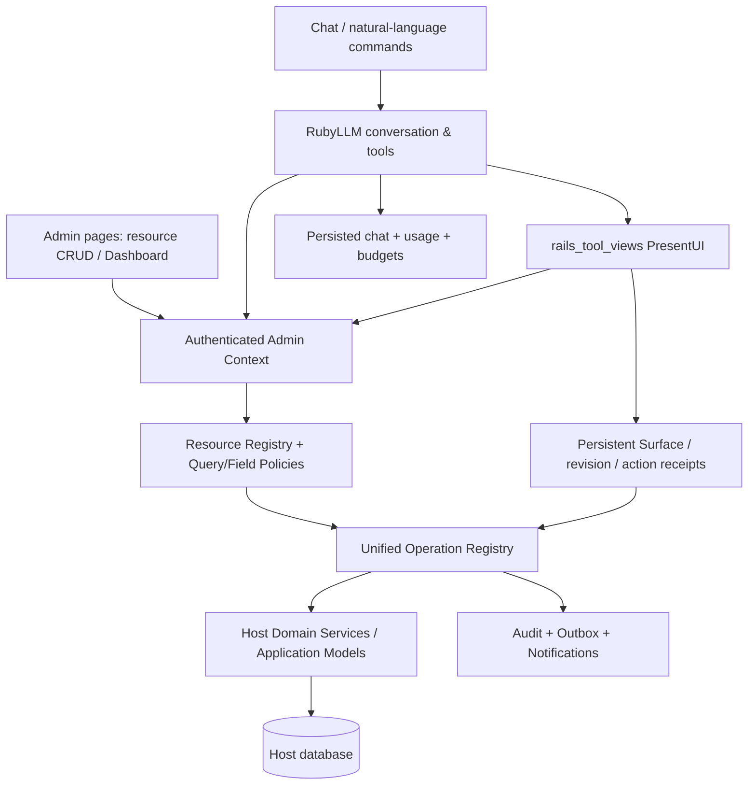

# rails_ai_admin — AI-native Rails Admin Framework

> **工程立项 / 产品需求文档 / 架构设计 / 测试与发布计划 / AI Agent 可执行任务书**  
> 状态：**Reviewed Proposal · v0.3（第二轮源码级复核完成；尚未实现、运行验证或批准发布）**  
> 实施检查点（2026-10-30）：常规 CRUD、成员级自定义 Operation/确认与事务 outbox、固定 Selection 捕获/重验与异步集合逐项执行/取消、显式 Pundit 适配器、两个独立 packaged Host、真实重载及崩溃恢复，以及 schema 注释建议、安装预检、Doctor/TestKit 初版已取得本地验收证据；当前依赖已升级 rails_tool_views 1.0.2；标量字段插件注册/规范化/校验/Schema/Partial、固定 Select 与只读字段语法已取得本地证据；有界只读 Virtual/计算字段的依赖授权、快照与重载已验证；常规模板单文件覆盖/源版本与 Context revision/Doctor 漂移诊断已验证；每视图字段掩码、受权只读上下文、分组表单及渐进增强 Tabs 已取得本地契约与 Chrome 验收；通用 Create/Update 开放标签页的会话恢复已按同一 intent/新认证/版本权限重验取得本地与 Chrome 证据；结构化列表返回位置、受权排序/分页、同筛选空页夹取与 Unicode 恢复已取得本地/消费端/Chrome 证据（剩余状态页/控制器扩展及 Phase 2 Gate 仍未完成）；完整范围与未完成项见 `ROADMAP.md` / `COMPATIBILITY.md`。以下审查结论保留为立项时历史基线，不能用于推断任何 Gate 已通过。
> 制定日期：2026-10-29  
> 复核日期：2026-10-29（Asia/Shanghai）；v0.2 设计复核 + v0.3 对本地 `rails_tool_views`/RubyLLM 源码与上游 Release 的二次核对；两轮均只修改计划，无产品代码  
> 目标项目：`rails_ai_admin`（项目名已由发起者确定；RubyGems 名称及 GitHub 仓库可用性须在创建前确认）  
> 许可证目标：MIT  
> 核心技术：Ruby on Rails、Hotwire/Turbo/Stimulus、Active Record、`rails_tool_views`、RubyLLM

## 0. 执行摘要及不可妥协原则

### 0.1 产品定义

`rails_ai_admin` 是一个**可挂载、可扩展、以 Rails 为中心、完全自托管的通用管理后台 Gem**。其第一职责是提供足以替换典型 Rails Admin 方案的高质量传统管理能力；其第二职责是让管理员通过聊天、自然语言命令和可信的交互式 UI 完成同一批被授权的业务任务。

**产品承诺**：

1. **Normal Admin First**：关闭 AI、不配置模型密钥，常规 CRUD、关联、过滤、搜索、批量操作、Dashboard、导入导出、审计均可工作。
2. **One Domain Operation, Multiple Interfaces**：传统页面、Chat Agent、交互式 Surface 与未来外部 API 共享同一套授权后的业务执行入口；不存在 AI 专用的越权捷径。
3. **Trusted UI, Not Arbitrary Generated Code**：AI 只能选择已经注册、经过权限验证的 Rails Partial/ViewComponent 和操作。不得由模型直接产生并执行 Ruby/SQL/HTML/JS。
4. **Owner-controlled Data**：业务数据留在宿主 Rails App 中；只有经过最小化、脱敏和范围约束的数据被发送到模型提供商；自托管不等于模型调用完全本地。
5. **Secure by Default**：默认拒绝、字段及记录级授权、审计、幂等、防重放、人工确认、限流与成本控制是平台的基线，而不是后期附加项。
6. **Native Rails Extensibility**：Rails Engine、Zeitwerk、Action Controller/View、Active Record、Active Job、I18n、Active Storage、Action Text（需要时）和 Hotwire 为优先方案；允许用普通 Rails 文件覆盖，而非强迫用户学习庞大的专有 DSL。
7. **Open-source Ready from Day 0**：从第一条提交建立 MIT LICENSE、贡献规范、行为准则、安全报告、版本/兼容矩阵、CI、变更日志和真实使用文档。
8. **Quality Gates over Calendar Dates**：每阶段设进入条件、可交付物、测试矩阵和阻断条件；不因日程推进而绕过数据安全/迁移风险。

### 0.2 非目标与产品边界

- 不创建独立的 SaaS 托管控制平面；不要求第三方账户或商业许可证。
- 不承诺通过 AI 可访问宿主的全部模型、字段、原始数据库或操作系统。
- 不取代 Devise、Rails 自带认证或公司的身份认证服务；Admin 提供明确的认证接入协议。
- 不以新的 Gem 重新实现 `rails_tool_views` 的 Surface / revision / idempotency / continuation 核心。
- 不复制 RubyLLM 的模型 Provider、Agent Runtime、Tool Approval 或持久化聊天底层。
- 不以复制 Avo、ActiveAdmin、Administrate 等项目代码作为实现路径；参考公开功能和用户体验，保持源代码独立及许可证合规。
- 不承诺第一版直接支持所有数据库、Mongoid、复杂复合主键或所有付费插件；要求每项不支持的能力有明确清单及迁移对策。
- 1.0 不内建管理员账户、角色或权限管理 UI。这些属于 Host；Host 可以把自己的 `User`/`Role` 注册为普通 Resource。“以某用户身份登录”（impersonation）只作为 P2 的 Host 领域 Operation（UX-016），不进入核心。
- 不提供公开的托管 Demo。参考 Host 只在本地或隔离环境运行；若将来公开部署，按 Owner 的规则用邀请码关闭注册（fail closed），且不使用真实数据。

### 0.3 成功定义

**技术成功**：两个风格不同的真实 Rails Host 安装 Gem，均实现基本资源管理和 Chat+UI 闭环；无 AI Key 时传统后台完整可用；跨租户/越权/重复执行测试必须全部通过。  
**产品成功**：熟悉 Rails 的开发者能以少量 Resource 配置覆盖常见 CRUD，并能用普通 Rails 扩展复杂页面；管理员完成代表性任务的效率和正确率不低于已有管理端。  
**生态成功**：文档可独立完成安装、迁移、开发、运行和贡献；外部使用者能够报告问题并提交可验证的 PR。  
**发布成功**：发布的 Gem 安装包、升级、兼容性与恢复均经过真实消费端验证；安全与数据损坏类阻断项为零。

### 0.4 目标受众与使用场景

- **首要设计对象**：管理约 5–20 个 Resource 的 Rails SaaS 运营/支持团队。首先把查找、修正、审核、批量处理和数据交换做可靠，再扩展到企业流程编排。
- Rails 独立开发者：五到十个模型，快速获得可维护的管理端。
- Rails SaaS 团队：面向多租户运营人员的 Customer、Subscription、Order、Support 管理。
- Rails 咨询公司：以通用 Gem 构建客户内管平台、定制流程与后台 AI。
- 企业内部工具开发者：复杂关联、审批、数据修正、报表、批量行动。
- 开源 AI/Rails 开发者：利用项目作为 `rails_tool_views` 与 RubyLLM 的真实范例和回归测试。

### 0.5 本次复核结论与证据边界

**方向成立**：以传统 Admin 为基础，以共享 Operation 和可信持久 Surface 连接 Chat；不再增加一套由模型控制的数据入口。**设计尚不能被称为“完美”或已经证明可生产使用**：安装、事务、Provider、易用性与迁移结论必须由后续真实 Host 验收给出。

本轮已直接检查当前目录（仅本计划，尚无 Git 仓库或应用）、本地 `rails_tool_views` 1.0.1 公共契约/Adapter/示例，以及上游 Release 和官方文档。另从架构、产品样本、安全三个角度独立复核。**没有运行依赖解算、代码、测试、Demo、付费 Provider 或迁移；没有确认 RubyGems 名称可用性。**

本版纠正的主要缺口：

1. Operation、原子审计、幂等与确认契约前移到首次 CRUD 写入之前；Phase 4 不再承担事后改造所有写入口的任务。
2. 增加跨 UI/Tool/Surface 的 `OperationRun`，明确同一数据库连接的事务边界、外部结果未知与恢复机制。
3. 审批绑定确切目标集合、规范化输入及操作版本；普通 Save、AI 写入、破坏性批量动作采用不同的交互强度。
4. 权限覆盖 Filter/Sort/Aggregate/关联标签和历史上下文；不把已脱敏输出当作查询本身安全的证明。
5. 修正 Rails 维护期、依赖版本及 Surface 生命周期；补充真实上游样本、完整用户任务和可重复的验收。

本文件中的 **设计决定** 是实施基线；**待验证假设** 不能被 Agent 当作现有能力。Gate A 仍待实际 ADR/契约与 Host 证据，不因本次文档审查自动勾选。

#### 0.5.1 第二轮复核（v0.3）：已核对的事实与新增修正

**本轮直接核对**（2026-10-29，只读，不运行测试）：

| 事实 | 来源 | 结论 |
|---|---|---|
| Rails 最新 Release 8.1.4（2026-09-24）；main 为 `8.2.0.alpha`，无 8.2 tag；维护页只列 8.1（bug-fix 至 2026-10-10，安全至 2027-10-10）与 8.0（安全至 2026-11-07）；7.2.4 于 2026-09-24 发布但不在维护页 | `gh release list`、rubyonrails.org/maintenance | 8.1.x 首条验证线不变；新增 Rails main nightly（允许失败）作 8.2 预警 |
| Ruby 4.0.9、3.4.12、3.3.13 同日发布（2026-10-23）；3.3 已是 security maintenance，预期 EOL 2027-03-31；3.4/4.0 normal maintenance | ruby-lang.org branches | v0.2 漏掉 3.4；下限改为 `>= 3.4`（§2.1） |
| RubyLLM 最新 Release 2.1.1（2026-10-11）；本地 main 已领先 332 个提交，含**未发布**的 queued messages、run claims、persisted cancellation、persisted pending approvals、`remember: true` 审批 | 本地 `ruby_llm` 与 `v2.1.1` tag 对比 | 1.0 只依赖已发布 API；未发布能力列入 upstream watch（§6.4.1） |
| `rails_tool_views` 1.0.1（2026-10-28）公共 Ruby API、错误码、Surface/Interaction 状态、MySQL 不支持、Ruby `>= 3.3`、Rails `>= 7.2, < 9` 与 v0.2 描述一致 | 本地源码 + `public-contract.md` | 维持；另发现**全局配置共存问题**（§6.3.1） |
| `rails_tool_views` 的 `scope_resolver`、`parent_controller`、`agent_adapter`、`auto_deliver` 与 registry 均为进程级单例；action form 固定指向 `rails_tool_views` engine 路由；`Scope` 的 actor/tenant 是 ≤150 bytes 的非空字符串 | `core.rb`、`surfaces_helper.rb`、`surfaces_controller.rb` | 与 Host 自己的 `rails_tool_views` 使用会冲突；需要命名空间化 actor ref 与 SPIKE-06 |
| RubyLLM 2.1.1 的 `acts_as_chat(messages:, message_class:, messages_foreign_key:)`、`acts_as_message(chat_class:)`、`Tool.requires_approval`、`chat.approve`、`RubyLLM.context` 均已发布 | `git show v2.1.1:…` | Admin 会话可使用 Engine 自有表与类，Provider 配置可隔离（§3.4、§6.4） |

**v0.3 新增或修正的设计决定**：

1. **Ruby 常量改为 `RailsAiAdmin`**，AI 子命名空间改为 `RailsAiAdmin::Assistant`；这样不需要修改 Host 的 Zeitwerk/ActiveSupport inflection（§3.7）。
2. **Host 扩展文件放在独立的 `app/rails_ai_admin/`**，采用带 `Admin` 后缀的顶层常量（`OrderAdmin`）。这样能避开 ActiveAdmin 被 Zeitwerk ignore 的 `app/admin`、Graphiti/JSONAPI 的 `*Resource`、Administrate 的 `*Dashboard`，迁移期间新旧后台可以共存（§3.7）。
3. **前端资产以预构建、命名空间化的 CSS/ESM 随 Gem 发布**；Admin layout 是独立文档，不依赖 Host 的 importmap/jsbundling/Tailwind，并兼容严格 CSP（§2.2、§8.3）。这能大幅压缩 §9.2 的前端组合矩阵。
4. **Admin 会话使用 Engine 自有 Chat/Message 表**，绝不写入 Host 产品的 `Chat`；ToolCall/Usage 行使用 RubyLLM 自有的共享表，按多态类型与会话隔离（2026-10-30 修正，见 §3.4）；Provider 凭据经 `RubyLLM.context` 隔离，不修改 Host 的全局 `RubyLLM.configure`（§3.4、§6.4）。
5. **业务写入工具禁止“记住审批”**（RubyLLM main 的 `remember: true`），也不能复用跨调用的 tool 级批准（§6.4）。
6. **新增 HTTP 路由契约、保留 slug、Host Test Kit 与 “AI 可见性报告”**（§4.6、§4.7），并补充 Audit Explorer、countless/keyset 分页、关联列排序等功能项（§5）。
7. **新增 SPIKE-06（`rails_tool_views` 全局配置共存）与 SPIKE-07（预构建资产跨 Propshaft/Sprockets/CSP）**，以及相应的 ADR、风险与 Phase 0/1 任务。
8. **Operation 示例与 §3.5 对齐**：外层事务、OperationRun 与审计由框架持有，Handler 不再自行开启另一个事务或连接（§4.3）。

### 0.6 交付切片与范围约束

| 切片 | 必须证明的价值 | 暂不要求完成的范围 | 发布标识 |
|---|---|---|---|
| Foundation / 第一条垂直路径 | 默认拒绝；Customer CRUD 共用 Operation、审计、冲突和幂等 | 完整字段库、CSV、Dashboard、AI | 内部开发验收 |
| Early integration proof（Phase 2 后） | 同一订单表单通过普通页面与单个 Surface 工作；离线 Chat loop 可恢复，业务不重复写 | 完整 Chat 产品、所有传统 P0、所有 Provider | 内部技术验证；不称 Beta/GA |
| Public Preview | 已列明的 CRUD/关联/Filter 与一个完整 Chat+Surface 工作流；关闭 AI 可用 | 明示未完成的 CSV/Dashboard/P1，不能声称可全面替换 | `0.x`，逐项列限制 |
| Beta | 全部 P0 的候选实现、两种 packaged Host、100 个确定性评估、真实 Provider 验证 | P1/P2 全覆盖与外部用户结论 | `0.x` Beta |
| 1.0 | 第 5/6/7 章全部 P0 + Gate A–E；三类迁移样本与独立试用 | P1 逐项公开支持范围；P2 不进关键路径 | Owner 明确批准后发布 |

不得为抢先发布把现有 P0 静默降级，也不得因为所有 P1 未完成阻塞已经界定的 1.0。早期技术验证用于尽早暴露 `rails_tool_views`/RubyLLM 集成风险，**不能取代后续常规 Admin 或正式 AI 安全验收**。

---

## 1. 背景、市场与竞品基线

### 1.1 已有产品的启发

| 项目 | 要学习的强项 | `rails_ai_admin` 应避免的缺陷/取舍 |
|---|---|---|
| **Avo 4 / Avo AI** | Resource DSL、丰富字段和关联、Dashboard、Action、Search、授权、聊天和确认卡片、AI Tool、MCP | 不仅做同样的 Chat+CRUD；重点发展**可恢复的 Rails 原生交互式 Surface + 统一 Domain Operation**；避免商业扩展成为基础能力的依赖 |
| **ActiveAdmin** | 成熟 Resource/Scope/Filter/Batch Action、Index 视图、定制页面、稳定的 Admin 工作流 | 避免与 Domain Logic 过度耦合的特有 DSL；避免生成器产生大量难升级的拷贝 |
| **RailsAdmin** | 快速接入、字段推断、搜索/过滤、CSV/JSON/XML、与认证/授权模块集成 | 不能靠反射自动将所有模型/属性暴露给 AI；权限必须是先决条件 |
| **Administrate** | 少量抽象、Rails 原生可定制、可覆盖 Controller/View、简洁面板 | 既保留轻量风格，又补齐成熟 Admin 所需的批量任务、筛选和插件能力 |
| **Madmin** | Rails scaffold 风格、Generator、可覆盖模板、Field 插件、Active Storage / Rails 技术集成 | 不把完整配置都复制成大量宿主文件；保持 Gem 升级路径 |
| **Motor Admin** | 动态查询、可视化、Dashboard、表单和业务工作流 | 避免将任意 SQL 赋予普通管理员或 AI；查询必须限定白名单、范围与配额 |
| **CopilotKit / assistant-ui** | AI Chat 中的工具 UI、状态同步、人工参与 | 借鉴交互模式，不依赖 React 才能使用 Admin |

**2026-10-29 资料基线**：Avo 4 的 AI 文档标为 **Beta / Add-on**，已描述当前页/选中行上下文、受 Policy 过滤的工具、导入预览及写入确认。它的详细文档与营销页在确认细节上存在差异；例如详细文档允许普通 Create 立即执行。不得推断 Avo 的每种写入都要求同样的确认，也不能将 Chat CRUD、页面上下文或确认卡当成本项目独有创新。参考能力不等于免费、GA 或已被本次实际运行验证。[Avo AI 官方文档](https://docs.avohq.io/4.0/ai.html)、[产品页](https://avohq.io/addons/ai)。

### 1.2 真正的产品差异化假设

- **UI 与 Chat 双向、无缝、同源**：聊天中展示的组件与普通 Admin 使用相同的操作/权限/数据结构。
- **Persistent Interactive Surface**：AI 返回的表单、Review Card、对比界面可以刷新、恢复、审计，并在用户提交后安全继续 Agent 流程。
- **Rails-native Human-in-the-loop**：对话内的人工审批、修正与业务表单是一等公民，不依赖任意前端代码生成。
- **Deterministic Business Actions**：AI 只负责解释和提议，所有写操作可通过确定性代码、约束和审批追踪。
- **OSS Self-hosted with Minimal JS**：开箱即用且允许宿主自定义，不绑定外部 Admin 托管服务。
- **A Gem that Tests a Gem**：它为 `rails_tool_views` 提供长期、非 Dummy、跨版本的实战场景，推动底层 Runtime 的正确演进。

**验证方法**：记录 20–30 个真实 Admin 工作流，分别用 Avo、传统 Rails Admin 与本项目完成；比较交互步骤、任务成功率、错误恢复能力、接入成本和维护成本。没有实测证据不得使用“性能更好”“更安全”“更完整”等宣传性结论。

### 1.3 参考样本如何转为需求（本轮已复核的公开资料）

| 参考及证据 | 提取的具体模式 | 本项目的落点与验证 |
|---|---|---|
| [ActiveAdmin Batch](https://github.com/activeadmin/activeadmin/blob/master/docs/9-batch-actions.md)、[Forms](https://github.com/activeadmin/activeadmin/blob/master/docs/5-forms.md) | 批量动作带输入、表单定制、嵌套属性 | SAMPLE-03；提交前显示目标/输入；嵌套保存规则见 §5.6；不照搬 DSL |
| [Administrate partial 定制](https://administrate-demo.herokuapp.com/customizing_attribute_partials)、[授权](https://administrate-demo.herokuapp.com/authorization) | Form/Index/Show 小范围覆盖、Controller/Policy 接入 | SAMPLE-01；只复制需要覆盖的模板；本项目仍默认拒绝而非只检查登录 |
| [Madmin](https://github.com/excid3/madmin)、[自定义字段](https://github.com/excid3/madmin/blob/main/docs/custom_fields.md) | Hotwire、只读资源、New/Edit 可见性、关联检索 | CRUD-019/020、SAMPLE-01；模板局部覆盖与安装依赖验证 |
| [RailsAdmin](https://github.com/railsadminteam/rails_admin/blob/master/README.md) | 常规 CRUD/Filter/Export/Action，PaperTrail 可选历史 | LIST-008/009/010、CRUD-017；业务历史与本框架执行审计分开 |
| [Motor Admin Rails](https://github.com/motor-admin/motor-admin-rails/blob/master/README.md) | Dashboard 到记录的钻取、自定义表单/动作、配置同步 | SAMPLE-05；复用受限 Query；不引入原始 SQL 或可视化 Builder |
| [RubyLLM Rails](https://rubyllm.com/rails/)、[Durable Agents](https://rubyllm.com/durable-agents/) | Host-owned Chat、持久化 Tool、至少一次恢复 | §6.8；已有 Generator 作为集成参考，避免生成第二套 Provider Runtime |
| [`rails_tool_views` v1.0.1 Demo](https://github.com/yorzi/rails_tool_views/blob/v1.0.1/docs/site/_getting_started/demo.md) | Customer Form、Support Review、结果版本、离线真实 Chat loop | §16.4；学习 ownership/continuation 边界，不能把 Dummy 成功算成真实 Host/Provider 证据 |

**同生态参考（Owner 的相关仓库，只作设计对照，1.0 不作硬依赖）**：

| 仓库 | 可借鉴的模式 | 落点 |
|---|---|---|
| `ruby_llm-conductor` | 数据库管理的模型路由、熔断与调用审计 | AI-019 多模型/租户 Key、§6.4 失败降级；作为可选集成评估，不内置第二套路由 |
| `ruby_llm-credits`（未发布） | 不可变价格、preflight quote、精确算术与结算 | §6.8 预算原子预留/结算的接口形状；发布前不依赖 |
| `rubyllm-workbench` | Run/Attempt/usage/cost/approval 的持久化时间线 | RAA-0709 审计链 UI、AI-017 评估面板 |
| `ruby_llm-ag-ui`、`openui-rails` | AG-UI SSE 流、OpenUI 渲染 | Phase 10 的可信 UI 协议 ADR 输入，1.0 不引入 |
| `rails_event_store` | 事件存储、Outbox 与订阅模式 | RAA-0404 Host Outbox 示例的对照，不作依赖 |

GitHub 默认分支文档只证明当前文档中有该模式；本次未逐项安装其发布 Gem。后续竞品实测必须补上 Release/Commit、版本/许可层、环境和任务结果。**参考目标是可维护的交互与业务契约，不是复刻截图或项目代码。**

---

## 2. 版本、兼容性、依赖与发布政策

### 2.1 初始支持策略

- **Ruby**：**`required_ruby_version >= 3.4`**，主开发为 Ruby 4.0，CI 同时测 3.4 与 4.0。理由：3.3 已进入 security maintenance，预期 2027-03-31 EOL，很可能早于或紧挨本项目 1.0；`rails_tool_views` 的 `>= 3.3` 是它的下限，不要求本项目沿用。v0.2 只列 4.0 与 3.3，漏掉了仍在 normal maintenance 的 3.4。本轮查得上游 [4.0.9](https://github.com/ruby/ruby/releases/tag/v4.0.9) 与 3.4.12；发布前再次核查补丁与维护状态，不能由下限推断每个中间版本均已支持。
- **Rails**：本轮上游最新 Release 为 [8.1.4](https://github.com/rails/rails/releases/tag/v8.1.4)，以 **8.1.4+ 的 8.1.x** 为首条验证线。Rails 维护页列 8.1 安全修复至 2027-10-10、8.0 至 2026-11-07，未将 7.2 列入当前支持线；其 bug-fix 列表日期已早于本次复核日，因此不据此声称当前存在全面 bug-fix 支持。**7.2 是可选的 legacy 迁移测试目标，不是初始稳定版承诺。**依赖能够解算与官方仍维护是两件事；每次 RC 根据 [Rails 维护政策](https://rubyonrails.org/maintenance) 重新确认支持线和补丁。8.0/7.2/未来 Rails 版本不得仅凭依赖范围扩大支持。7.2.4 虽于 2026-09-24 发布，但不在维护页上，因此不改变上述结论。Rails main 目前为 `8.2.0.alpha`：CI 增加一个**允许失败的 Rails main nightly**，用于提早发现 Engine/Zeitwerk/资产破坏；8.2 正式发布后再评估纳入支持线。gemspec 先用 `rails >= 8.1.4, < 8.2`，经 CI 证明后再放宽。
- **数据库**：首个稳定版本必须支持 SQLite 和 PostgreSQL；MySQL 必须经过迁移、排序规则、锁/并发与索引测试后才可列为支持。由于 `rails_tool_views` 1.0.1 尚不支持 MySQL，**不能由 `rails_ai_admin` 提前宣称端到端 MySQL 支持**。
- **主键**：整数型主键必测，UUID 必测。复合主键、STI/多态关联逐项验证，在兼容表中列出边界。
- **RubyLLM**：Adapter 协议最低要求 2.0，但本项目首条消费线采用 **2.1.1，候选依赖范围 `>= 2.1.1, < 3`**；其发布修复了 fresh install 的 Faraday 解析问题。2.0.x 仅作为上游 Adapter 的回归信息，不作为本项目支持承诺。用 Appraisal/lockfile 保存实际解算组合，未来 minor 仍需 CI。[Release 2.1.1](https://github.com/crmne/ruby_llm/releases/tag/v2.1.1)。
- **rails_tool_views**：以已发布 **1.0.1，候选范围 `~> 1.0.1`** 作为首条集成线（先限制在 1.0.x，再经测试放宽）；稳定核心有 Public Contract，RubyLLM Adapter 仍为实验性，不能因为核心 1.0 就推定 Adapter 稳定。正式 Admin AI 前必须完成真实 Provider 和 Host 聊天持久化验证。[Release](https://github.com/yorzi/rails_tool_views/releases/tag/v1.0.1)。
- **JSON 兼容**：RubyLLM 文档指出 JSON 3 需要 Rails 8.1.4+；旧 Rails 测试线应按实际解析后的依赖选择 JSON 2，并通过 bundler matrix 复核。
- **浏览器**：当前稳定 Chrome、Firefox、Safari；测试桌面及移动宽度，不承诺过时浏览器。
- **资产方案（v0.3 决定）**：Gem 在发版构建时生成**预构建、带指纹的** `rails_ai_admin.css` 与 `rails_ai_admin.js`（ESM，内含 Admin 自己的 Turbo/Stimulus 应用与控制器），放在 Engine 的 `app/assets/builds/`。由 Propshaft 或 Sprockets 作为静态文件提供。Admin layout 是独立 HTML 文档，只加载这两份资产，**不依赖 Host 的 importmap、jsbundling、Tailwind 或 Node**，也不在安装时修改 Host 的全局样式、`manifest.js` 以外的配置或 importmap。Host 的扩展 JS 通过显式配置的额外 asset 注入，并注册到 Admin 的 Stimulus 应用。仍需在 importmap/Propshaft、jsbundling、Sprockets 三类 Host 上验证（SPIKE-07），但验证对象从“每种构建链编译我们的源码”缩小为“每种管线能否提供我们的静态文件”。

### 2.2 依赖分层

**核心运行依赖（拟定，需通过 Bundler 解算验证）**：

- `rails`：Rails Engine、Active Record、Active Job、Action View 等。
- `rails_tool_views`：Surface Runtime；**显式且主版本受限**。
- `ruby_llm`：AI 能力的主集成（即使 Gem 已安装，仍支持 `ai.enabled = false`）；定义版本下限/上限。
- `turbo-rails`、`stimulus-rails`：Hotwire；若已由宿主提供应复用。

**能力级可选集成**：Pundit / ActionPolicy、Pagy / Kaminari、Ransack、Active Storage、Action Text、PaperTrail、Solid Queue 等。原则：**有内部稳定接口；不依赖某个可选 Gem 的内部/私有 API**。除非它能明显降低维护量，否则使用 Rails 原生实现。不要一次性硬依赖所有可选 Gem。

**初始包装决定**：先交付一个 Gem，RubyLLM/`rails_tool_views` 为显式、受版本范围约束的依赖；“可选 AI”指**安装在 Bundle 中但运行禁用**，不宣称无 SDK 依赖。常规 install 不生成 Chat/Message，不刷新模型目录，不读取 Key，不加载实验 Adapter，不执行 Provider 请求。AI 表/Runtime migrations 在显式 AI install 步骤中接入；常规模式不得要求它们存在。此约束必须由空数据库/无网络 Host smoke 证明；若依赖的 Railtie 使它不可行，先改依赖 ADR，再决定拆分可选集成包，不能默默要求所有用户安装 AI 表。

**基础设施决定**：使用 Host Active Job，无强制 Redis/Sidekiq/Solid Queue。异步 Import/Export/Chat 要求可持久队列并有恢复扫描；测试 inline adapter 不代表可生产恢复。初始 HTML 读写在无 JavaScript 下可完成主要 CRUD，Chat/Surface 渐进增强；不为此额外建立 SPA。

### 2.3 Semantic Versioning

- `0.x`：开发契约尚未完全冻结；重要改动必须有 Upgrade Guide；严禁不告知的持久数据破坏。
- `1.0`：冻结 Resource DSL、Field/Action/Policy API、HTTP 契约、可覆盖的模板、事件、持久化数据迁移与扩展插件协议。
- patch：修复不改变公开契约；minor：兼容新增；major：改变公开契约。
- 给出**支持窗口**：稳定版发布后明确支持的 Rails/Ruby 组合、安全修复策略、弃用期限；弃用至少在发布说明中预告且提供迁移器/指南。

---

## 3. 参考架构与责任边界

### 3.1 逻辑架构



> 图中 Query 只读；所有写入通过统一 Operation。Surface 只负责交互状态，不是独立的业务事实来源。RAG/AI 分析的文本不是授权证据。

### 3.2 明确的职责划分

| 层 | 必须负责 | 严禁负责 |
|---|---|---|
| `rails_ai_admin` Engine | 路由、Admin shell、CRUD、Resource/Field/Query/Operation 注册、工具发现、权限适配、审计、安全策略、安装和文档 | 直接修改 `rails_tool_views` 内部数据、接管宿主全部认证 |
| `rails_tool_views` | 可信组件注册、Surface 创建/恢复、Action Dispatch、Revision、Receipt、Continuation | 定义业务模型、替代 Admin Resource 系统 |
| RubyLLM | Chat、模型/Provider、工具调用、批准/恢复、Token 用量、Agent | 绕过 host 业务权限、任意执行 SQL/Ruby |
| Host Rails App | Auth、Domain Model、Policy、实际 Business Operation、外部副作用 | 信任 AI 输入或 UI props 作为已授权决策 |
| Infrastructure | Jobs、Redis（可选）、数据库、日志/指标、备份 | 未授权读取业务数据 |

### 3.3 公开命名空间和建议目录

```text
rails_ai_admin/
├─ .github/
│  ├─ workflows/{ci,security,release}.yml
│  ├─ ISSUE_TEMPLATE/ ...
│  ├─ PULL_REQUEST_TEMPLATE.md
│  ├─ CODEOWNERS
│  └─ dependabot.yml
├─ app/
│  ├─ controllers/rails_ai_admin/
│  │  ├─ application_controller.rb
│  │  ├─ resources_controller.rb
│  │  ├─ actions_controller.rb
│  │  ├─ searches_controller.rb
│  │  ├─ exports_controller.rb
│  │  └─ chats/{conversations,messages,approvals}_controller.rb
│  ├─ models/rails_ai_admin/{audit_event,setting,...}.rb
│  ├─ jobs/rails_ai_admin/{conversation,export,import,...}_job.rb
│  ├─ views/rails_ai_admin/{layouts,resources,fields,chats,dashboards,...}/
│  └─ assets/builds/rails_ai_admin.{css,js}   # prebuilt at gem build; sources in frontend/
├─ frontend/                       # CSS/JS sources + build script; not shipped in the .gem
├─ config/{routes.rb,locales/}
├─ db/migrate/ ...                 # conventional tables only
├─ db/migrate_assistant/ ...       # copied only by rails_ai_admin:assistant:install
├─ lib/
│  ├─ generators/rails_ai_admin/{install,resource,operation,field,assistant}/  # Rails generator lookup path
│  ├─ rails_ai_admin.rb
│  └─ rails_ai_admin/
│     ├─ engine.rb
│     ├─ version.rb
│     ├─ configuration.rb
│     ├─ resource.rb
│     ├─ field.rb
│     ├─ registry.rb
│     ├─ context.rb
│     ├─ authorization/
│     ├─ queries/
│     ├─ operations/
│     ├─ assistant/{tools,orchestrator,context_builder,guardrails}/
│     ├─ integrations/{ruby_llm,tool_views}/
│     ├─ instrumentation/
│     └─ test_kit/                 # public host test helpers (§4.7)
├─ test/{unit,integration,system,security,contract,fixtures}/
├─ test/dummy/                    # Quick smoke app, not only proof host
├─ spec_hosts/                    # Isolated packaged-consumer apps
├─ gemfiles/                       # Appraisal matrix
├─ docs/site/                      # public guides (same Jekyll stack as rails_tool_views), llms.txt
├─ docs/{adr,architecture,security}/   # long-lived contracts and decisions
├─ examples/{shop_admin,support_admin}/
├─ LICENSE
├─ SECURITY.md
├─ CONTRIBUTING.md
├─ CODE_OF_CONDUCT.md
├─ CHANGELOG.md
├─ ROADMAP.md
├─ SUPPORT.md
├─ MAINTAINERS.md
├─ rails_ai_admin.gemspec
└─ README.md
```

**核心约束**：Public classes 遵循 Zeitwerk；不修改宿主 `ApplicationRecord` 或 `ApplicationController` 的全局行为；Engine 使用隔离命名空间和明确的 Hook/Config；所有全局装载可撤销，Development Reload/Test Isolation 必须工作；不得污染宿主路由、I18n、资产、filter_parameters。

### 3.4 数据模型草案

业务模型永远属于 Host；Engine 仅保存必要的运行与管理记录。

| Engine 实体 | 用途 | 关键字段/约束 |
|---|---|---|
| `AuditEvent` | 业务及系统操作审计 | actor/tenant、resource、record ref、action、status、before/after 摘要或受保护变更、request/correlation id、created_at；append-only 语义 |
| `SavedView` | 用户表格偏好/筛选组合 | actor/tenant、resource、列、过滤、排序、schema version |
| `ExportRun` / `ImportRun` | 大批量任务和进度 | actor/tenant、目标资源、状态、输入摘要、结果文件/过期日、权限快照及二次授权 |
| `AdminConversation`（或 Chat host adapter） | 将 RubyLLM 的 persisted chat 关联管理员与租户 | `actor_ref`/`tenant_ref`/context、状态；避免复制 RubyLLM message schema |
| `AIUsageEvent`（可选） | 请求预算/成本/错误分析 | provider/model、token、估算成本、耗时、outcome、actor/tenant；最小化保存原文 |
| `ApprovalRecord`（可独立表或并入 OperationRun） | 必需的业务审批证据；独立表按需要建立 | requester、approver、原始拟执行操作、参数摘要、record version、decision、有效期；不重复 RubyLLM 审批运行状态 |
| `OperationRun`（必需） | 三种入口共享的业务意图、执行与防重证据 | server-created intent、actor/tenant、operation/schema version、规范化输入 digest、selection ref、状态、结果 ref、scoped unique idempotency key；不以 Surface Receipt 代替 |
| `Selection` / `SelectionItem`（需要批量时） | 固定、受限的目标清单与必要版本 | owner/tenant/resource、target identity、version、排除项、digest、数量、失效时间；Query 只保存为来源，不代表未来动态目标 |
| `WorkItem` / `ContinuationDelivery`（需异步时） | DB 提交后可恢复的排队与 continuation admission | unique work/delivery key、owner、conversation、operation ref、lease/attempt、状态、next attempt；与业务成功状态分开 |

**先做 ADR**：是否用独立 `AdminConversation` 包装 RubyLLM Chat，还是由用户注入 `chat_model`；比较安装复杂度、升级迁移成本、数据所有权。不可在未定模型下直接写永久 migrations。

**v0.3 推荐起点**（2026-10-30 修正）：使用 Engine 自有的 `RailsAiAdmin::Assistant::Chat`/`Message` 类（表名 `rails_ai_admin_assistant_*`），通过 RubyLLM 2.1.1 已发布的 `acts_as_chat(message_class:)`、`acts_as_message(chat_class:)` 等选项接入。ToolCall 与 Usage 不建 Engine 自有表，使用 RubyLLM 自有的 `ruby_llm_tool_calls`/`ruby_llm_usages`。actor/tenant/security epoch 直接作为 Chat 列保存，不再另包一层 `AdminConversation`。理由：

- 目标受众里有已经用 RubyLLM 做产品功能的团队。若 Admin 会话写入 Host 产品的 `Chat` 表，客服或运营人员看到的客户数据就可能出现在终端用户可读的会话里，这是数据边界错误，不只是命名问题。
- Engine 自有 Chat/Message 表才能保证 §3.5 的同连接事务、§7.5.1 的旧会话失效与独立保留期。
- **ToolCall/Usage 隔离在行级，不在表级**。RubyLLM 的所有权模型是：应用拥有 Chat/Message，RubyLLM 拥有 ToolCall、Usage 等支撑表。`acts_as_message` 固定映射到 `RubyLLM::ActiveRecord::ToolCall`/`Usage`，没有 `tool_call_class:` 选项，也不应向上游提议增加。这些关联是多态的（`as: :message`/`as: :chat`/`as: :result`），会话级查询（2.1.1 的 `pending_approvals`/`find_tool_call`，main 的 `chat_approvals.rb`/`run_claims.rb`）同时按 `message_type` 与本会话的 message id 过滤。`tool_call_id` 全局唯一，冲突时由 `add_message` 重新分配。2026-10-30 在 RubyLLM dummy app 中以 id 相同的两组 Chat/Message 实测：tool calls、`pending_approvals`、usages 互不可见，跨会话 `approve` 报 `Unknown tool call`，删除一方会话不影响另一方（DEP-007，已解决）。
- 不覆盖 SDK 表名、不 monkey patch 私有方法。Admin 会话只经自身 Chat/Message 关联读取 ToolCall/Usage，绝不直接查询全表。
- **Usage 归属须有意设置**：共享 usage ledger 按 `owner:`/`RubyLLM.with_usage_owner` 归属。若 Admin 用量记在与产品相同的 owner 下，`current_user.ruby_llm_usages.sum(:total_cost)` 之类的 owner 级汇总会包含 Admin 支出；按 §6.4 成本归属单独选择 owner。
- “注入 Host chat_model”保留为 P1 高级选项，但只接受专用于 Admin 的类，doctor 检查它不是 Host 产品正在使用的会话类。
- RubyLLM 的模型目录表（若 Host 已有）可只读复用。是否需要 Engine 自有目录，以及 2.1.1 的生成器与 Engine 自有类能否共存，并入 SPIKE-01 验证，不在本轮假设。

**存储/隐私**：Engine 自有表前缀 `rails_ai_admin_`（RubyLLM 自有的 `ruby_llm_*` 表除外：删除 Admin 消息会删除其 tool calls，usages 保留并清空关联）；外键/索引可迁移；支持 UUID/Bigint；按 actor/tenant 加索引；审计日志与聊天保留期分开；日志不存访问凭据、密码、原始大文件或默认完整 Prompt。

### 3.5 事务、队列和身份边界（首次写入前必须确定）

- **1.0 支持边界**：参与一次原子业务写入的 Host Domain、`OperationRun`、Audit、Outbox，以及通过 `dispatch` 同步提交的 Surface/Receipt，必须使用**同一个 writable 数据库连接/事务**。同一数据库地址但不同 connection pool 也不能据此宣称共享事务。多数据库应用可以存在，但跨连接写入、分片与跨租户数据库切换不在首版原子操作支持范围；doctor/安装指南必须提示。
- `rails_tool_views` v1.0.1 在 Surface lock 内调用 Action Handler。固定锁顺序为 Surface（若存在）→ OperationRun → 按稳定 identity 排序的 Domain locks；普通 UI 不反向获取 Surface lock。禁止在持有 Domain lock 时嵌套 dispatch 另一个 Surface。实际锁/唯一约束设计须经 PG 与 SQLite 并发测试，不假设两者行锁行为相同。
- Surface Handler 只在短事务内执行业务或持久化可恢复工作意图；**LLM、邮件、外部 HTTP 和大批量循环不得放在数据库锁/事务中**。异步长动作返回已排队，不能把排队成功显示成业务完成。
- `after_commit` 只解决入队过早，不能关闭“提交成功→尚未入队进程就死亡”的窗口。需要事务内持久化待办/Outbox、提交后投递及可重复的 pending-work 扫描；队列与主库可以不同，但不能依赖它们跨库原子提交。
- 本地事务提交、审计、OperationRun 成功状态同步提交；失败审计另行记录拒绝/失败，不伪装为已提交业务事件。若业务已提交而外部结果未知，显示 `reconciliation_required`，不回滚成未发生。
- 服务端 identity 是稳定、带类型/命名空间的引用（如 actor 类型+主键、tenant 类型+主键、resource key+record key），支持 bigint/UUID；不以显示名称或裸 `id` 跨类型解析。签名/opaque ref 不能代替最新授权。
- `Current`/租户连接上下文每次请求和 Job 尝试都建立并在 `ensure` 中复位；测试同一 worker/thread 先处理租户 A 再处理 B，不得残留权限或 Provider credentials。

### 3.6 数据与扩展归属

框架审计记录本框架的执行证据；不会自动捕捉 Host 内其他入口或直接 SQL 的全部变更。PaperTrail 等历史集成独立声明覆盖范围。Append-only 是应用级约束，不代表数据库管理员无法篡改。

ERB、Field、Filter、Policy、Operation 和 Host 插件都是**可信 Ruby 代码**，可以越过框架 API；本项目不提供 Ruby 插件沙箱。注册 trusted partial 只约束代码来源，不能证明其查询或展示已授权。公开扩展必须接收受限 Context/Query/Result，并用扩展契约测试检查数据边界。

### 3.7 命名、自动加载与 Host 文件布局（v0.3 决定，ADR-0013 固化）

**公开常量为 `RailsAiAdmin`**（不是 `RailsAIAdmin`）。`"rails_ai_admin".camelize` 的默认结果就是 `RailsAiAdmin`，所以 Zeitwerk、Generator 查找、`isolate_namespace`、迁移任务和 Engine 名称都按 Rails 默认约定解析，无需任何 inflection。若采用 `RailsAIAdmin`，Engine 的 `app/` 目录由 **Host 的 main autoloader** 管理，必须改 Host 的 inflector；而 `RailsAIAdmin::AI` 需要的 `"ai" => "AI"` 规则会让 Host 自己的 `ai.rb`/`ai/` 也变成 `AI`，这是全局污染。同一理由下，AI 子命名空间命名为 `RailsAiAdmin::Assistant`，`app/` 下不建 `ai/` 目录。这与 `RailsToolViews` 的先例一致。**禁止**在 Engine 中调用 `ActiveSupport::Inflector.inflections { acronym "AI" }`。

**Host 扩展文件默认放在 `app/rails_ai_admin/`**，它是 Zeitwerk root，常量为带 `Admin` 后缀的顶层名称：

```text
app/rails_ai_admin/
├─ admin_context.rb            # AdminContext        (host auth/tenant adapter)
├─ order_admin.rb              # OrderAdmin          < RailsAiAdmin::Resource
├─ customer_directory_admin.rb # CustomerDirectoryAdmin (second resource on Customer)
├─ money_admin_field.rb        # MoneyAdminField     < RailsAiAdmin::Fields::Type
├─ high_value_admin_filter.rb  # HighValueAdminFilter
└─ sales_admin_dashboard.rb    # SalesAdminDashboard
app/services/orders/mark_reviewed.rb   # Orders::MarkReviewed — host domain code stays where it lives
```

选择理由：

- `app/admin/` 被 ActiveAdmin 设为 Zeitwerk ignore；§11.1 要求新旧后台并行时，放在那里的文件会静默不加载。
- `*Resource` 会和 Graphiti/JSONAPI::Resources 的 `app/resources/*_resource.rb` 冲突，`*Dashboard` 会和 Administrate 冲突。
- 很多 Host 已有 `Admin::UsersController`，隐式 `Admin` 命名空间不能再被我们 push 成其他模块。
- 目录可通过 `config.host_paths` 改名，但只支持一个目录集合；generator 生成前检查常量冲突，doctor 报告冲突与被 ignore 的目录。

**CI 必须对两个 packaged Host 执行**：`bin/rails zeitwerk:check`、`config.eager_load = true` 的 production boot、`assets:precompile`，以及“Host 自有 `app/models/ai.rb` 仍是 `Ai`”这类防污染断言。

---

## 4. 面向开发者的 Public API 与 DSL（设计草案）

> **以下示例为目标语义和接口形态，不保证当前 gem 已经提供这些 API。** 实现前先写 Contract Tests，再冻结真实方法名。

### 4.1 安装开发者体验

```bash
bundle add rails_ai_admin
bin/rails generate rails_ai_admin:install
bin/rails db:migrate
bin/rails generate rails_ai_admin:resource Customer
bin/rails generate rails_ai_admin:resource Order
bin/rails rails_ai_admin:doctor

# Later, only when the owner opts into the assistant:
bin/rails generate rails_ai_admin:assistant:install   # copies db/migrate_assistant, adds config stub
bin/rails db:migrate
```

常规 install 只复制常规表的 migrations；不生成 Chat 表、不写入 Provider 配置。`doctor` 是安装流程的一部分，而不是事后排错工具：它报告认证适配器是否 fail closed、Active Storage 私有方案、队列/广播是否持久、常量冲突与 §3.5 的事务连接配置。

Routes（示意）：

```ruby
Rails.application.routes.draw do
  mount RailsAiAdmin::Engine => "/admin", as: :rails_ai_admin
end
```

Initializer（示意，不能默认放行）：

```ruby
RailsAiAdmin.configure do |config|
  # Proposed public host adapter. Methods/names remain subject to contract review.
  # Strings, not constants: the initializer runs once, host classes reload.
  config.context_adapter = "AdminContext"
  config.authorization_adapter = :pundit

  config.ai.enabled = ENV["ADMIN_AI_ENABLED"] == "1"
  config.ai.default_model = ENV["ADMIN_AI_MODEL"]
  config.ai.require_confirmation_for_writes = true
  config.ai.allow_arbitrary_sql = false
  config.audit.enabled = true
end
```

`AdminContext`（`app/rails_ai_admin/admin_context.rb`）是 Host 编写的公开接入对象，负责认证、返回 actor/tenant、未登录时的响应；不假装上述类已存在。Devise 与 Rails 原生 Session Auth 各提供独立示例。只复用宿主认证接口，不用 `send` 依赖私有 Controller 方法。**安装 Generator 需要生成可理解的 `TODO: implement authentication/authorization` 且 fail closed，不得自动把 `/admin` 变成公开后台。**

### 4.2 Resource DSL

```ruby
# app/rails_ai_admin/order_admin.rb
class OrderAdmin < RailsAiAdmin::Resource
  model "Order"                       # string: resolved after reload
  key :orders                         # stable registry key, URL slug and AI resource name
  label "Orders"
  navigation group: "Commerce", icon: "shopping-bag"

  # Record label used by breadcrumbs, association pickers, audit and AI summaries.
  # It declares its field dependencies so a hidden field never leaks through a label.
  title :number

  # Explicit: never auto-expose every attribute or table
  fields do
    id :id
    text :number, searchable: :prefix, sortable: true
    badge :status, enum: %w[pending paid cancelled]
    money :total_cents, currency: :currency
    belongs_to :customer, searchable: true, sortable: { by: :name }   # registered join, not free SQL
    text :internal_note, ai: false, export: false
    datetime :created_at, readonly: true
  end

  index do
    columns :number, :status, :customer, :total_cents, :created_at
    default_sort created_at: :desc     # primary-key tie-breaker is added automatically
    page_size 25
    count :estimated                  # :exact | :estimated | :none for large tables
  end

  scopes do                           # named tabs; intersect with policy scope, never unscoped
    scope :pending, -> { where(status: "pending") }, default: true
    scope :all
  end

  filters do
    enum :status
    date_range :created_at
    association :customer
  end

  show do
    panel :summary, fields: %i[number status customer total_cents]
    association :order_items, limit: 20   # scoped, paginated child table
  end

  form do
    section :details, fields: %i[status internal_note]
  end

  # Reuse the host's authorization and domain service
  operation :mark_reviewed,
    handler: "Orders::MarkReviewed",
    scope: :member,
    confirmation: :required

  assistant do                        # absent block = resource invisible to the assistant
    describe "Customer orders. 'Pending' means paid but not yet reviewed."
    synonyms en: %w[purchase], zh: %w[订单]
    tools :search, :get, :aggregate
    operations :mark_reviewed         # proposal only; human approval per §4.3.2
    surface :order_review
  end
end
```

必须支持：覆盖默认显示名、路由 slug、导航、默认 scope、可读/可写/可检索字段、关联、Field 自定义组件、普通 Rails partial/controller escape hatch。DSL 只声明**展示、查询与暴露**，授权仍来自 Policy Adapter：`ai: false` 只能收窄，任何 DSL 选项都不能放宽 Policy 结果。

### 4.3 统一 Operation 协议

```ruby
# Design intent / pseudocode — app/services/orders/mark_reviewed.rb
class Orders::MarkReviewed < RailsAiAdmin::Operation
  # One schema compiles to typed coercion for forms, JSON Schema for RubyLLM
  # tool parameters, and rails_tool_views action schemas. No second schema library.
  input do
    string :review_note, max_length: 500, optional: true
    enum :outcome, values: %w[approved flagged]
  end

  # Pure: no save, no callbacks, no external calls. Feeds preview and confirmation.
  def preflight(ctx, order, input)
    preview(order, changes: { status: [order.status, "reviewed"] })
  end

  # The framework has already opened the transaction, locked the target,
  # re-authorized the actor, checked expected_version and claimed the
  # OperationRun. Do not open another connection or a requires_new transaction.
  def perform(ctx, order, input)
    order.update!(status: "reviewed", review_note: input.review_note)
    ctx.outbox.enqueue("orders.reviewed", order_ref: ctx.ref(order))  # side effect after commit
    success(order)
  end
end
```

框架负责：解析 Context、加锁与重新授权、版本检查、OperationRun claim、在**同一事务**中写审计/receipt，以及把异常转成稳定错误码。Handler 只负责领域判断与修改。若 Host 必须调用已有 Service（内部自开 `transaction`），在同一连接上的嵌套 `transaction` 会并入外层事务，可以接受；Service 内部的 `requires_new`、另一个数据库连接或事务内外部调用都由 doctor/契约测试拒绝。

Operation Registry 规范：

- `key`、`description`、`scope(:member/:collection/:global)`、输入 JSON Schema、输出类型、`read_only?`、`side_effects?`、`approval_policy`、幂等策略、`audit_policy`、`timeout`、`expose_to_ai?`。
- 每个 Operation 显式注册；默认**不向 AI 暴露写操作**。
- `execute(context:, validated_input:, target_ref:, expected_version:, idempotency_key:, origin:)` 语义一致；字段强类型，异常转稳定错误码。
- 记录引用不得由模型提供 Ruby 常量名；Server 根据 Resource Registry 解析。
- Write Operations 在最新权限/业务状态下重新判断，必要时使用锁或乐观锁；仅拥有客户端 token 不足以执行。
- 序列化输出大小受限、脱敏；不把整个 ActiveRecord 对象直接交给模型。
- Admin UI、AI Tool、Surface Action 均通过这一执行层；必须有 Contract Tests 验证结果一致。

**默认 CRUD 决定**：框架提供 typed Create/Update/Destroy handlers，使用受权字段并执行正常 ActiveRecord validation/callback；不使用 `update_all`/`delete_all` 绕过领域约束。Host 可逐项禁用或替换为领域 Service。金额结算、退款、发信等必须显式领域 Operation，不能由通用属性更新冒充。

**Callback 兼容前提**：若 Host 的 validation/callback 已在事务内发送邮件、执行 HTTP 或制造不可回滚的外部副作用，普通 ActiveRecord save 并不能使它安全。该 Resource 的通用写入必须先由 Host 改成 Outbox/支持下游防重的流程，或配置经过明确验证的领域 Operation；无法满足则先保持只读。不声称框架能自动发现全部 callback 副作用。

#### 4.3.1 执行协议与幂等

1. 服务端建立 `intent_ref`；解析当前 Context、Operation 版本、目标和输入 Schema。规范化省略值/默认值/时区/精度后计算 digest，不能直接对不稳定 JSON 字串签名。
2. `preflight` 是**无业务副作用的计算**：返回受权原值/新值、确切目标、冲突、影响及确认策略。不执行 save/callback 再 rollback 来模拟 Dry Run；Host 的验证若有外部副作用必须先修正/显式隔离。
3. 确认后固定 operation/version、normalized input digest、selection manifest、record versions、actor/tenant 与有效期；用户编辑输入必须产生新预览/确认。Preview 不保证执行时一定成功。
4. `execute` 重新授权并原子 claim `OperationRun`，在 §3.5 事务边界内完成业务、审计、结果 receipt。唯一约束作用于 identity namespace + intent key；不能只靠进程内 mutex 或先查再写。
5. 同 key/同 digest 的已提交重试返回原结果的**当前可见投影**；同 key/不同 digest 返回 `IDEMPOTENCY_CONFLICT`；正在执行返回受控 pending/conflict，不再次执行。当前权限已撤销时即使重放成功 receipt 也不能泄露旧内容。
6. 不同入口只在代表**同一次意图**时共享 key；两次独立且有意的相同业务操作不能因为参数 digest 相同而自动合并。`origin` 是审计信息，不是绕过防重的命名空间。Surface 的 `base_revision` 与业务 `expected_version` 是两种版本，均需检查。
7. 异步 run 先原子入待办，Worker 以稳定 item/run key 执行；状态迁移用 CAS/锁、有限 lease 和递增 fencing generation。每次重新 claim 增加 generation；执行工具/每个 batch item 前和持久化消息/结果时校验 owner+generation，旧 worker 恢复后不能推进状态。外部请求已经在途时仍可能产生费用/未知结果，继续依赖下游去重及 reconcile。`queued/running/succeeded/failed/partially_succeeded/cancelled/reconciliation_required` 为目标业务状态，具体迁移与终态需 Contract Tests 锁定。
8. 幂等证据保留至少覆盖已公布的 intent/replay/retry 窗口与所有未终结 Job。清理完整输入/结果后保留必要的最小 digest/tombstone 至安全窗口结束；**未知/过期/已清理 intent 不得由客户端重建并执行**。过期后新动作必须创建新服务端 intent 并重新获得所需人类意图证据。运行中/结果未知的记录不可按普通终态保留期清除。

**OperationResult** 至少含 `status`、稳定 `code`、授权的 field errors、safe record/result refs、audit/correlation ref、重试/恢复能力及 job ref（如适用）。错误码区分 `VALIDATION_FAILED`、`FORBIDDEN/NOT_FOUND`（按防枚举策略）、`CONFLICT`、`APPROVAL_EXPIRED`、`APPROVAL_INVALIDATED`、`IDEMPOTENCY_CONFLICT`、`RATE_LIMITED`、`OUTCOME_UNKNOWN`。未提交的失败不能显示 success；已提交成功但 AI 续答失败必须分开显示。

#### 4.3.2 确认与审批的唯一权威

| 操作类型 | 默认的人类意图证据 |
|---|---|
| 普通传统 Create/Update | 已认证用户主动提交明确 Save 表单；一般不再套一层相同确认 |
| Delete / 大批量 / 外部副作用 | 展示后果与目标的专门确认；高风险可由 Host 要求重新认证/不同批准人 |
| **所有 AI 发起的业务写入（包括 Create）** | 明确的人类表单提交或批准按钮；单纯聊天中的“是/继续”默认不是已批准凭据 |
| 只读 Query / 展示 UI | 无业务写确认；展示和数据读取仍实时授权 |

一个业务 intent 只有一份权威审批证据：可与 OperationRun 同表或独立记录。状态为 proposed → awaiting_confirmation → approved → consumed，另有 rejected/expired/invalidated/cancelled；原子消费与执行提交关联。RubyLLM Approval 负责暂停工具循环，不能代替业务审批绑定。采用 Surface 表单时其主动提交是人类事件；Agent 不能调用一个自批工具。人工修改后只对新 payload 批准；相同数量的另一批记录也必须重新确认。

**异步批准规则**：在“创建 durable run + 固定 manifest + 持久待办”的同一事务中消费批准；同 key 重放只读原 run，不能再接纳第二个 run。批准有效期约束 admission，已接纳 run 不因排队期间越过批准时间而自动取得新目标或再次批准；另有明确 `execution_deadline`，超过则未开始项停止并要求新 intent。Worker 每项仍重验权限、版本和业务规则。取消与 admission 原子竞争；取消若先成功则不接纳，admission 先成功则停止尚未开始项，已提交项保留，不能声称整批回滚。

### 4.4 插件能力和覆盖层

- `RailsAiAdmin::Field`：render index/show/form、validate、sanitize、format、`searchable?`、`sortable?`。
- `RailsAiAdmin::Filter`：schema + 安全的 ActiveRecord relation transformation。
- `RailsAiAdmin::Operation`：领域操作适配，含同步/异步。
- `RailsAiAdmin::DashboardWidget`：metrics/chart/table/list。
- `RailsAiAdmin::Assistant::ToolProvider`：可发现的安全工具目录；MCP 以后同源转换。
- `RailsAiAdmin::Authorization::Adapter`：Pundit、ActionPolicy 或自定义授权。
- Host 可覆盖 ERB/Partial、组件以及控制器的明确扩展点；拒绝依赖 Monkey Patch 私有类。
- 插件版号、依赖规则、注册失败诊断、重名冲突与 Zeitwerk Reload 行为均有测试。

### 4.5 避免形成第二套 Rails 框架的契约

- 一个 model 可注册多个 Resource（如完整 Customer 与只读 CustomerDirectory），但每个有稳定唯一 key/slug/policy；引用按 Resource 解析，不能从较宽权限的 alias 跳到另一入口。
- 首版只承诺一个 Engine mount；自定义 path 和 Rails relative URL root 必测，多 mount/多独立 registry 留到明确需求后验证。
- Config 在 boot 完成后只读；development reload 通过 `to_prepare` 幂等重建 registry，不保留旧 class 实例。字段建议来自开发期 schema，boot/asset precompile 不扫描生产记录，也不依赖模型表可查询。
- 公共覆盖清单包含 layout、index/show/new/edit、field index/show/form、Action/Surface wrappers；按需生成单个 override，带源版本提示。升级 doctor 检测过期 override，不能把整个 Gem 模板复制进 Host 当默认安装方式。
- Field 的 render/parse/coerce/serialize 和权限决定分离，能从同一 Field schema 构造普通 Form 与 Surface；指定允许依赖的计算字段、关联 label 与 preload，不让 renderer 任意绕过投影。
- URL/Turbo Frame/DOM id 含 Resource/实例命名空间；列表批量表单与嵌入 Surface 不生成嵌套 `<form>`。Host redirect/return_to 必须来自受限内部路由。
- 配置中引用 Host 类一律用字符串（`"AdminContext"`、`"Orders::MarkReviewed"`），并在每次请求或 `to_prepare` 后解析。initializer 只运行一次，直接保存常量会在 development reload 后指向陈旧类对象（`A copy of X has been removed from the module tree`）。
- **一个 Input Schema DSL**：Field/Operation 的输入声明同时编译为类型化 coercion（替代 strong params 的手写白名单）、RubyLLM tool 参数的 JSON Schema 和 `rails_tool_views` action schema（后者底层使用 `json_schemer`，并且只接受一个关键字子集：`type properties required additionalProperties items enum const minimum maximum minLength maxLength pattern minItems maxItems uniqueItems description title anyOf oneOf allOf`；不能使用 `format`、`$ref`、`default`、`multipleOf`。Email/URL/日期等语义因此由 Ruby coercion 负责，JSON Schema 只用 `pattern`/长度约束近似）。不引入 dry-schema 等第二套校验库；三种输出由契约测试锁定一致。

### 4.6 HTTP 路由契约（草案，RAA-0012 冻结）

| 路由（相对挂载点） | 用途 | 说明 |
|---|---|---|
| `GET /` | Admin 首页 / 默认 Dashboard | 按权限裁剪 |
| `GET/POST /:resource` · `GET/PATCH/DELETE /:resource/:id` · `GET /:resource/new` · `GET /:resource/:id/edit` | 常规 CRUD | `:resource` 只匹配注册表中可见的 key；未注册 key 与无权 key 返回同样的 404 |
| `POST /:resource(/:id)/operations/:operation/preflight` · `…/execute` | 成员/集合 Operation | `execute` 需要服务端 intent ref，不能只凭参数 |
| `POST /:resource/selections` · `GET /selections/:id` | 固定批量目标 manifest | LIST-017 |
| `GET /:resource/associations/:field/options` | 关联选择器的受限搜索 | 与字段 label/租户权限同源 |
| `/imports/*`、`/exports/*`、`/jobs/*`、`/audit/*` | 数据交换、任务中心、审计浏览 | 下载走授权代理 |
| `/assistant/conversations/*`、`/assistant/surfaces/:id/*` | Chat 与 Admin 自有的 Surface 端点 | 见 §6.3.1；仅在 Assistant 已安装且启用时挂载 |

**保留 slug**：`assistant`、`audit`、`dashboards`、`exports`、`imports`、`jobs`、`selections`、`settings`、`doctor`、`assets`。Resource key 与它们冲突时，generator 与 boot 都拒绝。路由约束读取注册表，必须在 development reload 后更新，不能缓存旧 key 列表。

### 4.7 Host Test Kit 与可见性检查（P0，开发体验差异化）

作为公开 API 随 Gem 发布（`require "rails_ai_admin/test_kit"`，Minitest 与 RSpec 均可用），让 Host 用几行代码验证自己的配置，而不是只信框架自己的测试：

- **Policy 矩阵断言**：`assert_admin_access(actor, :orders, read: true, write: false, export: false)`；`assert_admin_hidden(actor, OrderAdmin, :internal_note, via: %i[index show filter sort export assistant])`。
- **跨租户冒烟**：给定两个租户的 fixture，自动走一遍所有已注册 Resource 的 index/show/search/count/export/association options，断言没有对方记录。
- **Resource lint**：未声明 `title` 依赖、可排序字段缺索引提示、敏感字段名（`password`、`token`、`secret`、`*_digest`、加密属性）被暴露给 assistant 或 export 时失败。
- **离线 Fake Provider**：基于 RubyLLM 真实 tool loop 的脚本化响应（参考 `rails_tool_views` 的 `demo_llm.rb` 模式），Host 无 Key、无网络也能测 Chat→Tool→Surface。
- **`bin/rails rails_ai_admin:exposure[actor_ref]`**：打印该身份下 AI 能看到的 Resource、字段、工具、Operation 与组件目录，以及每项被拒绝的原因。这是向安全审阅者解释“模型能拿到什么”的一等工具，也用于 PR 前后对比（文本输出可 diff）。

---

## 5. 常规 Admin 功能矩阵（以完整替换为目标）

优先级：**P0 = 稳定版必须有；P1 = 重要通用覆盖，稳定版尽量有或正式兼容扩展；P2 = 专业/行业/增强能力**。`GA` 只有在满足本章验收后才能承诺。

### 5.1 安装、资源、路由与导航

| ID | 功能 | 优先级 | 验收要求 |
|---|---|---|---|
| ADM-001 | Install/Resource/Field/Action/Policy generators | P0 | 重复运行非破坏、给出清晰冲突提示、生成可运行测试 |
| ADM-002 | Rails Engine mount、path prefix、自定义布局 | P0 | `/admin` 或其他路径均正常，Host 路由不冲突 |
| ADM-003 | Resource Registry、显式暴露 | P0 | 未注册资源无路由/无 AI 工具入口 |
| ADM-004 | Model schema 推断建议 | P0 | 仅建议供审阅；敏感字段默认隐藏；禁用自动公开 |
| ADM-005 | 导航分组、标签、图标、排序、权限裁剪 | P0 | 不泄露不可见 Resource 名称 |
| ADM-006 | 快捷导航、面包屑、返回、最近访问 | P1 | 键盘/移动端可用 |
| ADM-007 | 自定义 Admin Page/Tool/Widget | P0 | 普通 ERB / Partial / ViewComponent 可扩展 |
| ADM-008 | Global Search / 命令面板 | P1 | 结果权限过滤、分页/数量上限、快捷键可取消 |
| ADM-009 | Dashboard 首页和个人偏好 | P0 | 空状态、权限、响应式、配置持久化 |
| ADM-010 | 用户偏好：语言、时区、主题、表格视图 | P1 | 跨设备恢复，租户隔离 |
| ADM-011 | `rails_ai_admin:doctor` 与安装诊断 | P0 | 认证 fail closed、私有附件、持久队列/广播、事务连接、常量冲突、`rails_tool_views` 共存模式逐项给出可操作结论 |
| ADM-012 | Host Test Kit 与 AI 可见性报告（§4.7） | P0 | 两个 packaged Host 用它跑通 Policy 矩阵、跨租户冒烟与 exposure diff |
| ADM-013 | Audit Explorer | P1 | 按 actor/resource/record/operation/correlation id 筛选；本身受审计角色权限保护，不泄露受限字段值 |
| ADM-014 | Resource 级 Assistant 开关与 per-tenant 启用回调 | P0 | `config.ai.enabled` 是进程级上限，`ai_enabled?(context)` 再按租户/角色收窄；运行时关闭立即对新 turn 生效 |

### 5.2 CRUD 与字段系统

| ID | 功能 | 优先级 | 验收要求 |
|---|---|---|---|
| CRUD-001 | Index/Show/Create/Edit/Delete | P0 | 通过宿主业务授权及校验，删除有确认 |
| CRUD-002 | 文本、长文本、整数、小数、布尔、日期/时间 | P0 | 正确的空值、格式化、I18n、本地时区 |
| CRUD-003 | Enum、Select、Radio、Checkbox、Tags | P0 | 选项值服务端校验，不可信任只读 HTML |
| CRUD-004 | Email、URL、Money、Percent、Color、UUID/ID | P1 | 规范验证、正确单位和精度 |
| CRUD-005 | JSON/JSONB、Array、Key-value | P1 | 深度和大小限制，敏感字段支持遮罩 |
| CRUD-006 | File/Image via Active Storage | P0 | 权限化下载、文件类型/大小验证、删除审计 |
| CRUD-007 | Action Text / Rich Text | P1 | 消毒、XSS 检查、上传权限 |
| CRUD-008 | 只读、隐藏、虚拟、计算字段 | P0 | Index/Show/Form 上独立配置权限 |
| CRUD-009 | 自定义字段类、Partial、ViewComponent | P0 | 示例 + 契约测试 + 消息可访问性 |
| CRUD-010 | 表单分区、Tabs、Panels、帮助文本、错误定位 | P0 | 验证错误保留输入，不丢字段 |
| CRUD-011 | 条件字段、动态字段依赖 | P1 | 服务端再次验证；JS 不构成授权 |
| CRUD-012 | Multi-step Form、Draft、恢复 | P1 | 并发冲突、失效与草稿回收明确 |
| CRUD-013 | 一对一/一对多/多对多关联 | P0 | 安全筛选关联对象、N+1 测试 |
| CRUD-014 | 嵌套资源、嵌套属性表单 | P1 | 深度受限、原子验证、复杂关联稳定 |
| CRUD-015 | Polymorphic/STI/自定义主键/UUID | P1 | 按支持矩阵逐项测试，不用拼接模型常量 |
| CRUD-016 | 删除保护、Soft Delete 集成 | P1 | 明确区分彻底删除与软删除，权限/恢复独立 |
| CRUD-017 | Record Activity 与修改记录 | P0 | 谁/何时/何种操作；敏感数据脱敏 |
| CRUD-018 | 重复数据检测、合并记录 | P2 | 只作为可插拔领域 Operation，不强加通用合并逻辑 |
| CRUD-019 | Resource 级只读模式 | P0 | UI/AI/Import/关联/直接 HTTP 均不能写；可以禁用单个 CRUD 动作 |
| CRUD-020 | New/Edit 字段契约和输入语义 | P0 | Create-only/Edit-only、omitted/blank/false/0/null 明确；隐藏字段仍由服务端拒绝 |
| CRUD-021 | 关联 attach/detach/reparent | P0 | 独立于 child create/destroy 权限；unlink 不静默删除记录 |
| CRUD-022 | 未保存表单与登录过期恢复 | P0 | 提示离开、验证后保留输入；重登录后重验版本/权限，不把敏感草稿写入 localStorage |
| CRUD-023 | Record title / display label | P0 | 声明字段依赖；关联选择器、面包屑、审计、AI 摘要共用；依赖不可读时退回安全占位（如 `Order #ref`） |
| CRUD-024 | Show 页的关联子表 | P0 | has_many 子表分页、受 scope 限制、不 N+1；子表行动作走子 Resource 的权限 |
| CRUD-025 | Index 行内编辑 | P2 | 仅限已声明字段，走同一 Update Operation、版本检查与审计；不是“绕过表单的快捷写” |

### 5.3 列表、搜索、查询与操作

| ID | 功能 | 优先级 | 验收要求 |
|---|---|---|---|
| LIST-001 | 服务器端分页、排序、列选择 | P0 | 大数据集不会全表载入；禁止任意 order expression |
| LIST-002 | 字段搜索、Exact/Contains/Prefix | P0 | 注入安全、索引建议、权限过滤 |
| LIST-003 | 组合 Filter、Scopes、日期/数字范围 | P0 | 类型化 Filter AST、明确 allowed operators |
| LIST-004 | Saved filters / Saved views | P1 | 存在字段变更时优雅失效及迁移 |
| LIST-005 | 列表多选、批量操作、批量删除 | P0 | 重新授权每条记录、预览数量、幂等/异步 |
| LIST-006 | Record-level / Collection-level custom actions | P0 | 输入 Schema、进度、通知、可审计 |
| LIST-007 | 自定义 Index 布局（table/card/grid） | P1 | 相同权限/查询逻辑、无重复定义 |
| LIST-008 | 导入 CSV | P0 | Dry run、列映射、逐行错误报告、限额/回滚策略 |
| LIST-009 | 导出 CSV | P0 | 可见字段清单、权限一致、CSV 注入缓解、后台 Job |
| LIST-010 | JSON 导出 / 可选 XML | P1 | 资源和字段级授权、流量/大小受控 |
| LIST-011 | 异步 Job 进度/取消/失败恢复 | P1 | 不重复写入，明确部分成功状态 |
| LIST-012 | 集合级操作、非 CRUD 领域动作 | P0 | 通过共享 Operation Layer |
| LIST-013 | 数据变更预览（diff） | P0 | 写之前明确展示受影响记录和字段 |
| LIST-014 | 大规模 Batch（游标、Job） | P1 | 不接受无上限 selection ID；中断/重复提交可控 |
| LIST-015 | 可视化 Query Builder | P2 | 优先绑定安全 Query DSL 而非原始 SQL |
| LIST-016 | 稳定排序、返回列表和可分享筛选 URL | P0 | 同值排序加主键 tie-breaker；后退恢复；旧 Filter 优雅失效；跨用户打开 URL 重授权 |
| LIST-017 | 本页/全部筛选结果选择协议 | P0 | 明确模式、数量、排除项；写入绑定固定 manifest；新增匹配记录不能进入旧批准 |
| LIST-018 | 大表计数与分页策略 | P0 | `count :exact/:estimated/:none`；大表默认不执行全表 `COUNT(*)`；可选 keyset 分页；估算值在 UI 明确标注 |
| LIST-019 | 关联列排序/搜索 | P1 | 只允许注册的 join 与列；跨 SQLite/PG 的大小写与 collation 行为有测试；不接受任意 `order` 片段 |
| LIST-020 | 大小写/重音不敏感搜索的数据库差异 | P0 | PG 用 `ILIKE`（或 Host 注册的 trigram/全文适配器），SQLite 的 `LIKE` 仅 ASCII 大小写不敏感；文档列出中文/重音字符的真实行为 |

### 5.4 Dashboard、体验、协作与运维

| ID | 功能 | 优先级 | 验收要求 |
|---|---|---|---|
| UX-001 | 响应式 Sidebar/Header/Tables/Forms | P0 | 320px 以上可浏览；移动端操作不遮挡 |
| UX-002 | 浅色/深色、CSS 变量主题 | P0 | 不覆盖宿主全局样式，正确对比度 |
| UX-003 | Loading/Empty/Error/Forbidden/Conflict States | P0 | 所有失败可理解并可恢复 |
| UX-004 | Toast、Flash、行动反馈、Undo（仅能安全补偿） | P0 | 不能把 Undo 误称为事务回滚 |
| UX-005 | Dashboards：Metric、Table、Chart、Trend | P0 | 数据查询限额和缓存策略；无权限不显示 |
| UX-006 | 定制报表与下载 | P1 | 后台任务、权限、导出清理 |
| UX-007 | Admin Notification Center | P1 | 任务完成/失败提醒，不泄密 |
| UX-008 | Keyboard shortcuts、Focus management | P0 | 快捷键不干扰输入框/辅助技术 |
| UX-009 | WCAG 2.2 AA 基准 | P0 | 自动检查 + 人工键盘/读屏检查 |
| UX-010 | I18n 基础、英文默认、中文翻译 | P0 | 文案可覆盖、日期/数字/时区规范化 |
| UX-011 | 评论、协作、Mentions | P2 | 权限隔离、通知、隐私策略 |
| UX-012 | Kanban、拖动排序 | P2 | 只能作为授权的业务操作 |
| UX-013 | 自定义 CSS、菜单扩展、主题包 | P1 | Host upgrade/兼容测试 |
| UX-014 | 操作手册、可发现性、帮助提示 | P1 | UI 说明与 API 保持一致 |
| UX-015 | 多语言 RTL | P2 | 单独验证布局及辅助技术 |
| UX-016 | Impersonation（以某用户身份查看） | P2 | 仅作 Host 领域 Operation；显式横幅、时限、不可嵌套、全程审计；AI 不能发起 |

### 5.5 功能覆盖策略

- **首个公开预览版**：至少完成基础 CRUD、字段、索引、Filter、关联、导航、基础权限、普通 UI/Chat 双入口、可操作的 Surface。
- **首个稳定版 1.0**：P0 功能全部满足，并对 P1 的支持/不支持边界提供准确文档；CSV Import/Export、Dashboard、审计、良好错误恢复等不能从稳定版剔除。
- **成熟版 1.x**：系统性补完 P1，包括自定义报表、Saved Views、嵌套资源、复杂 Batch、扩展插件、更多字段；P2 可插件化。
- **替换能力不是数量比赛**：通过“项目迁移样本测试”（第 11 章）证明常见后台能迁移，而不是仅按功能名称打勾。

### 5.6 日常工作流的完整语义

**列表与关系**：Query 的默认 scope 必须与 tenant/授权 scope 相交；任何 Scope/Filter 均不能用 `unscoped` 恢复被排除记录。排序 null/case/collation 行为按 SQLite/PG 测试，默认加唯一主键作次级排序；删除末页最后一条可回到有效页。大批量用稳定主键清单/游标，不用会因更新而跳动的 offset 逐块执行。

关联控件必须区分选择已有记录、创建新关联对象、解除关系、移动父对象和删除子对象。检查当前父记录、旧/新父记录、目标 relation 与 action 各自权限；关联选项的 label/count/搜索同样受字段与租户限制。多对多默认改变 join，`dependent: :destroy` 或 Host callback 的后果必须在预览中说明。嵌套 `_destroy`、position、外键和 STI type 不从请求自由赋值；嵌套表单 P1 支持时明确整单原子/分项提交，不能把部分保存显示为全部成功。

**表单**：金额用整数最小货币单位或精确 Decimal，不经 Float；Money 携带 ISO currency，小数位按币种配置。日期/时间显示 actor 时区，持久化按 Host 约定；无时区/有歧义 DST 时间拒绝或要求选择。`false`、`0`、空字符串、显式 null 和 omitted 不互相吞并；空关联和清空文件必须是明确动作。只读记录和字段即使伪造 HTTP 仍拒绝修改。密码/token 如被 Host 显式配置，应为 write-only，不回显、不进 Preview/AI/Audit。

**批量**：明确“当前页已选 n 条”或“本次筛选全部 n 条（排除 m 条）”。确定目标时生成服务器 manifest/digest 和相关版本；执行逐项重授权。记录消失/变更/移租户时标 skipped/conflict/denied，不能偷偷换成其他记录；若固定列表未完整冻结，则不得进入批量确认。每项稳定 item key、短事务、结果计数及可下载的受权错误报告；取消只阻止未开始项，不能撤回已提交项。默认不提供通用 Undo；需要 Host 显式注册有权限和前提检查的补偿 Operation。

### 5.7 CSV 数据交换契约

1. **默认 create-only**。Update/upsert 由 Resource 显式启用，声明唯一匹配 key、可写列和独立权限；不以任意 id/email 自动跨租户匹配。检测同文件重复 key 与数据库重复 key，返回行号和安全错误，不静默覆盖。
2. 默认 UTF-8，可识别 UTF-8 BOM；其他编码/分隔符由用户显式选择并预览，不自动猜错中文/数字。拒绝重复/未知表头，保留前导零/UUID/电话号码，使用 Field parser；日期格式、时区、Decimal/Money 单位及 null token 写入映射确认。CSV 空 cell 默认不代表清空已有值，Update 时另需明确清空规则。
3. 上传/解析流式处理，按 bytes/rows/columns/cell 限制；错误数量有上限。Dry run 返回可提交/不通过数量、列映射、转换例子和受权差异，但不执行 Model callback 或产生外部请求；提交仍按最新权限/校验重跑。
4. 常规大文件采用**分行短事务、允许部分成功**，Run + Row/item receipts 使崩溃恢复不重复创建，映射/文件 digest 不可在确认后替换。原子整文件模式只可由 Host 对受限规模且无外部副作用显式提供；UI 在开始前标清模式。重试只针对可重试未完成行。
5. Export 固定已授权列与目标策略，Job 开始/分块/下载时重验；权限变化可中止或要求重新生成。报表标明生成时间与筛选范围。默认提供面向电子表格的安全文本导出；如提供 lossless machine CSV，须独立标注其用途与公式风险，不能把所有前缀转义称为完全防御。[OWASP CSV 指南](https://owasp.org/www-community/attacks/CSV_Injection)。
6. 输入文件、错误报告、导出原件和预览同属敏感附件；独立过期、下载鉴权及删除。已下载副本无法由框架撤回；不能承诺所有导出后权限回收都能消除副本。

### 5.8 首轮容量与限额（设计起点，待 Host 基准调整）

| 边界 | 候选默认值 | 超限行为 |
|---|---|---|
| Index / 关联搜索 | 每页 25，最大 100 | 拒绝非法 page size，采用受限下一页 |
| Filter AST | 深度 4、20 个条件；不开放任意关联路径 | 返回字段化验证错误；昂贵操作符需另注册 |
| AI 单次工具输出 / Surface Props | 各 64 KiB 上限 | 截断摘要并给 next/ref；不可静默裁掉写入目标 |
| 交互式批量 / 异步目标 | 100 / 10,000 条起点 | 更大任务由 Host 单独定义 Operation 与预算 |
| CSV | 10 MiB、50,000 行、100 列、单 cell 64 KiB | 上传前后均检查；不把整文件读入内存 |
| Chat 单 turn | 10 次工具调用、120 秒 wall-time、可配置 token 上限 | 停止并保存可恢复状态；不自动无限重试 |

以上是待测的默认策略，非已测吞吐或无限适用的 API 保证。Host 可按角色/租户收紧；放宽前需明确预算和容量证据。字节、字符、行数和 Token 分别计量；不能用字符数假装 Token 硬上限。

---
## 6. AI-native Admin：详细需求与交互规范

### 6.1 交互模式：三种入口、单一执行核心

| Mode | 用户行为 | 系统行为 | 权限/审计要求 |
|---|---|---|---|
| **Traditional UI** | 点击表格、Filter、表单、Action | Host Controller → Query / Operation → Turbo 页面 | 同一授权与业务规则 |
| **AI Command** | “找出今天金额超过 X 的待处理订单” | RubyLLM Tool Calling → Query Registry → 授权结果/摘要 | 只读默认、限查询范围与结果数 |
| **Chat + UI** | “检查这批订单” → 在 Chat 中点选/编辑/确认 | RubyLLM `PresentUI` → `rails_tool_views` Surface → Operation → 后续 Chat | 组件授权 + Action 授权 + 版本校验 + 操作审计 |

**场景 AC-AI-001**：用户在传统 Orders Index 中选中 3 条记录，对话输入“解释这些订单的风险”，Chat 获取**服务端保存、与 actor/tenant 绑定、带版本和过期策略**的 selection context，不使用未经确认的“这些”推断。  
**AC-AI-002**：AI 查询出候选记录，用户点击“在 Admin 打开”，打开同一资源的已授权 Index/Show；无需 AI 的静态页面保持常规可用。  
**AC-AI-003**：AI 提议 `mark_reviewed`，显示明确变更列表，用户修改其中一个值并提交；服务器重新查询记录与执行权限，返回每条结果及错误，再继续 Chat。  
**AC-AI-004**：用户刷新、切换会话、开第二标签、Worker 重启；未完成的 Surface 恢复，不出现重复写或错误串租户。  
**AC-AI-005**：AI Provider 不可用、超时或无 Key；系统提示可恢复，并保留传统 Admin 页面和已提交业务结果。  
**AC-AI-006**：用户权限被撤销或记录被移出租户后，已生成 Surface 不能继续读、编辑或执行。

### 6.2 AI Tool Catalog 设计

优先构建少量**高质量、确定性、可权限过滤的工具**；不要把每一个 Model 字段变成原始 ORM 操作。

| 工具（拟定） | 输入 | 输出 | 初始安全策略 |
|---|---|---|---|
| `list_resources` | 无或用途标签 | 被授权 Resource 摘要 | 默认可用；不返回隐藏模型名称 |
| `describe_resource` | resource key | 可检索字段/操作/展示能力的受限 Schema | 限数量与上下文大小 |
| `search_records` | resource、Filters AST、排序、分页 | 授权后的短摘要与稳定 record ref | 仅 Query Registry，可取消/限流 |
| `get_record` | resource、opaque reference | 授权字段及必要版本 | 不回传隐藏字段和全部关联 |
| `aggregate_records` | 预注册指标/Groupings | 受限结果 | 不允许任意 SQL/表达式 |
| `present_ui` | 注册组件、符合其 Schema 的 Props | persistent Surface ref | `rails_tool_views` Adapter + scope/policy |
| `propose_operation` | operation key、target、输入 | 规范化预览/差异/确认需求 | 不执行业务写入；所有 AI 写入遵循 §4.3.2 人类批准 |
| `execute_approved_operation` | 一次性批准引用 | Operation result | 服务端批准绑定与最终重验 |
| `open_admin_page` | 安全 route reference | 内部页面定位 | 不允许任意 URL/path open redirect |

工具注册协议需要 `input_schema`、`output_schema`、`policy`、`cost_class`、`timeout`、`read_only`、`confirmation_required`、`redaction` 和版本。执行工具时捕捉与分类错误（NotFound、Forbidden、Validation、Conflict、RateLimit、ProviderFailure），让模型能解释失败，但不能收到内部堆栈、SQL 或秘密。

### 6.3 `rails_tool_views` 集成规范

- 必须使用 Gem 的公共 `RailsToolViews.register/present/restore/dispatch/render/deliver` 等稳定 API；**不要直接修改 Engine 的 Surface、ActionReceipt、Presentation 表**。
- `PresentUI` Adapter 当前是**实验性**；单独包装在 `RailsAiAdmin::Integrations::ToolViews`，避免它的 minor 变更传染整个 Admin 公共 API。
- `Scope` 的 `actor` 与 `tenant` 必须从已经通过认证的服务端请求上下文创建，绝不从模型参数/前端隐藏域恢复权限。
- 对 Surface 设计可重建的 `context_ref`，并建立其与 Chat/actor/tenant 的**服务器侧 ownership check**。
- 同一业务表单可复用在传统页面与 Surface；应优先提取 Presentation Component，避免两套表单实现。
- Surface 内返回的 Action `arguments` 仍须重验业务对象、输入 Schema、对象范围和权限。
- 对复杂列表，Surface Props 传**授权查询/选择的引用**而非无限 Record IDs 或敏感记录全文；其响应的对象列表须基于最新业务状态重查。
- 严格沿用稳定 Surface 生命周期：**active → closed 或 abandoned → purged**；created 是创建事件，completed 是业务/回执结果，不是 Surface 状态。`AgentInteraction` 的 pending/delivering/completed/failed/skipped/abandoned 是另一状态机。关闭/清理通过公共 API，保留调度由本框架的维护任务负责。
- Action 后续 Agent 调度默认不应把同步 HTTP 操作绑定在长耗时模型调用上；优先 `auto_deliver: false` + Host Job，验证事务提交后入队和 Worker 故障恢复。
- 不要将 `rails_tool_views` Receipt 的幂等仅理解为“业务系统端到端精确一次”；外部 HTTP、邮件等仍要 Host Outbox 和下游去重。
- 观察并提交 `rails_tool_views` 上游需要的**最小、兼容补丁**，例如 Adapter 权限上下文、工具 Schema 绑定、持久化 chat 的实例测试；不直接把 Admin 专用逻辑写回底层。

`PresentUI` 1.0.1 的 provider schema 将 component enum 与 props `anyOf` 独立声明，不能保证模型把正确 Props 配到正确组件。必须保留执行时 component-specific validation；组件 Schema/digest 变化后旧 Surface 显示兼容失败/重建选项，不能用新结构盲读旧数据。不要通过改第三方私有 Adapter 代码“修好”这项边界。

#### 6.3.1 与 Host 自己的 `rails_tool_views` 共存（v0.3 新增，SPIKE-06）

**源码事实（1.0.1）**：`scope_resolver`、`parent_controller`、`agent_adapter`、`auto_deliver`、各项限额和组件 registry 都是**进程级单例**。稳定 helper `rails_tool_views_action_form` 总是 POST 到挂载名为 `:rails_tool_views` 的 Engine 路由，该路由由全局 `parent_controller` 和 `scope_resolver` 认证。`Scope` 只有 actor/tenant 两个 ≤150 bytes 的字符串。

**风险**：如果 Host 已经为终端用户使用 `rails_tool_views`，Admin 安装时改写这些全局配置就会破坏 Host 的产品 Surface；反过来，Host 的 resolver 会把 Admin Surface 的 action 用错误的身份认证。若 actor 只写成 `user.id.to_s`，Admin 用户 `AdminUser#5` 与产品用户 `User#5` 会得到同一个 actor 字符串，可以恢复对方的 Surface，造成跨身份访问。

**设计决定**：

1. **身份命名空间化**：Admin 创建的每个 Scope 都使用 `raa:<actor_type>:<id>` 与 `raa:<tenant_type>:<id>`，并检查长度不超过 150 bytes（UUID 主键也必须放得下）。Admin 组件的 policy 拒绝任何不以 `raa:` 开头的 actor；Host 的组件即使被 Admin 身份调用，也因 actor 不匹配而读不到。
2. **组件 key 命名空间化**：Admin 注册的组件一律以 `raa_` 开头（1.0.1 的 key 必须匹配 `/\A[a-z][a-z0-9_]{0,63}\z/`，不能含 `/` 或 `.`；DSL 的 `surface :order_review` 注册为 `raa_order_review`），`expose_to: [:agent]` 只出现在 Admin 自己构造的 catalog（PresentUI 的 `keys:` 显式列出）中；`reset_registry!` 会清掉**全部**定义（包括 Admin 的），所以 Admin 必须在每次 `to_prepare` 中、排在 Host 的 reset 之后幂等重新注册；SPIKE-06 覆盖 reload 顺序。
3. **Admin 不修改 Host 已设置的全局配置**。安装时检测：未配置 → “Admin 独占模式”，由 Admin 配置 resolver 并把 Engine 挂在 Admin 路径下；已配置 → “共享模式”，doctor 给出显式的组合 resolver 指引（先按 Surface 的 `actor_ref` 前缀选择身份，再交给对应认证），绝不静默覆盖。
4. **共享模式优先走 Admin 自有端点**：Admin 的 Surface 用自己的 Controller（§4.6 `/assistant/surfaces/:id/*`）调用公共 Ruby API `restore/dispatch/render(scope:)`，显式传入 Admin Scope，不依赖全局 resolver；continuation 用 `deliver(id, scope:, adapter:)` 显式传入 Admin adapter，不依赖全局 `agent_adapter`/`auto_deliver`。代价是 Admin 组件不能使用固定指向 Engine 路由的 `rails_tool_views_action_form`，需要 Admin 自己的等价 form helper，而且仍要遵循 HTTP 契约的字段集与 revision 语义。
5. **向上游提最小兼容改进**（不阻塞 1.0）：例如 `rails_tool_views_action_form(surface, action, url:)` 可选 URL，或按组件前缀注册 resolver。获准合并前不 monkey patch。

SPIKE-06 须在两个 packaged Host 中各加一个 Host 自有的产品 Surface，证明两种模式下互不可见、互不破坏。失败时 1.0 只支持“Admin 独占模式”，并在兼容表中写明。

### 6.4 RubyLLM 集成规范

- 使用当前 RubyLLM Rails generators 和官方 `acts_as_chat`/持久化 Agent 机制；不要自己手写平行版 Provider SDK。
- 实测持久化 Chat、Message、ToolCall、Approval 在重启、崩溃、后台 Job、流式响应中的状态迁移，特别注意**未完成的 Tool Call 可能重复执行**。
- 高影响 Tool 使用 RubyLLM Tool Approval 或由 `rails_tool_views` 人工表单提交。每个工作流定义**唯一的权威审批状态机**，不让重复确认制造误导或绕过。
- AI Chat Streaming 用 Turbo Streams/SSE/Jobs 中适合的手段；前后端顺序、断线重连、重复消息和取消请求要有一致语义。
- 明确 Token / Provider 成本归属：Admin/租户/用户、会话与工具粒度；提供每日/每次/每个用户预算上限和软/硬告警。
- 配置模型白名单、最大上下文、工具数上限、最大轮数、响应超时和重试次数；失败后优先降级到非 AI UI，而不是悄悄改用昂贵模型。
- 默认不让模型看到 API Key、Rails Secrets、加密列、密码 hash、Session、完整 Audit 等。
- 角色/系统 Prompt、领域知识文件和 Resource 工具说明均版本化，支持 Host 覆盖并纳入测试；Prompt 本身不是权限控制机制。
- **Provider 配置隔离**：Admin 的每次调用都在 `RubyLLM.context { |c| … }`（2.1.1 已发布）中进行，凭据来自 Host 的 credentials/secret store，经 `config.ai.credentials_resolver.call(context)` 按租户解析；不读写 Host 的全局 `RubyLLM.configure`，也不影响 Host 产品自己的 Provider 设置。
- **会话存储隔离**：见 §3.4，Admin 会话绝不写入 Host 产品的 Chat 表。ToolCall/Usage 行存于 RubyLLM 自有的共享表，按多态类型与会话隔离；契约测试覆盖 Admin 与产品会话 id 相同时 tool calls、`pending_approvals`、`approve` 与 usages 互不可见。
- **禁止“记住审批”**：RubyLLM main（未发布）新增 `approve(..., remember: true)`，之后同一工具在该会话中免审批运行。Admin 的业务写入工具必须拒绝 remember，并在每次调用时要求 §4.3.2 的 intent 级批准；只读工具不需要审批，也就无所谓 remember。升级到包含该能力的版本时加契约测试。
- **RubyLLM MCP 客户端（2.1.1 已含）不在 1.0 启用**：远程 MCP 工具会引入新的网络能力与身份边界，与 §6.8 “不进入首版”的列表一致。

#### 6.4.1 Upstream watch：RubyLLM 未发布的协调原语

RubyLLM main（2.1.1 之后）已出现 `ruby_llm_queued_messages`（向运行中的会话排队消息，“每条消息只加入一次或不加入”）、run claims（条件更新式租约，`max_run_time` 后由其他进程接管）、persisted cancellation，以及从数据库读取 pending approvals。它们与 §6.8 自建的“持久收件箱 + lease + fencing”高度重叠。

- **1.0 只依赖已发布版本**。在这些原语发布前，按 §6.8 自建最小实现，并把接口收窄到可替换的 `RailsAiAdmin::Assistant::TurnCoordinator`。
- 原语随正式版发布后，SPIKE-03 重新评估：若能满足 FAIL-06/09，就删除自建 inbox，改用上游，以减少一套需要维护的状态机。
- 若需要上游调整（例如 claim 的 fencing generation），按 RubyLLM 维护者的贡献规范先开 issue，不 fork。

### 6.5 AI 上下文与协议

**上下文输入来源按信任级别隔离**：

1. 服务端可信：Authenticated actor、tenant、Policy Context、Registry、当前工具版本。
2. 已授权业务数据：经过 Scope/Field Policy 的 Record Summary、aggregate 结果、当前页面上下文。
3. 不可信文本：用户消息、客户备注、邮件、文档、外部网页、来自模型的建议。

所有上下文必须有**来源、时间、对象、范围、是否已授权**标识；业务数据中的“忽略权限”等指令不得进入系统/开发者指令层。

**UI/Chat 统一事件模型（拟定）**：

```json
{
  "event_type": "admin.operation.proposed",
  "schema_version": 1,
  "request_id": "opaque-request-ref",
  "conversation_ref": "opaque-conversation-ref",
  "surface_ref": "opaque-surface-ref",
  "operation_key": "orders.mark_reviewed",
  "target_ref": "opaque-target-ref",
  "expected_version": "opaque-version",
  "requires_confirmation": true
}
```

实际消息不得将可猜测 ID 作为授权 Token；引用必须与 Session/Actor/Tenant 在服务端绑定。事件只需承载必要信息，避免在浏览器暴露大段隐私数据。

### 6.6 AI 功能需求矩阵

| ID | 功能 | 级别 | 可验收结果 |
|---|---|---|---|
| AI-001 | Chat Sidebar / Floating Chat / Fullscreen | P0 | 可与普通 Admin 并存；可关闭/打开；键盘可用 |
| AI-002 | 持久化对话、历史记录、会话切换 | P0 | 多 Tab/重启/退订权限测试通过 |
| AI-003 | Stream tokens / tool progress / cancel | P0 | 无消息乱序、取消后不会执行未批准副作用 |
| AI-004 | Resource/Field/Action Tool 发现 | P0 | 每次按当前用户权限过滤 |
| AI-005 | Query + Summary | P0 | 受限 Query、记录定位、引用来源可点开 |
| AI-006 | `present_ui` 展示交互组件 | P0 | 组件映射正确，刷新恢复 |
| AI-007 | AI 预填表单、用户编辑提交 | P0 | 相同 Operation、相同验证及审计 |
| AI-008 | 写操作 Preflight + 人工确认 | P0 | 修改详情与数量清晰，超时/撤销/状态变化阻断 |
| AI-009 | Continuation after action | P0 | 回写结果、对话继续、失败恢复不重复执行 |
| AI-010 | Context of current page/selection | P0 | 绑定 actor/tenant/resource，过期与重新校验 |
| AI-011 | Prompt injection / data exfiltration guardrails | P0 | 模拟攻击用例通过；权限不能被 prompt 改写；不宣称能完全消除模型注入风险 |
| AI-012 | Cost/Token Tracking + Budget | P0 | 超限有稳定错误、无隐形多次重试消耗 |
| AI-013 | AI disabled/offline experience | P0 | 不影响正常 Admin；无 Key 不抛 500 |
| AI-014 | 多语言问法及业务指令 | P1 | 中文/英文固定评估集，处理时区及金额 |
| AI-015 | 多组件组合与相互状态更新 | P1 | 有明确版本和独立授权，不产生无界动态树 |
| AI-016 | 多步骤复杂 Workflow | P1 | 审批中断、回滚/补偿、恢复一致 |
| AI-017 | Prompt/Tool 评估与回归 Dashboard | P1 | Provider/模型间可比较正确率与成本 |
| AI-018 | Suggested prompts / explain this record | P1 | 有数据引用和字段权限 |
| AI-019 | 多模型、租户自带 Key | P1 | Credentials 独立、轮换、Token 成本归属正确 |
| AI-020 | MCP Server / 外部 Agent 访问 | P2 | 引入后仍复用 Operation/Policy，并使用独立认证与授权 |
| AI-021 | 自定义 Skills、流程模板 | P2 | Markdown 输入不自动赋予执行权限；版本化 |
| AI-022 | Arbitrary UI generation | 非目标 | 不进入默认核心；未来可研究安全协议/可信渲染边界 |
| AI-023 | 历史上下文与权限变更 | P0 | Reopen/continuation/broadcast 重验；不重放失去权限的旧 Tool 输出；安全上下文变化使旧 Chat 失效 |
| AI-024 | 单会话协调与续答收件箱 | P0 | 并发发送、重复 Job、待完成 Tool 与 Surface continuation 不产生乱序或重复人类消息 |
| AI-025 | Chat 内容安全与任务状态 | P0 | Markdown/链接消毒；不自动加载远程图片；区别 proposal/queued/applied/AI reply pending |

### 6.7 代表性的端到端交互剧本

**用例 1：查询与定位**  
输入：“显示过去七天所有待处理、金额超过指定阈值的订单。” → 已授权 Filters AST → 数据摘要 + Open in Admin → 点开记录详情 → 传统操作。  
**AC**：结果只包含 actor 所属租户；金额单位和时间区间准确；每条链接重新授权；非法 Filter 被拒绝；无匹配结果有空状态。

**用例 2：AI + 表单**  
输入：“把这条订单的备注修正一下。” → 获取现有记录 → `present_ui` 编辑表单 → 人类修正 → 同一 Domain Operation → 确认 UI → Agent 恢复。  
**AC**：字段级权限一致；错误输入定位；版本冲突展示重新加载与差异；刷新仍能提交同一 Surface（若还有效）；重复网络 POST 不重复写入。

**用例 3：人工批量审批**  
输入：“检查今天可能重复的工单并建议处理。” → 只读工具生成候选 → `ticket_review` 审核组件 → 人工勾选/逐项修改 → 预览影响 → 提交 Batch Operation → 分项结果 + 审计 + Chat 说明。  
**AC**：数量变化时重新确认；单项失败不伪装全成功；撤销/取消有正确语义；多租户边界守住。

**用例 4：生成报告**  
输入：“按周汇总新增客户及订单状态。” → 只允许注册的 Metrics/Aggregates → Chart/Table UI → CSV 授权导出。  
**AC**：聚合受相同 tenant scope 保护；不得泄露用户不可读取的细粒度数据；昂贵查询超时受限。

**用例 5：降级恢复**  
在用户编辑 Surface 并提交的瞬间 Agent Provider 超时 → 已提交业务 Operation 保持有效 → 显示“操作成功、AI 后续回复待恢复” → 重试 continuation → 使用持久化 delivery key 去重。  
**AC**：数据库业务状态和 UI 回执一致，绝不因为模型超时重复执行业务写入。

### 6.8 会话协调、Streaming 和 Continuation

**基本规则**：一个 Conversation 同一时刻只有一个有权推进的 turn。用户快速重复提交、两个 Tab、审批回调和 Surface continuation 进入统一的持久收件箱，按 conversation sequence 排序；短事务 claim/lease + 递增 fencing generation，过期可恢复，provider 调用在事务外。重新分配后旧 worker 即使苏醒也不能执行下个工具或提交消息/状态；在途 Provider 请求可能仍计费。重复任务按 admission/delivery key 去重，不靠内存 `references` 或 Job 自带重试次数。

`rails_tool_views` 的现有 `Continuation` 调用 `chat.ask`，不是向未完成 Tool 任意插入结果；RubyLLM 有 pending tools 时可能拒绝新 turn。**必须先做兼容性验证**：记录 tool result 后结束当前 round，再通过受支持的 Agent/Chat API admission；阻塞时保留 pending work，不调用私有 message/state API 强行插入。加载会话要重新绑定工具和当前 Context，不能认为裸 `Chat.find` 自带原 Agent 配置。

续答设计分两段：在本地事务中只接纳一次 continuation event/用户消息或等价的可恢复命令，再通过持久化 Chat 继续生成。能否利用当前公共 RubyLLM API 实现这项原子接纳，是 **SPIKE-03** 的阻断问题；没有证明前不能宣称端到端恰好一次。Provider 调用在崩溃后可能重复且计费；业务写入依然由独立 OperationRun 防重。遇到 uncertain delivery 使用上游 reconciliation API/明确人工恢复，不无条件重跑 `chat.ask`。

**默认传输候选**：Active Job + Turbo Streams；先实现一种生产可恢复的路径，不同时维护 SSE 和 Cable 两套协议。Host 必须提供被测试的持久队列及跨进程广播配置；若不具备，可轮询受权状态作为明确降级。Web 发送消息只保存并入队，不长时间等待 LLM。Worker 重启后从持久消息/工具结果继续，而非恢复浏览器 token buffer。

- 消息有稳定 id、sequence、status；以持久消息为重连事实，流式 chunks 是临时增量。重复/过期 chunk 不覆盖已完成消息，取消/重试生成新 attempt 但不复制人类意图。
- Cancel 是请求 Worker 在下个安全检查点停止；不能撤销已提交业务或保证网络请求立刻停止。取消时未执行的写入批准必须明确失效，已提交状态保留。
- 显示“查询中/等待确认/已排队/部分完成/业务已完成，AI 回复待恢复”，不显示模型未核验的“已完成”。不要求保存/展示原始模型推理，使用工具和业务状态解释进展。
- 过滤 Markdown、URL scheme、HTML 与下载链接；不自动请求模型给出的远程图片/追踪链接。远程 URL 文件导入、网页抓取、任意 MCP tools 不进入首版，避免意外新增网络能力。
- 预算按 actor/tenant 原子预留并在请求结束后结算；并发 turns 不能各自看见同一剩余额度而超额。价格缺失时标估算/未知，token/调用数仍受限；Provider 已发生费用不因本地 Job 失败归零。

### 6.9 教会 Assistant 宿主业务，且保持数据可追溯

Host 提供受版本控制的简短领域词表：Resource 别名、状态含义、允许的业务操作、金额/时区、常见问法与禁止推断。可有中英同义词；不把完整数据库 schema、所有字段或机密数据塞入 system prompt。工具说明与领域文件只帮助选择操作，不能扩大授权。

答案中的记录/指标标明受权 ref、数据时间与过滤条件；时间范围/币种不明时澄清，输入“这些/全部”而无有效 selection ref 时不能猜目标。模型可以说明不确定性；实际数量/金额/成功状态来自工具结果。Chart 必有等价 table，并能通过相同 Query 打开列表。对“最好/风险最大/异常”等需要领域定义的词，使用已注册规则或请用户明确，不能伪造业务判断。

---

## 7. 安全、权限、多租户、隐私与风险模型

### 7.1 Trust Boundary / Threat Model（项目初期就必须完成）

需要维护 `docs/security/threat-model.md`，至少覆盖：

- **主体**：普通管理员、超级管理员、租户管理员、已停用员工、匿名访问者、AI Tool、导入 CSV、恶意记录内容、外部 Provider、浏览器扩展。
- **资产**：用户和租户数据、机密字段、Session、Provider Key、审计记录、导出文件、业务操作权、后台任务。
- **边界**：Browser→Engine、Engine→Host Domain、Engine→RubyLLM/Provider、Chat→Tool、Surface→Action、Job→Host、Import→DB、Storage→Download。
- **主要威胁**：未授权访问、IDOR/BOLA、跨租户泄露、Mass Assignment、CSRF、XSS、SQL 注入、CSV 注入、开放重定向、SSRF（如未来引入远程链接）、Prompt Injection、数据外泄、过度 Agent 权限、预算耗尽、重放/重复写、TOCTOU、日志泄密、导出后访问权限变更。

### 7.2 强制安全要求

| ID | 规则 | 实现要求 | 阻断性测试 |
|---|---|---|---|
| SEC-001 | 默认拒绝 | 没有认证回调/授权策略时 Engine 拒绝启动管理端或所有请求 | 无配置不得读任何资源 |
| SEC-002 | Record-level scope | 列表、Show、搜索、Filter、Export、Relation、AI 均查询受限 relation | 跨租户 ID/搜索/统计不可见 |
| SEC-003 | Field-level controls | read/write/search/export/AI exposure 分别授权 | 机密字段不可由 AI 或导出泄露 |
| SEC-004 | Operation-level authorization | 每次执行前重验 actor/tenant/业务状态 | 仅隐藏按钮不能提升权限 |
| SEC-005 | CSRF / Session / SameSite | 遵循 Rails Host 配置；外部 API 独立认证 | CSRF 失败无副作用 |
| SEC-006 | Concurrency / idempotency | expected version + idempotency key + write locks | 重试、并发、断网不重复写 |
| SEC-007 | Approval binding | 确认对象、操作、参数摘要、版本、发起者/批准者、有效期 | 修改审批 payload 后拒绝 |
| SEC-008 | Query restriction | 白名单资源、字段、操作符、排序，分页/时间限制 | 任意 SQL/字段/条件无法注入 |
| SEC-009 | XSS / HTML safety | 默认 escape；trusted partials；Content Security Policy 兼容 | 恶意记录内容不执行脚本 |
| SEC-010 | Sensitive data | Filtered logs、加密密钥、脱敏和最小化 Provider 上送 | 测试日志、异常、Tool 输出无 Secret |
| SEC-011 | Export/Import | CSV 注入缓解、限额、MIME、下载授权、过期清理 | 未授权导出/旧下载链接被拒绝 |
| SEC-012 | Rate / quota | Actor+Tenant+Operation+Provider 分层限流；HTTP 层用 Rails 8 controller `rate_limit`，计数存于跨进程共享的 cache store（Solid Cache/Redis 等）。每进程独立的 memory store 下限流形同虚设，doctor 报告 | 高并发无边界调用被拒绝；多进程部署下限额仍生效 |
| SEC-013 | Prompt injection | 不可信内容始终作为数据；Tool 权限独立于 Prompt | 注入“忽略之前规则”无法提升权限 |
| SEC-014 | External effects | Host Outbox + 下游 idempotency；无去重能力且结果未知时停止自动重试 | 请求已被接受但响应丢失时标 outcome_unknown/reconciliation_required，不伪装确定失败 |
| SEC-015 | Audit integrity | Append-only 语义、权限保护、操作链关联 | 非管理员不可改审计/跨租户查审计 |
| SEC-016 | Data lifecycle | chats/surfaces/audits/exports 保留策略、手动/定时清理 | 框架控制的副本按策略清理；备份/Provider/已下载副本的边界明确 |
| SEC-017 | Inference-aware field policy | filter/sort/aggregate/group/label/derived dependencies 独立授权 | 隐藏字段无法借排序/条件/计数/错误文本推断 |
| SEC-018 | 历史、缓存和广播撤权 | security-context version、no-store、受限 stream、旧 Chat 失效 | 降权后重开页面/续答/订阅不能再取得历史敏感数据 |
| SEC-019 | 私有附件全路径 | 原件/variant/preview/导出及 direct-upload ownership 都受限 | 公开默认 URL、跨租户 blob signed_id、撤权下载无法绕过 |
| SEC-020 | 持久执行与确认 | 唯一 intent/digest/manifest，短事务原子提交 | 提交后回执丢失、同数换目标、同 key 改参数、跨入口重试不重复业务写 |
| SEC-021 | 身份命名空间 | Admin 的 actor/tenant ref 带类型与 `raa:` 前缀；与 Host 产品身份、Host 自有 `rails_tool_views` Surface 互不可解析（§6.3.1） | `AdminUser#5` 与 `User#5` 不能互相 restore/dispatch 对方的 Surface 或会话 |
| SEC-022 | 审批不可复用 | 业务写工具拒绝 RubyLLM 的 remembered approval 和 tool 级“全部允许” | 同一会话第二次调用同一写工具仍需新的 intent 级人类批准 |

### 7.3 Policy 模型与执行时机

`AuthorizationAdapter` 至少要能提供：

```text
authenticate!(request)
context(request) -> actor + tenant
scope(resource, relation, context)
can?(context, action, resource, record?)
readable_fields(context, resource, record?)
writable_fields(context, resource, record?)
searchable_fields(context, resource)
filterable_fields(context, resource) -> field + allowed operators
sortable_fields(context, resource)
aggregatable_fields(context, resource) -> metrics + groupings
exportable_fields(context, resource)
ai_exposable_fields(context, resource)
```

权限缓存若存在只能做请求内缓存，严格与 actor/tenant/policy version 关联。**所有写操作必须在执行前重新验证**，不能因为 UI 已显示按钮或 Chat 之前通过权限检查就跳过。

默认建议集成 Pundit，但设计独立抽象；如果宿主不用 Pundit，也能提供自定义 Policy Adapter。对于“无 Policy/异常 Policy”的处理应是拒绝且有诊断，不应退化为“所有已登录管理员可读写一切”。

**必须明确的交集**：Provider 可见字段 = 当前 readable ∩ 显式 ai_exposable；Export 同理再交 exportable。搜索、过滤、排序、聚合即使不输出值也可能泄密，分别授权，不能由 read/write 隐式推导。关联 label/计算字段需声明读取依赖；包含隐藏依赖时拒绝或使用 Host 注册的安全替代值。Discovery、预览、validation error 和计数同样不能暴露受限字段值或对象存在性。

`scope` 必须给出可安全用于分页、count 和 aggregate 的**完整受权 relation**；若 Host 的权限无法表达成 SQL relation，需自定义安全 Query Adapter 或禁用该 Query 能力。禁止先对全表分页/统计，再逐行 `can?` 过滤而宣称等价权限。逐记录动态字段权限不能安全转换为 filter/sort 条件时，拒绝该能力。

### 7.4 多租户要求

- Tenant Scope 优先从 Host Auth Context 获取；列表及搜索默认要求显式 `authorized_scope`。
- `belongs_to` 关联、文件下载、Export、Count、Charts、AI 的 `search_records` 都必须受 Tenant Scope 限制。
- 即使租户之间存在相同 record id、相同会话可猜测 ID、相同 Surface ID 的历史引用，仍必须按 actor/tenant 精确匹配。
- Tenant 切换要刷新 Chat Context；老 Surface 不自动继承新租户权限。
- Job 使用**受验证且可重新授权的 Actor/Tenant identity** 恢复操作，而非序列化 ActiveRecord 实例或永不过期的权限快照。
- 在明确不需要多租户的 Host 允许 `tenant: nil`，但必须明确选择并测试，不能由配置丢失隐式触发。

### 7.5 AI 数据治理

- 管理员消息和业务内容可能发送第三方 LLM；安装文档与 UI 需要对此明确说明。
- 提供字段级 AI 暴露开关（DSL 的 `ai: false` 与 Resource `assistant` 块，§4.2），默认脱敏、最长文本长度、Tool Output 最大字节、对话保留期、用户/租户停用后的访问回收。
- 日志默认只记录 request id、model、Tool 名、耗时、状态、Token/成本，不记录完整 Prompt/Response；调试日志只能显式开启并说明风险。
- 允许配置 Provider、模型、地区/存储策略，但不得承诺 Provider 层面不存在数据保留；实际以服务协议与配置为准。
- 敏感字段（密码、token、API key、鉴权信息、私人附件）默认不可自动加入任何 LLM Context。
- 防止无界工具循环：最大 iterations、总时间、Token、输出大小、调用次数、任务取消和隔离。

### 7.5.1 历史信息与权限变化的真实边界

actor、tenant、角色/Policy version 或影响可读记录的安全上下文改变时，旧 selection/approval 失效。Host 提供 `security_context_version` 或等价 epoch；若不能可靠识别权限变更，禁用跨请求敏感上下文复用，采用短会话与重新创建的保守策略，不能声称能精准撤回旧数据。

新上下文默认不能打开/继续旧 Chat，展示“权限环境已变化，请开始新会话”；历史仍按保留规则供有权限的审计角色访问。Tool 结果/Surface Props 优先保存受权 ref 和最小摘要，重渲染/重建 model context 时重新查询，不能把旧全文结果/summary 当作当前已授权数据。任意自由文本中的敏感值无法可靠自动识别并删除，因此不承诺对旧 assistant prose 做完美脱敏。

敏感页面和 JSON 使用 private/no-store；Turbo 敏感 frame 不缓存，logout/tenant switch 清除 Turbo snapshot/页面选择/对话 DOM。stream 订阅绑定 actor+tenant+conversation+security context；授权改变需终止或过期并重新订阅，不能只在生成签名时检查一次。服务端以 401/403/失效状态取代静默展示缓存。已经交付到用户设备或 Provider 的内容无法由本框架撤回；文档说明此边界。

### 7.5.2 Active Storage、上传与下载的完整边界

Rails 默认 blob/representation routes 可被持有 URL 的人访问，Host `ApplicationController` 登录检查并不自动保护它们。因此仅新增一个授权下载 Controller **不足以证明私有文件安全**。[Rails Authenticated Controllers](https://guides.rubyonrails.org/active_storage_overview.html#authenticated-controllers)。

安装时要求 Host 选择并验证私有存储方案：保护或替换 original/variant/preview 路由，避免默认公开 signed-URL 通道；有需要时由 Host 显式关闭默认 routes 并补足其其他文件功能。Gem 不静默修改全局 Active Storage 路由。doctor 检查默认公开路径风险；未完成私有方案时敏感文件/导出功能 fail closed，普通无附件 CRUD 仍可使用。

Direct upload/附件 attach 绑定 actor、tenant、上传意图与期限；blob signed_id 只是完整性引用，不是 attach 权限。禁止把另一租户、已附着的受限或过期 blob 接入当前记录。检查实际 MIME/字节限额、文件名/路径、恶意 SVG/HTML 的展示策略；图片/预览转换有像素/计算限额；需要时提供 quarantine/扫描 Hook，不虚构自带杀毒能力。分析器/预览进程也是 Host 运维依赖。失效上传与临时文件有安全回收，不能误删仍被其他允许记录引用的文件。

强撤权下载优先授权代理；若使用短期 service redirect，明确链接剩余有效期与 CDN cache 的泄露窗口，不能承诺瞬时撤回。已开始的下载/已下载副本也不在即时撤销范围。该策略分别用于业务附件、Import 原件、行错误报告和 Export 文件。

### 7.6 安全审查机制

- 每个涉及认证、授权、文件、外部副作用、AI Tool 的 PR 必须附安全用例和边界说明。
- 通过 RuboCop/Standard、Brakeman、依赖漏洞扫描、Secret Scan、Security Code Review；自动扫描不取代人工审查。
- 发布 1.0 前有独立安全 Review / Threat Modeling Review；如无法完成则不得声称“已独立审计”。
- 建立 `SECURITY.md`，规定私下披露渠道、响应流程、支持版本和修复公告机制。

---

## 8. 性能、可靠性、可访问性与设计系统

### 8.1 性能工程

- **禁止**：无界 `.all` / `.to_a`、每个 index cell 单独查询、关联选择一次装载数十万行、按 Chat 请求全文扫描所有记录。
- Index 使用受限 relation、分页、显式 includes/preload、字段 projection；复杂关系支持开发者自定义 Query Adapter。
- 过滤/排序必须只对被注册字段进行；提供建议索引/慢查询诊断。
- CSV Export、Import、大规模 Batch 使用后台 Job + 游标/分块；不要让 Web 请求一直等到完成。
- Chat Prompt 使用字段最小化、分页和摘要，对长列表优先返回统计与 record refs。
- 设性能基准 Fixture：1k / 100k / 1M 条记录（实际运行环境和基线记录），针对 Index、Filter、关联、Export、AI Tool Context 聚合报告 DB 查询数、耗时、内存和分配。
- 初期性能预算是**待实测的目标**：典型本地 100k 行数据的 P95 Index 应尽量低于 300ms（不含网络/模型，按可复现环境与合理索引计算）；若目标不合理则在 ADR 中调整，不把它写成无条件承诺。
- 不应通过缓存绕过授权：缓存键包括 tenant/role/policy/查询版本，或只缓存不敏感且与权限无关的结果。

### 8.2 可靠性

- 关键写入有稳定 `OperationResult`，成功/失败/部分成功可区分。
- 高风险写入和副作用使用事务/Outbox/幂等去重；后台 Job 遇死锁/超时采用有限重试。
- AI Provider 错误分类：timeout、rate limited、invalid schema、tool error、context overflow、permission rejected；每类都有可理解 UI 和保留状态的恢复路径。
- 需要记录审计事件与业务写入之间的一致性策略，杜绝“修改成功但审计完全消失”的普通场景。
- 并发更新使用 `lock_version` 或 Host 自定义版本判定；兼容无 `lock_version` 模型时定义冲突检查机制。
- Surface 清理/Conversation 清理/导出清理需要后台维护任务和运营手册；不得默认无限保留。

### 8.3 可访问性与 UX

**目标：WCAG 2.2 AA**，而不是只通过 axe 的基础扫描。

- 表单字段关联 `label`、`aria-describedby`、错误提示，焦点正确定位到第一个错误。
- Dialog/Drawer/Chat Panel 支持键盘操作、Esc 关闭（适用时）、焦点循环/返回。
- Turbo/Surface DOM 替换后需要正确公告结果，但不能在页面加载时无故抢焦点。
- 表格有标题与列头，筛选与排序提供可理解提示；批量选中数量被辅助技术读出。
- AI Streaming 支持阅读稳定性、节流公告、取消动作、失败及恢复状态；不会每个 token 都抢夺屏幕阅读器注意力。
- 色彩不是唯一语义，Loading/Error/Success 有文本，Click target/Focus-visible 符合 WCAG 2.2。
- 主题使用 CSS Custom Properties、组件作用域与稳定的 design tokens；支持 Light/Dark、系统偏好；不与 Host Tailwind 或全局样式冲突。

### 8.4 前端组件选型（v0.3 决定：零运行时第三方 UI 依赖）

| 需求 | 选择 | 理由 |
|---|---|---|
| 日期/时间/数字输入 | 原生 `<input type=date/datetime-local/number>` + 服务端时区说明 | 无障碍和移动端原生支持；无日期库 |
| 关联选择器 | 自写 Stimulus combobox，遵循 WAI-ARIA 1.2 combobox 模式，后端为 §4.6 的受限 options 端点 | 避免 select2/Tom Select 与 Host 版本冲突，权限与搜索同源 |
| 图表 | 服务端渲染 SVG（bar/line/sparkline）+ 等价数据表；Chartkick 等为可选适配器 | 无 JS 也可读，满足 §6.9 “Chart 必有等价 table” |
| 图标 | 内联 SVG 子集，来自 MIT/ISC 许可的图标集，记入 `THIRD_PARTY_NOTICES.md` | 无远程字体/CDN |
| 富文本 | 由 Host 的 Action Text/Trix 提供，Admin 只做字段适配 | 不内置编辑器 |
| Dialog | 原生 `<dialog>` + 焦点管理 | 浏览器原生焦点陷阱与 Esc 语义 |

**CSP**：预构建资产不含内联 `<script>` 和 `style=""` 属性；需要的少量初始数据用 `data-` 属性或 `<script type="application/json">` 传递（不执行，不受 `script-src` 约束）。Turbo 进度条等运行时注入的 `<style>` 通过 layout 输出的 `csp_meta_tag` 取得 Host nonce。Host 开启严格 CSP（`script-src 'self'` + nonce）时 Admin 必须完整可用，并纳入 SPIKE-07 与 packaged Host 测试。

---

## 9. 质量工程：测试策略、评估集与发布门槛

### 9.1 测试金字塔

1. **Unit**：Resource/Field/Filter/Registry、Schema Validation、Operation Result、Serialization、Permission Adapter、Audit Redaction。
2. **Controller/Request/Integration**：Auth、Scoped Query、CRUD、错误、CSRF、文件、CSV、Turbo/JSON/HTML、HTTP Status。
3. **Cross-module Contract**：Traditional UI / AI Tool / Surface Action 三个入口完成相同操作，产生等价的授权、业务结果和审计。
4. **Browser System E2E**：真实 Chrome / Firefox，覆盖安装后、表格、表单、关联、Dialog、Chat、Surface、键盘和移动宽度。
5. **Failure/Concurrency**：锁冲突、重放、过期确认、Worker 崩溃/重启、Provider 超时、数据库事务回滚、Job 重试。
6. **Security / Adversarial**：越权 ID、字段泄露、Prompt Injection、任意 SQL/对象发现、Mass Assignment、恶意上传、CSV 注入、XSS。
7. **AI Evaluation**：真实 Provider 调用 + 录制的确定性样例 + 无 Provider Fixture；可复现实验结果、成本和版本。
8. **Packaged Host Acceptance**：安装从实际发布的 `.gem` 进行，不仅在本仓库 `test/dummy` 上验证。
9. **Migration/Upgrade**：旧版数据库和配置升级，历史 Surface、Chat/Approval、Audit 保持契约一致。

### 9.2 跨版本 CI 矩阵

| 轴 | 基线 | 验证方式 |
|---|---|---|
| Ruby | 4.0 主线；3.4 下限线 | `ruby/setup-ruby` + Appraisal；维护状态与实际通过组合分别列出 |
| Rails | 8.1.4+；发布前复核当时受维护线 | 最新补丁；Rails main（8.2.0.alpha）nightly 允许失败；7.2 仅独立 legacy 迁移 job，不计正式支持 |
| Boot 形态 | development reload、`eager_load = true` production、`assets:precompile`、`zeitwerk:check` | 每个 packaged Host 都跑；也测 Host 已有 `app/admin`（ActiveAdmin ignore）与 Host 自有 `rails_tool_views` 产品 Surface 的共存 |
| DB | SQLite / PostgreSQL | 迁移、并发、事务、查询/排序测试 |
| Browser | Chrome + Firefox，Safari 通过单独环境/人工 | 核心 E2E、键盘/响应式 |
| Frontend | importmap/Propshaft，jsbundling，必要的 Sprockets；严格 CSP 开/关 | 预构建资产在每种管线中可提供、可指纹化；Host 自己的 Turbo/Stimulus 版本不影响 Admin |
| Auth | Devise、Rails 原生 Session Auth、自定义回调 | 认证、登录过期/注销，权限复核 |
| Policy | Pundit + 自定义 Policy Adapter | 跨租户、字段级、Action Policy |
| RubyLLM | 2.1.1 为最低消费线；受支持的 2.x 解算组合 | Adapter 实际工具调用契约与 Approval；不承诺 2.0 |
| Provider | Offline Fake + OpenAI + Anthropic | 真实 Provider 受控预算、隔离 CI Secrets |

不能对未测试组合宣称正式支持。所有 CI 组合测试过于昂贵时区分 PR Smoke、Nightly Full Matrix、Release Candidate Full Matrix，并以 Release Candidate 全量通过作为发版门槛。

必须公布**组合表**而非各轴单独打勾：例如 `Ruby 4.0 + Rails 8.1.4 + PG + importmap + Pundit + RubyLLM 2.1.1`。非全笛卡尔积时明确哪些 pair 被覆盖。Core/disabled Host 的检查不接触 Provider；真实 Provider 测试只在被授权的隔离 job 执行，不向外部 PR 暴露凭据。

### 9.3 AI Evaluation 具体设计

建立 `test/ai_eval/cases/*.yml`（禁止把生产数据直接提交），每个案例记录：

```yaml
id: AI-EVAL-001
locale: zh-CN
actor_role: support_admin
tenant: tenant_a
page: orders#index
prompt: "找出本周待审核订单并显示可操作的审核表单"
expected_tool_family: [search_records, present_ui]
expected_resource: orders
expected_surface: raa_order_review
side_effects_before_approval: 0
expected_denials: []
```

Evaluation 应至少覆盖：

- 只读查询、过滤/日期/金额解析、资源选择、字段名称、关联定位。
- 多轮对话、上下文缩略语（“这些订单”）、页面切换、失效上下文。
- 组件选择与 Props Schema 匹配，尤其验证 `present_ui` 的跨 Schema 错配率。
- 写操作提议、人类修改并提交、撤销、确认超时、状态冲突、重复发送。
- 跨租户/字段拒绝、非授权操作的拒绝率。
- 中文与英文、真实数据中包含恶意指令文本、没有匹配结果、Provider 故障。

每次 CI/Release 记录 `model/provider/sdk/gem-versions/prompt-version/tool-catalog-version/case-id/result/latency/token/cost`。初始建议：至少 **100 个确定性场景**用于 Beta Gate；已定义且支持的任务成功率目标 **≥95%**，权限越界/未经确认写入的允许次数 **0**。这是**拟定验收目标**而非现有实测成绩；应按复杂度与 Provider 细分，不以总体平均掩盖高风险失败。

确定性案例证明应用契约，不等于模型成功率。≥95% 的分母为固定的、无选择性删题的已支持任务集；每个真实 Provider/model 至少重复 3 次并报告逐类失败、区间/样本量与成本，不能用一次好运气或把重试全部隐藏来过关。安全断言由应用状态/实际工具调用/数据库证据判断，不能只让另一个 LLM 打分。Provider 不支持某项 schema/tool/approval 时应在能力表标不支持，而非把 case 从总体悄悄删除。

### 9.3.1 必须能复现的跨入口故障矩阵

| ID | 失败/攻击触发 | 必须观察到的结果 |
|---|---|---|
| FAIL-01 | UI/Surface/Tool 对同 intent 并发提交；DB 已提交但 HTTP/Tool result 丢失；正常保留清理后重放 | 一次本地业务提交与审计；当前权限下可安全读原结果；改 digest 拒绝；清理后旧 intent 不可复活 |
| FAIL-02 | 批准后同数量换目标、改参数/默认值、部署新 Operation 版本；排队越过批准期或 cancel/admission 竞争 | 原批准不可用于改变后的请求；固定 manifest；admission/执行 deadline/取消遵循 §4.3.2，无第二个 run |
| FAIL-03 | Preview 后撤权/切租户；重开 Chat/重连 stream/再次发给模型 | 旧上下文被拒绝，不再渲染/发送旧敏感内容；无跨 tenant DOM 复用 |
| FAIL-04 | 持有 blob signed_id/variant URL；试图 attach 他租户文件 | default path 无旁路；attach 拒绝；下载撤权窗口按策略准确显示 |
| FAIL-05 | 以隐藏字段 Sort/Filter/Count/Group，或通过关联 label/错误信息推断 | 在查询/投影前拒绝，不只在结果中遮罩 |
| FAIL-06 | commit 后队列不可用/进程死亡；过期 worker 在新 owner claim 后苏醒 | pending work 可被恢复；旧 generation 无权执行下项或提交状态；不同租户同 worker 无上下文残留 |
| FAIL-07 | 下游接受请求但响应丢失，没有下游幂等 | 标 unknown/reconciliation；不自动反复外部执行 |
| FAIL-08 | Import 第 n 行后崩溃；重复文件；执行中撤权/数据变化 | 已提交行不重复创建；未完成行重验；精确计数和部分完成状态 |
| FAIL-09 | 两标签发送消息；pending tool 时 continuation 到达 | admission 去重并有序等待；不强行混入新 turn；无 provider 事务锁 |
| FAIL-10 | 新组件部署、旧 Surface restore、被删除字段的 SavedView/旧导入映射 | 明确兼容失败/失效及重建步骤；不静默映射成另一含义 |

### 9.4 测试覆盖与缺陷标准

- 核心权限、Operation、工具执行、幂等和数据隔离必须 100% 覆盖**定义的分支与威胁用例**；不以单纯行覆盖率判断安全。
- 一般业务核心模块设覆盖率阈值（建议 90% 分支/行指标的适用组合，按工具和成本确定），但是完整性依赖场景测试。
- **发布阻断**：已知越权/跨租户、未批准写、重复外部副作用、数据损坏/丢失、敏感日志泄露、安装/升级破坏、关键浏览器路径不可用。
- **可延后且必须标注**：非核心 UI 小瑕疵、扩展插件缺口、明确不在支持矩阵的环境。
- 记录 flaky E2E，不能靠无限重试掩盖错误；修复或禁用有可追踪 Issue 和理由。

### 9.5 可观察性（Observability）

- `ActiveSupport::Notifications` 或稳定 Event Bus：`admin.resource.read`、`admin.query.executed`、`admin.operation.proposed/approved/executed/rejected`、`admin.ai.tool_called`、`admin.ai.response_failed`、`admin.surface.restored`、`admin.export.completed`。
- 事件载荷只包含 metadata：actor/tenant 的受保护引用、operation key、status、耗时、request/correlation id，默认不包含 Prompt/明文输入/完整业务记录。
- 接入 Rails.logger、Rails.error、OpenTelemetry（可选）且不能要求额外 SaaS。
- 提供诊断模式，列明已注册 Resource、未连接的认证/策略、未满足的依赖、AI Provider 状态、Surfaces pending/uncertain 次数、Job 故障。

### 9.6 需求、样本、任务与证据的最小追踪

不另建任务治理系统。维护一份简短矩阵：`requirement IDs → SAMPLE/FAIL IDs → implementation tickets → test paths → actual evidence/status`。需求 Owner 默认 Maintainer，Host-specific policy/service 的 Owner 为 Host author；关键契约的独立 Reviewer 不是原实现者。计划中写了验收不表示已运行。

| 需求组 | 首次实现前提 / 所属阶段 | 主要样本与反例 | 证据载体 |
|---|---|---|---|
| ADM-001–010 / CRUD / LIST | Phase 1–4；写入依赖 RAA-0112/0113 | SAMPLE-01/03/04，FAIL-01/02/08 | packaged Host + request/system + DB 结果 |
| Operation / SEC-001–020 | Phase 1 起，逐阶段阻断 | SAMPLE-02/06，FAIL-01–10 | contract/concurrency/security；事务连接记录 |
| AI-001–025（排除明确 P1/P2/非目标） | 早期验证 + Phase 5–7 | SAMPLE-02/06，FAIL-03/09/10 | 离线契约与真实 Provider 分开报告 |
| UX / Dashboard / I18n | Phase 1–4/8 | SAMPLE-01/05/06 | 浏览器、人工键盘/读屏、时区/金额案例 |
| 兼容/升级/迁移/打包 | Phase 1/8/9 | 两种 Host + 第三类迁移样本 | 组合 lockfile、包 checksum、upgrade/restore 结果 |

一次性研究、审计、操作记录、PR/Issue 草稿及基准原始报告放本地 `drafts/`；自有仓库初始化时加入 `.gitignore`，绝不暂存。正式 `docs/` 只保留长期有效的契约、指南和经过审阅的事实摘要；被跟踪的文件不得依赖 drafts。Release 证据如需公开，存受控 CI artifact/Release asset 并给稳定链接，别把临时日志变成永久文档体系。

---
## 10. 分阶段工程 Roadmap（完整产品，逐关卡发布）

> 本 Roadmap 以**可验证交付**为单位，不把“完成阶段”简单等同于代码合并。每阶段任务可以分派给独立 Agent，但必须有一位架构/安全 Reviewer 维护公开契约和跨模块一致性。禁止未经授权直接向 RubyGems 发布。

### Phase 0 — 技术尽调、立项 ADR 与目标产品基线

**目标**：避免从错误的抽象起步；建立竞品实测与验收事实，而非先实现 UI。

**任务清单**

- [ ] `RAA-0001` 在收到实施授权后初始化 Git/正式仓库和基础工程文件；先确认名称，再设置可用的分支保护、MIT LICENSE、README、SECURITY、CONTRIBUTING、CHANGELOG、CODEOWNERS、Issue/PR templates。当前规划审查不创建远程仓库。
- [ ] `RAA-0002` 验证 RubyGems `rails_ai_admin` 名称可用性、Gem 名称冲突、相关商标/许可证风险；预留名称但不要未经授权发布。
- [ ] `RAA-0003` 对 Avo 4、ActiveAdmin、RailsAdmin、Administrate、Madmin、Motor 建立本地 `drafts/reference-review/competitive-matrix.md`，按 Release/默认分支文档、许可层、已运行/未运行逐项注明；经审阅且长期有效的选型结论才进入正式 docs。
- [ ] `RAA-0004` 在隔离 Demo 中完成 Avo/Administrate/Madmin 代表性任务体验，拍摄自制操作图/流程图，记录不依赖主观评分的基线。
- [ ] `RAA-0005` 对 `rails_tool_views` 1.0.1 稳定核心/实验 Adapter 与 RubyLLM 2.1.1 建立可复现消费契约；不以 Adapter 测过 2.0 推定本项目支持 2.0。
- [ ] `RAA-0006` 编写 `docs/adr/0001-engine-and-runtime-boundaries.md`。
- [ ] `RAA-0007` 编写 `docs/adr/0002-auth-policy-and-scoping.md`：Pundit Adapter、自定义 Adapter、默认拒绝、字段权限与作用域。
- [ ] `RAA-0008` 编写 `docs/adr/0003-resource-and-operation-api.md`：DSL 形态、Action input/output schema、错误与异步语义。
- [ ] `RAA-0009` 编写 `docs/adr/0004-chat-and-surface-ownership.md`：持久化 Chat 模型、ContextRef、Surface/Chat/Actor/Tenant 关联。
- [ ] `RAA-0010` 编写 `docs/adr/0005-data-retention-and-audit.md`。
- [ ] `RAA-0011` 创建 20–30 个真实任务脚本与可重复使用的 Shop/Support Fixture（不会上传生产秘密数据）。
- [ ] `RAA-0012` 确定 Public API 原型、组件注册和 Host override 范围，用接口测试锁定目标，而不是直接冻结实现。
- [ ] `RAA-0013` 确认 §0.6 切片、六个 SAMPLE、需求追踪和限额；对支持矩阵按组合解算，复核 Rails/Ruby 维护期。
- [ ] `RAA-0014` 完成事务/OperationRun/批准 manifest/恢复 WorkItem 的 ADR，锁定同 connection 支持边界。
- [ ] `RAA-0015` 为 SPIKE-01–07 写可失败的实验说明和成功标准；这些是后续实施阶段实验，本次不执行。
- [ ] `RAA-0016` ADR-0013：常量 `RailsAiAdmin`、`Assistant` 子命名空间、Host 目录 `app/rails_ai_admin/` 与 `*Admin` 后缀命名、配置字符串化（§3.7、§4.5）。
- [ ] `RAA-0017` ADR-0014：`rails_tool_views` 独占/共享模式、身份前缀、组件 key 前缀、Admin 自有 Surface 端点（§6.3.1）。
- [ ] `RAA-0018` ADR-0015：预构建资产、CSP 与零运行时第三方 UI 依赖（§2.1 资产方案、§8.4）。

**可交付物**：架构图、竞品矩阵、ADR、威胁模型 v1、需求追踪表、双入口使用流程、核心公开接口草案、风险登记表。

**Exit Gate**：所有 P0 业务要求有对应测试场景；分层职责无循环依赖；不确定项被明确写成 ADR 和 Spike；Owner 同意基础架构方向。

### Phase 1 — Gem/Engine 基础设施与无 AI 运行

**目标**：生成一个可从 Rails Host 实际安装、可维护、默认拒绝访问的 Gem。

**任务清单**

- [ ] `RAA-0101` 建立 gemspec、独立 Engine、isolated namespace、可重复安装 migrations。
- [ ] `RAA-0102` 添加 CI：Format/Lint、Unit、Request、System、Postgres/SQLite、Packaged Install、Security。
- [ ] `RAA-0103` 引入 `rails_tool_views` 与 RubyLLM，并使缺少 AI Key 时启动和传统页面访问均正常。
- [ ] `RAA-0104` Auth Context：Actor/Tenant、Session/Auth adapter、登入/登出/超时、路由保护。
- [ ] `RAA-0105` AuthorizationAdapter 接口 + Pundit 示例适配，缺省拒绝。
- [ ] `RAA-0106` Resource Registry + Auto/Manual Reload，注册/重复键/错误诊断。
- [ ] `RAA-0107` Layout、Sidebar、Header、Breadcrumb、Flash、Admin 首页、可覆盖主题 tokens。
- [ ] `RAA-0108` Install generator：路由、initializer、示例 Resource、Policy、测试、文档链接。
- [ ] `RAA-0109` Resource generator：基于模型只生成**可审阅的字段建议**，敏感字段屏蔽。
- [ ] `RAA-0110` 建立 Dummy Host + 两个以 `.gem` 安装的 Consumer Host 基架。
- [ ] `RAA-0111` Ruby 4.0/3.4 + Rails 8.1.4+ + SQLite/PG 的 packaged install/migrate/boot smoke（含 `zeitwerk:check` 与 eager-load production boot）；Rails main nightly 允许失败；7.2 仅 legacy 实验。
- [ ] `RAA-0112` **首次 CRUD 写入前**实现最小 OperationRegistry/typed Result/默认 CRUD handlers、受限输入、版本冲突和所有入口共享的执行协议。
- [ ] `RAA-0113` **首次 CRUD 写入前**实现 OperationRun unique claim、原子 audit/receipt、确认绑定与 post-commit 可恢复待办；FAIL-01/02/06 通过才开放写路由。
- [ ] `RAA-0114` 前端构建：`frontend/` 源码 → `app/assets/builds/` 预构建资产；gemspec 只打包产物；在三类资产管线与严格 CSP 下验证（SPIKE-07）。
- [ ] `RAA-0115` Test Kit 骨架与 `doctor` 首版（ADM-011/012）：先覆盖认证 fail closed、跨租户冒烟与常量冲突，后续阶段逐步扩充。

**Exit Gate**：从打包 Gem 在两个不同 Host 安装；`zeitwerk:check`、eager-load production boot 与 `assets:precompile` 通过；`/admin` 没有鉴权不会开放；开发热重载无重复注册；无 Key/AI 表/网络可启动常规模式；无全局 CSS/路由污染；最小写安全核心已通过 contract/concurrency 测试。

### Phase 2 — Resource、Field、Form 与完整 CRUD 基础

**目标**：先达到“可以替换简易 Administrate / Madmin 后台”的基础可用度。

**任务清单**

- [ ] `RAA-0201` Resource DSL：模型、标签、表格、过滤、Action、Scope、导航配置。
- [ ] `RAA-0202` Index / Show / New / Edit / Update / Delete / Forbidden / NotFound / Conflict；所有写入从第一天通过 RAA-0112/0113，不出现待 Phase 4 重构的直写分支。
- [ ] `RAA-0203` Field Registry：Text、Textarea、Integer、Decimal、Boolean、Date、Datetime、Enum、Select、ID、Readonly、Virtual。标量插件及只读 Virtual/计算依赖契约已本地验收（ADR 0009/0010）；完整阶段验收继续。
- [ ] `RAA-0204` Form Builder + Server validation + 错误反馈；嵌套参数仅白名单允许。
- [ ] `RAA-0205` Resource scoped relation + member lookup，记录级授权。
- [ ] `RAA-0206` 操作结果协议：标准 success/validation/conflict/forbidden/error。
- [ ] `RAA-0207` 优化 URL、Flash、返回位置、空状态、确认 Dialog。
- [ ] `RAA-0208` 扩展 Field type 的插件 API 与示例。标量 refinement、class-name Registry、form/index/show partial 与两 packaged Host 示例已实现；完整扩展兼容验收仍待完成（ADR 0009）。
- [ ] `RAA-0209` 所有默认页面由 Host override 实现主题/业务布局，无需修改 Gem 内部代码。当前 24 个常规模板的单项 Generator、source/context 跟踪与标准 Host 查找优先级已验收（ADR 0011）；状态页/控制器与未来 Surface 覆盖继续。
- [ ] `RAA-0210` 添加 Model validation、CSRF、Mass Assignment、XSS、Reload 和 N+1 测试。
- [ ] `RAA-0211` 提供普通 Rails Controller/Partial escape hatch，不强制所有复杂页面必须使用 DSL。
- [ ] `RAA-0212` 完成只读 Resource、New/Edit 可见性、dirty form/Session 过期恢复、return_to/浏览器返回列表与稳定排序。

**Exit Gate**：至少三个领域资源的基础 CRUD/标量字段由新 Gem 管理；其权限/只读模式/输入/恢复验收通过；字段/表单能扩展；无 AI 可完成本阶段路径。关联/文件/批量与剩余 CRUD P0 在 Phase 3/4 验收，不能把阶段通过称为全部 Admin P0 完成。

### Early Integration Proof — Phase 2 后的窄路径验证

**不是提前开放通用 AI 写入**。在实施获授权后，用同一 `OrderReview` Form/Operation 做普通页面 → 单个可信 Surface → 人工编辑并明确提交 → 异步续答/刷新恢复。先用 RubyLLM 真实 loop + 离线网络 fixture；Provider 使用仍需单独预算授权。

- [ ] `RAA-0251` 解决 SPIKE-02 的离线契约部分及 SPIKE-03：组件 schema、persisted chat ownership、pending tool 与 continuation admission；不以手写假消息跳过 Runtime。SPIKE-02 的真实 Provider 部分在 Gate C/AI Beta 前关闭，不阻塞常规 Phase 3。
- [ ] `RAA-0252` SAME intent 传统与 Surface 结果一致；跨 Surface 重试只提交一次；记录版本改变/撤权拒绝。
- [ ] `RAA-0253` 在两种 Host 发现实际安装、资产、Scope 和消息协议缺口，更新 ADR；任何基础 API 阻断先解决，再扩展 Phase 3/5/6。

**Exit Gate**：SAMPLE-02 的最小路径、FAIL-01/03/09 可复现；明确哪些只验证离线、哪些尚待真实 Provider。本 Gate 没有通过前，不投入完整聊天 UI 或几十种 Surface 组件。

### Phase 3 — 关系、Search/Filter、Batch 与 CSV 导入导出

**目标**：具备成熟 Admin 的日常生产操作能力。

**任务清单**

- [ ] `RAA-0301` `belongs_to`/`has_many`/`has_one`/`has_many :through` 字段与页面；支持关联对象搜索与创建的正确授权。
- [ ] `RAA-0302` Filter AST、allowed operators、服务器分页/排序、快速过滤与持久 URL。
- [ ] `RAA-0303` 普通搜索、多字段搜索、Global Search 的基本能力。
- [ ] `RAA-0304` 列选择、列格式化、分页设置和列表状态回显。
- [ ] `RAA-0305` 成员与集合 Action、批量选择、Server-side Revalidate。
- [ ] `RAA-0306` 批量操作 dry run、差异预览、逐项结果、异步 Job、重试与取消。
- [ ] `RAA-0307` CSV Export：列权限、编码、注入缓解、下载授权、异步与保留清理。
- [ ] `RAA-0308` CSV Import：上传/映射/Dry Run/确认/行错误/部分成功报告。
- [ ] `RAA-0309` Active Storage 字段、上传文件验证及下载访问控制。
- [ ] `RAA-0310` 支持 Enum/JSON/Array/自定义字段，Association/Nested 功能按兼容矩阵分层验收。
- [ ] `RAA-0311` 对 100k 行/大关联 Fixture 记录 Index、Filter、Batch 的查询数和吞吐基线。
- [ ] `RAA-0312` 固定 Selection manifest、分项 receipts、attach/detach/reparent 权限与 CSV §5.7 全部语义；验证同数量替换目标、部分导入崩溃恢复和私有文件全路径。

**Exit Gate**：常见规模的客户/订单/工单可以搜索、批量处理和导入导出；数据量扩大仍受分页/分块限制；所有入口遵循记录和字段权限。

### Phase 4 — Operation 强化、Dashboard 与传统后台完整基线

**目标**：让传统操作路径先达到安全可管理、可观测、可扩展的稳定基线，并为 AI 提供唯一执行入口。

**任务清单**

- [ ] `RAA-0401` 强化 RAA-0112 的 Operation 协议：自定义 Service/异步/集合动作、公共错误和插件契约；不是此时才创建核心。
- [ ] `RAA-0402` 审核所有传统写入口（含附件、关联、Import/Batch），确认继续共享 Operation/receipt；补齐跨入口契约证据。
- [ ] `RAA-0403` 强化 RAA-0113 的审计：浏览、请求链、受限变更投影、保留/清理；明确仅覆盖框架入口的范围。
- [ ] `RAA-0404` 定义处理外部副作用的 Host Outbox Example，验证数据库事务边界。
- [ ] `RAA-0405` Dashboard Widget API：Metric、Chart、Table、List、已授权 Query。
- [ ] `RAA-0406` Async Job Center：Import/Export/Batch 的状态查看、失败原因和恢复。
- [ ] `RAA-0407` `SavedView` / 偏好、I18n、时区、主题、移动端与可访问性强化。
- [ ] `RAA-0408` `rails_ai_admin:doctor`：兼容性、身份绑定、权限、模型/Key、安全配置检测。
- [ ] `RAA-0409` 创建完整的“无 AI 运行”回归矩阵，确认禁用 AI 不破坏 Admin。
- [ ] `RAA-0410` 执行非 Dummy Host 传统后台替换试点，记录与旧 Admin 的差异。

**Exit Gate**：在已安装依赖但禁用 AI、无 AI 表/密钥/Provider 的情况下，传统管理能力对核心 P0 需求全部有证据；可插拔字段/Action/页面；审计和权限贯穿所有写操作；升级和回滚方案可执行。此为常规模式验收，不提前宣称整个项目 GA。

### Phase 5 — RubyLLM Conversation 与只读 AI Assistant

**目标**：先建立一个权限正确、可恢复的 AI Chat，而不是先让它自动写数据库。

**任务清单**

- [ ] `RAA-0501` 安装并抽象 RubyLLM 2.x Chat/Message/ToolCall 持久化；明确 Host-owned 模型和 Engine 存储契约。
- [ ] `RAA-0502` Chat UI：Sidebar/Fullpage、会话列表、切换/删除/存档、stream、取消与错误。
- [ ] `RAA-0503` Actor/Tenant 绑定、会话授权、过期/停用策略。
- [ ] `RAA-0504` Tools：`list_resources`、`describe_resource`、`search_records`、`get_record`、`aggregate_records`、`open_admin_page`。
- [ ] `RAA-0505` Query AST/RecordRef、字段脱敏、上下文大小、分页/Time/Rate limits。
- [ ] `RAA-0506` 在 Admin UI 当前页面/选择记录与 Chat 之间传递**经过验证的上下文引用**。
- [ ] `RAA-0507` Usage/Cost 统计、模型白名单、预算、重试限制。
- [ ] `RAA-0508` 默认 Prompt、Host domain context、Tool Catalog 的版本化与注入风险检查。
- [ ] `RAA-0509` OpenAI/Anthropic 至少各一次经过预算授权的真实调用验证，记录 Provider 形状差异。
- [ ] `RAA-0510` Chat/Tool 只读操作的离线 + 真实 Provider Eval 集（中文/英文、跨租户、恶意文本）。
- [ ] `RAA-0511` 持久 conversation admission/lease、secure broadcast、旧 Chat 撤权和 context 重建；预算并发预留、取消与失败状态。

**Exit Gate**：工具不会越权查记录或字段；无权限/断网/限额有清晰反馈；重启后 Chat 恢复；只读阶段无意外**业务写入**（Chat/usage 自身持久化除外）；Provider 兼容证据可检查。

### Phase 6 — `rails_tool_views` 双模式 Chat / Interactive UI

**目标**：实现核心差异化——AI 能展示可信的 Rails 原生业务组件，人与 AI 共用同一操作层。

**任务清单**

- [ ] `RAA-0601` 基于 `RailsToolViews.register` 建立 Admin Resource → trusted Component Catalog 的桥接。
- [ ] `RAA-0602` `PresentUI` Tool 在 Chat 中返回授权的 SurfaceRef，前端通过受保护 Controller 挂载和渲染。
- [ ] `RAA-0603` 实现持久化的 RecordCard、RecordTable、EditableForm、ReviewList、BatchPreview 五种参考组件。
- [ ] `RAA-0604` Surface 与 Conversation/Actor/Tenant/Context 的 owner binding；刷新、切换账户、重连、撤销授权回归测试。
- [ ] `RAA-0605` Surface `ActionHandler` 统一委托 OperationRegistry，完整权限/验证/审计/幂等；写入沿用 RAA-0113 的人类确认和 §4.3.2，不等 Phase 7 才补批准。
- [ ] `RAA-0606` Action 完成后的 `RailsToolViews.deliver` / Agent Continuation 异步方案；确定性恢复和去重测试。
- [ ] `RAA-0607` 比较单 `present_ui` 工具 vs per-component Tool，记录 Provider Schema 配对错误率、成本和延迟；按实测择优。
- [ ] `RAA-0608` Surface stale revision、component schema 版本不兼容、用户被移租户、跨 Tab 竞争等错误路径。
- [ ] `RAA-0609` 浏览器 E2E：Chat → Surface 表单 → 用户修改 → 提交 → 继续 Chat → 刷新恢复。
- [ ] `RAA-0611` 实现 §6.3.1 的身份/key 前缀、独占与共享模式、Admin 自有 Surface 端点与 form helper，并跑通 SPIKE-06 的回归用例。
- [ ] `RAA-0610` 发现 `rails_tool_views` Adapter 缺口时先以公开 API 包装；确实需要改底层时开独立 Issue/兼容 PR，禁止静默 Patch 私有类。

**Exit Gate**：完整闭环通过 Chrome E2E、数据库并发和真实 Provider；与传统 Edit/Action 业务结果一致；失败后恢复不重复写入；Scope/Policy 攻击测试全通过。

### Phase 7 — AI Operations、确认与复杂流程

**目标**：实现安全、可解释、可审计的 AI 辅助修改能力。

**任务清单**

- [ ] `RAA-0701` `propose_operation` 仅生成 Plan/Preflight，不执行业务写入；所有 AI 写入（包括低影响 Create/Update）遵循 §4.3.2。
- [ ] `RAA-0702` 审批 UI：记录集合、字段变更、原值/新值、受影响数量、发起/批准者、过期时间。
- [ ] `RAA-0703` 绑定批准的 action/target/input digest/actor/tenant/version；批准后重新校验最新权限与对象状态。
- [ ] `RAA-0704` 强化既有 RubyLLM `requires_approval` / Surface 手动提交边界，测试每种操作/风险等级；新增双人审批等按需求选择，不新建第二份权威批准状态。
- [ ] `RAA-0705` Bulk Operation 的部分失败、异步进度、Human Review 与操作通知。
- [ ] `RAA-0706` AI 工具禁用、allowlist、操作风险分级（Read / Low-write / High-write / External-effect）。
- [ ] `RAA-0707` 提供 10+ 个已授权的典型业务任务 Eval（客户备注、工单状态、订单审核、批量标签、报告创建等）。
- [ ] `RAA-0708` 故障注入：LLM 超时、工具重复、Worker 死亡、事务冲突、批准失效、业务模型变动。
- [ ] `RAA-0709` 审计记录关联 ToolCall、Surface、Operation、Job 和审批结果，UI 可按 request id 追溯。
- [ ] `RAA-0710` 完善多模型与预算操作、Provider Failure 处理。

**Exit Gate**：没有未批准/越权写入；每次修改都能回答“谁发起、谁批准、改了什么、何时提交、是否重试”；外部副作用具备去重证据。

### Phase 8 — 高级 Admin 能力、扩展性、迁移与稳定性

**目标**：从可用 Demo 进入可以被新旧 Rails 应用选型的成熟 Gem。

**任务清单**

- [ ] `RAA-0801` 补齐所有剩余 P0 字段、关联、CSV、Dashboard、Action、I18n、可访问性缺口。
- [ ] `RAA-0802` 补齐重要 P1：Saved Views、嵌套资源、复杂 Association、Advanced Filters、插件扩展。
- [ ] `RAA-0803` 重跑多种主键/Model 结构/大数据集测试，明确 STI/Polymorphic/Composite PK 的可支持边界。
- [ ] `RAA-0804` 运行 Avo/ActiveAdmin/Madmin/Administrate → `rails_ai_admin` 的迁移样本，建立差异与阻断记录。
- [ ] `RAA-0805` 正式 Migration Guide、配置转换模板和错误定位工具；按需要提供**辅助迁移 Generator**（不能静默改业务模型）。
- [ ] `RAA-0806` 完整文档：Quick Start、Fields、Policies、AI、Surface、Deployment、Upgrading、Troubleshooting、API、Security。
- [ ] `RAA-0807` 发布兼容性矩阵，明确不支持的 DB/字段/浏览器/Provider/业务场景及可行 workaround。
- [ ] `RAA-0808` 运行无 AI、Chat Only、Chat+UI 三种配置的完整 E2E；性能基准与安全回归。
- [ ] `RAA-0809` 单独进行可访问性人工审查、跨浏览器访问和国际化检查。
- [ ] `RAA-0810` 请求外部 Rails 用户执行“无作者指导安装试用”，记录安装时间、失败点与 PR/Issue；未获得外部试用不能写成“已验证易用性”。

**Exit Gate**：核心常规 Admin 能力具有可替换证据；自定义 Field/Operation/Tool 有稳定插件接口；升级不损坏历史数据；文档让外部用户独立完成安装。

### Phase 9 — 1.0 RC、独立评审、发行与后续维护

**目标**：发布可信赖的开源正式版，而不是打标签即结束。

**任务清单**

- [ ] `RAA-0901` 冻结 Public Contract；完成全部 SemVer 和 deprecation 文档。
- [ ] `RAA-0902` 从先前预发布版本数据进行升级回归；Migration dry run/backup/restore/rollback 演练。
- [ ] `RAA-0903` Packaged Install Matrix（不是 path gem），按 §2.1 复核后的受维护 Rails/Ruby 组合、SQLite/PG、Auth/Policy、RubyLLM 实测；legacy 实验单列。
- [ ] `RAA-0904` 全量功能/安全/性能/可访问性/AI Eval 运行并保存报告。
- [ ] `RAA-0905` 执行独立的安全和权限审查，记录发现与修复；未审查则明确状态，不用模糊的“安全认证”。
- [ ] `RAA-0906` 发布候选 `1.0.0.rcN`，由至少一个非 Dummy Host 持续使用，并观察重启/升级/权限/回收/导出。
- [ ] `RAA-0907` 执行许可证、第三方资产、SBOM、RubyGems MFA、Trusted Publishing / OIDC、Git Tag、Release Notes 及 Checksums 检查。
- [ ] `RAA-0908` 明确 Bug Reporting、Vulnerability Reporting、Maintainer Code Review、Support Policy、兼容矩阵和下一版本规划。
- [ ] `RAA-0909` Owner 审批后才发布 `1.0.0`；发布后按稳定运行数据决定 1.0.x/1.1 改进方向。

**Exit Gate**：所有 P0 Required 验收通过、阻断缺陷为零、可下载 Gem 与 docs 对应、公开契约一致、长期支持规则明确、发行有可追溯证据。

### Phase 10 — 1.x / 2.x 后续方向（不作为 1.0 延迟理由）

- MCP Server（严格沿用 Tool/Operation/Policy；新增身份认证威胁模型）。
- AI Skills、业务流程 Template Marketplace（不是默认自动执行脚本）。
- 任意 External HTTP Resource（与 ActiveRecord Adapter 分离、同步/补偿策略）。
- Kanban、可编辑 Dashboard Designer、更多可视化与报表。
- 高级多阶段审批与跨业务流程编排。
- 自定义 AI 表单生成提议、由开发者审查后注册为可信 Component；不执行未审查的生成代码。
- 支持新的可信 UI 协议（如 A2UI/AG-UI/MCP Apps）**必须独立 ADR + Provider/浏览器/安全兼容验证**。
- 更深入的 Rails/AI 生态集成（Agents、Chat Provider、审计后端、组织管理），不强绑基础使用。

---

## 11. 从其他 Admin 迁移：真正证明“可替换”

### 11.1 迁移原则

- 多数 Admin Gem 主要持有**展示/配置**，业务数据通常仍属于 Rails Host；迁移不等于搬迁全部业务模型。
- 迁移需要处理 Resource DSL、Action、Field、Filter、权限和路由；**不能默认自动兼容原 Admin 的全部 DSL、权限插件或商业能力**。
- 实施并行期 `/old_admin` 与 `/admin` 双系统，不同时向所有人开放新系统；对同一模型比较读结果和关键业务操作结果。
- 不做未经审查的“原有所有模型自动公开”；迁移需人工签署资源/字段/权限映射。
- 需要核对旧 Admin 审计、历史操作和用户角色是否与 Host Domain 持续兼容；通常不直接搬迁内部持久化结构。
- **并行期的文件与常量不冲突是硬前提**：新后台文件在 `app/rails_ai_admin/`，不碰 ActiveAdmin 的 `app/admin/`、Administrate 的 `app/dashboards/`、Madmin 的 `app/madmin/`、Avo 的 `app/avo/`；两套后台各自挂载路径，doctor 检查路由与常量冲突（§3.7）。
- **权限适配器复用旧系统**：ActiveAdmin/RailsAdmin 常用 CanCanCan，其 `accessible_by` 能直接给出受权 relation，适合作为 `scope`；提供 CanCanCan 适配示例（P1），字段级权限需另行补齐，不能视为等价。

### 11.2 按旧系统列迁移手册

| 来源 | 配置迁移重点 | 可自动辅助部分 | 需要人工检查 |
|---|---|---|---|
| ActiveAdmin | register DSL、Scope/Filters/Batch Action、View Overrides | 列出资源/字段/Action 对应项 | 复杂 `member_action`、自定义页面、CanCan/Policy 权限 |
| RailsAdmin | Model 配置、Navigation、Search、导出 | 识别 Model/字段候选 | 数据模型反射暴露、权限、历史自定义 Action |
| Administrate | Dashboard Field Types、Controller/View Overrides | Field 清单与 Show/Index 映射 | 自定义 Dashboard 逻辑、查询/性能 |
| Madmin | Resource class、Fields、Scopes、Actions、View Overwrite | 资源/字段和导航映射 | 自定义成员 Action 和宿主 Controller |
| Avo | Resource/Field/Filters/Actions/Dashboards/Policy/AI Tools | 可读 DSL 的映射指南 | 商业扩展、Field 事件/Actions、专有功能、AI 审批与历史 |
| 自研 Admin | Controller/View/Service、Auth/Policy | 资源候选扫描 | 业务操作语义、权限、非标流程 |

### 11.3 迁移验收流程

1. **Inventory**：原系统资源、字段、动作、过滤器、权限、页面、导入/导出和用户工作流清单。
2. **Mapping**：为每个旧功能标注目标实现：原生、新插件、自定义 Host 页面、未支持/延期。
3. **Policy Parity**：相同用户/租户在旧新界面的可读/可写范围比较；有意变更单独审计。
4. **Read Parity**：记录数、列表过滤、排序、Show 与关联结果一致（考虑权限和分页差异）。
5. **Write Parity**：同一 Domain Operation 的业务效果一致，旧 Admin 与新 Admin 的行为不产生隐性分叉。
6. **Performance**：关键页面大数据基线对比；慢于旧系统的原因需归档。
7. **Security Review**：确认新 UI 和 AI 不暴露旧系统隐藏的字段和操作。
8. **Cutover**：按角色/租户灰度；保留退回旧界面的步骤；新后台不得自行删除旧审计数据。
9. **Post-cutover**：监测错误和权限拒绝率、业务任务完成、导出/工作流失败；通过后退役旧后台。

### 11.4 “替换已完成”的客观标准

至少从以下样本中分别选出代表性 Rails Host（可使用非生产/隔离环境）：

- **简单 CRUD App**：10 个模型以内，字段、关联、查找、导出；适合 Administrate/Madmin 对照。
- **中等 SaaS App**：多租户、复杂授权、导入/导出、批量操作；适合 ActiveAdmin/RailsAdmin 对照。
- **复杂 Ops App**：审批、Dashboard、业务操作、Chat/Surface、审计；适合 Avo 功能模式对照。

为每个 Host 编制“旧功能项总数 / 已覆盖 / 部分覆盖 / 需要自定义 / 未覆盖”，同时记录开发工时和维护成本。**只有 P0 任务无阻断、权限不退化、无未记录的数据迁移损失，并且日常运营人员可以完成工作，才可声称该类应用可以替换。**

---

## 12. 开源工程与社区维护设计

### 12.1 License、IP 和供应链

- 使用 MIT License，保留贡献者版权声明；不直接复制 Avo 商业 Add-on 的源代码、CSS、商标或专有资产。
- 第三方图标、字体、代码片段和开源依赖都要审查许可证；保留 `THIRD_PARTY_NOTICES.md` 和依赖来源。
- Release 需要来源可验证、不可变 Tag、GitHub Release、RubyGems MFA/Trusted Publishing、校验和、SBOM（可选但推荐）。
- 未引入 Contributor License Agreement 时明确贡献许可：Contributor 同意其贡献按项目许可证发布；如未来引入 CLA/DCO，需公共讨论并事先公告。

### 12.2 仓库基础文件清单

- `README.md`：产品定位、3 分钟安装、安全的默认配置、两种交互模式的 GIF/截图、兼容矩阵、授权、架构链接。
- **公开文档站点**：与 `rails_tool_views` 同一套 Jekyll 站点（`docs/site/`，Rails Guides 式的 “After reading this guide, you will know”），发布 `llms.txt`。对一个 AI-native Gem 来说，让 Coding Agent 能准确读懂接入方式本身就是产品功能。最新 Release 在 `/`，默认分支在 `/next/`。
- `docs/getting-started.md`：未配置 AI → 普通 Admin → AI read-only → Chat/Surface。
- `docs/guides/*.md`：Resource/Field/Form/Filter/Actions/Query/Policy/Dashboard/AI/Surface/Audit/Jobs/I18n/Theme。
- `docs/reference/*.md`：公开 Ruby API、DSL、配置、HTTP、数据表、事件、Extension Points。
- `docs/architecture/*.md`：分层、Context Ownership、流程时序、架构决策 ADR。
- `SECURITY.md`、`docs/security/threat-model.md`、`docs/security/data-handling.md`。
- `UPGRADING.md`、`COMPATIBILITY.md`、`CHANGELOG.md`、`ROADMAP.md`。
- `CONTRIBUTING.md`、`CODE_OF_CONDUCT.md`、`MAINTAINERS.md`、`SUPPORT.md`。
- `.github`：Bug/Feature/Security templates、PR template、dependabot/renovate 配置、CI、Release、CodeQL/Brakeman、CODEOWNERS。

### 12.3 Issue / PR / Reviewer 纪律

- Issue 标签：`area:core|crud|fields|query|ai|surface|security|docs|compat`；`priority:p0|p1|p2`；`kind:bug|feature|regression|security|question`。
- 每个 PR 写清 Purpose / API Delta / Auth Boundary / DB & Migration / Test Evidence / Documentation / Rollback / Screenshots（UI）/ Compatibility。
- 必须通过 Lint、测试、危险依赖扫描；重要 API、数据、授权/AI Tool 变更需要第二次 Review。
- 不接受仅有 Demo 且没有系统测试的安全敏感功能合并。
- 针对贡献者新建 Good First Issue（Field/Docs/Localization），把关键权限与存储协议变更保留严格评审。
- 维护者公开 Release Cadence（以可用性为原则）、漏洞处理规则、版本结束支持的公告方式。

### 12.4 文档与 Demo 是产品的一部分

- 页面文案与文档英文为正式基线，提供中文版本；两种语言功能和 API 不产生歧义。
- 所有 API 示例都通过 Docs Test / Rails runner 或安装 App CI，避免发布无法运行的示例。
- Demo 数据为合成数据，绝不提交真实用户/客户、Provider Key、生产文件。
- Demo 至少三条录屏路径：经典 CRUD、AI 只读查询、Chat → Interactive Review → 人工操作 → Continuation。
- 公开“当前不支持与已知限制”，避免用夸张截图替代真实证据。
- 添加“为何我们与 Avo、ActiveAdmin 不同”的对比页，注明核查日期和商业/社区版本区别。

---

## 13. 技术风险与决策记录

| 风险 | 级别 | 触发/迹象 | 缓解措施 | 所属关卡 |
|---|---|---|---|---|
| Admin 范围过大，1.0 永不完成 | 高 | 功能和插件持续膨胀 | P0 核心闭环，P1/P2 公开列边界，严守阶段 Exit Gate | Phase 0/8 |
| `rails_tool_views` Adapter 实验性 | 高 | Provider Schema 错配、Chat 恢复失败 | Wrapper/Contract Tests、真实 Provider、最小上游 PR | Phase 5/6 |
| RubyLLM 持久化工具重复执行 | 高 | Worker 重启后 pending tool 重放 | Operation 幂等、Outbox、Tool Approval 绑定 | Phase 5/7 |
| 权限语义分叉 | 严重 | Chat 能做 UI 无权做的事 | 单一 Policy/Operation，三入口等价测试 | 全阶段 |
| 跨租户数据泄漏 | 严重 | Query、Association、Surface 历史跨 Scope | Query scope、Field/Record Policy、上下文绑定 | 全阶段 |
| MySQL 未支持 | 中 | 用户试图安装在 MySQL | 明示不支持；有足够测试证据再加入 | Phase 1/8 |
| 不同 Rails/JSON/RubyLLM 版本冲突 | 中高 | Bundle resolution/生成器失败 | Appraisal matrix、Packaged Host、版本上下限 | 全阶段 |
| 生成表单与传统表单维护两份 | 高 | 校验结果不同，BUG 不一致 | UI 可不同，但必须共享 Field/Operation 定义 | Phase 2/6 |
| 批量任务中的权限/记录变化 | 高 | Preview 与 Submit 时间差导致目标变化 | 记录数/版本绑定、最终重查、必要时要求二次确认 | Phase 3/7 |
| LLM 成本不可控 | 中高 | 工具循环/上下文暴涨/Provider 失败反复重试 | 调用/Token/预算上限、可观察性、降级 UI | Phase 5 |
| `rails_ai_admin` 变成依赖 `rails_tool_views` 私有内部实现 | 高 | Upgrade 出现隐蔽破坏 | Public API Only、独立 Adapter、上游契约测试 | Phase 6 |
| 前端样式污染 Host | 中 | Tailwind/JS/CSS 冲突 | Scoped CSS、CSS Variables、不同 assets Host 实测 | Phase 1/8 |
| 开源维护能力不足 | 中高 | Issue/PR 负担超出可持续范围 | 边界清晰、稳定扩展点、自动化测试/文档、公开支持政策 | Phase 0/9 |
| 缺乏真实用户验证 | 高 | Dummy 很漂亮但 Host 不能迁移 | 多 Host、外部安装试用、旧 Admin 迁移样本 | Phase 8/9 |
| 跨连接事务假设错误 | 严重 | Surface receipt 与业务分别提交 | §3.5 同连接边界、doctor、禁止未声明跨库原子写 | Phase 0/1/6 |
| 续答 admission/API 无法原子去重 | 高 | 重启后重复 user turn 或 pending-tool deadlock | SPIKE-03；持久 inbox、受支持 Chat API、uncertain reconciliation | Early Proof/5/6 |
| 旧聊天/附件 URL 保留已撤权限 | 严重 | 重新打开即泄密，默认文件路由旁路 | security epoch、旧 Chat 失效、私有存储全路径 | Phase 1/3/5 |
| 与 Host 自有 `rails_tool_views` 全局配置冲突 | 严重 | 安装后 Host 产品 Surface 认证失败，或 Admin/产品身份互相 restore | §6.3.1 身份/key 前缀、不覆盖既有配置、Admin 自有端点、SPIKE-06 | Phase 0/6 |
| Zeitwerk/命名冲突 | 高 | `zeitwerk:check` 失败、ActiveAdmin 并存时文件不加载、Host 常量被 inflection 改写 | §3.7 命名决定、packaged Host 防污染断言、generator 冲突检测 | Phase 0/1 |
| 依赖 RubyLLM 未发布能力 | 中高 | 计划或代码引用 main 上的 queue/run claim/remember 而 2.1.1 中不存在 | §6.4.1 只依赖已发布 API；upstream watch 定期复核 | Phase 5/6 |
| Admin 会话落入 Host 产品 Chat 表 | 严重 | 运营会话与终端用户会话同表，可能被产品端读到 | §3.4 Engine 自有会话类；doctor 检查注入的 chat 类 | Phase 5 |

**ADR 最小清单**：

1. Engine vs mountable architecture。
2. Resource Schema DSL vs Rails override。
3. AuthorizationAdapter + tenant context + default-deny。
4. Unified Operation、幂等和业务外部副作用。
5. Chat persistence 与 `rails_tool_views` Surface ownership。
6. RubyLLM Tool Approval vs Surface Confirmation。
7. CSS/assets/JS 分发与 Host 兼容。
8. AI Query Registry/Filters AST vs Ransack/自研。
9. Audit/Event Retention + Privacy。
10. Async Jobs 与 Callback/transaction 边界。
11. DB compatibility，特别 MySQL 和 UUID/Composite keys。
12. Public API SemVer、扩展点、弃用策略。
13. 常量命名、自动加载与 Host 文件布局（§3.7）。
14. `rails_tool_views` 共存模式与身份命名空间（§6.3.1）。
15. 预构建资产、CSP 与前端组件选型（§8.4）。

### 13.1 尚待证据关闭的技术问题（不以增加更多功能掩盖）

| ID | 问题 / 推荐起点 | 后续实验的成功条件 | 失败后的处理 |
|---|---|---|---|
| SPIKE-01 | 单 Gem、AI disabled、不安装 AI 表能否正常 boot/precompile？ | 两种 packaged Host 无 Key/无网络/无 Chat 表，CRUD 与资产加载通过；既有 RubyLLM Host 不重复建表 | 先改装载/依赖 ADR；必要时独立可选集成包 |
| SPIKE-02 | 1.0.1 `PresentUI` 的 Schema/组件配对及实际 Provider 表现？ | Early Proof 先通过离线真实 loop 的 schema/ownership/错配拒绝契约；Gate C/AI Beta 前再以两个真实 provider 验证单/多组件、成本与兼容，不以付费调用阻塞常规开发 | 限制组件目录/每组件 tool；必要时提最小上游改进，不 patch 私有代码 |
| SPIKE-03 | 持久 Chat 的 continuation 接纳与 turn 协调是否有足够公共 API？ | 杀 worker 于接纳前后/响应前后、pending tool 与双 Tab 并发，无重复业务/人类消息；provider 重试与未知结果如实记录 | 收窄恢复承诺、上游兼容扩展或明确人工 reconcile；不宣称已解决 |
| SPIKE-04 | Surface lock + OperationRun + Host 模型能否共享同一事务？ | SQLite/PG 都在固定锁序下正确 rollback/重放；跨连接配置被拒绝，DB 提交后响应丢失不重复业务 | 拒绝该配置/调整 handler；跨库另写编排协议，不隐式分布式事务 |
| SPIKE-05 | Host 私有文件和认证/广播能否兼容？ | 默认 blob/representation URL 无旁路；direct upload owner 正确；撤权后 stream 不再供给敏感数据 | 敏感附件/stream fail closed 或明确安全降级，普通 CRUD 保留 |
| SPIKE-06 | Admin 能否与 Host 自有的 `rails_tool_views` 产品 Surface 共存？ | 两个 packaged Host 各加一个产品 Surface：独占/共享两种模式下互不可 restore/dispatch，Host 的 resolver 与 reload hook 未被改写，Admin 端点经公共 Ruby API 完成 action 与 continuation | 1.0 只支持独占模式并在兼容表声明；向上游提可选 URL/按前缀 resolver |
| SPIKE-07 | 预构建资产能否在 Propshaft、Sprockets、jsbundling Host 与严格 CSP 下工作？ | 三类 Host 的 `assets:precompile` 与浏览器 E2E 通过；Admin 页面无 CSP 违规；Host 的 Turbo/Stimulus 版本与 Admin 互不干扰 | 收窄支持的资产管线，或为 Sprockets 提供 `manifest.js` 安装步骤，不改为要求 Host 编译我们的源码 |

这些实验是获得**后续实施授权**后的任务；本次只定义问题、方案和可失败的条件。数据模型具体物理布局、Chat wrapper/injected model、approval 独立表与否、query/pagination/chart library 按实验和最小依赖原则决定，不能假装本轮已验证。决策 Owner 为 Maintainer；每项由非实现者复核，产物是短 ADR 与必要契约测试，不额外引入控制面板/审批平台。

---

## 14. 让 Coding Agent 可以执行的任务拆分规范

每张开发卡都必须包括：

```yaml
id: RAA-0605
title: Surface Action calls Unified Operation
phase: 6
priority: P0
prerequisites: [RAA-0112, RAA-0113, RAA-0601, RAA-0604]
owned_paths:
  - lib/rails_ai_admin/integrations/tool_views/**
  - test/contract/**
public_contract_change: false
security_boundaries:
  - actor/tenant from authenticated host context
  - reauthorize record and fields before write
  - no direct mutation of rails_tool_views private models
acceptance:
  - same business and audit outcome as traditional UI
  - same request replay does not repeat write
  - stale revision returns conflict with recovery
  - other tenant and revoked actor are rejected
tests:
  - contract
  - integration
  - concurrent
  - system
review:
  - normal code review
  - security review
```

### 14.1 Agent 工作规则

1. 先读取当前 `ARCHITECTURE.md`、ADR、COMPATIBILITY、Public Contract、相关上游官方文档；**不要只凭模型记忆调用最新 RubyLLM/API**。
2. 先写/更新测试和复现，再完成实现；从小的垂直业务用例开始，不把整个 Phase 一次性塞进一个 PR。
3. 每个 PR 只解决一个清晰的契约或功能；权限/数据库/迁移/公开 API 变更独立审核。
4. 不更改依赖的源码、RubyLLM/`rails_tool_views` 内部状态表，也不随意 monkey patch 第三方 Gem。
5. 安全测试覆盖匿名、低权限、跨租户、过期会话、恶意参数、重放、并发和模型输入。
6. 每个接口和 DSL 必须提供真实可运行的 Host 示例和相应 API Docs。
7. 编写 `Result/Trade-offs/Tests/Compatibility/Security/Rollback` PR 总结，不得把尚未运行的测试写为通过。
8. 失败的 Provider 或跨平台测试要记录实际失败原因，不以模拟输出代替真实调用。
9. 不擅自发布 Gem、创建公网生产实例、上送用户数据或使用付费 Provider；外部调用预算和授权由 Owner 控制。
10. 任何未覆盖的能力应标 `TODO`/Issue/Unsupported，不通过自造一个与当前 Gem 不一致的 API 来“演示完成”。
11. 为验证启动的 Rails server、Vite/esbuild watcher、队列 worker 只绑定 `127.0.0.1`，记录 PID，任务结束前全部停止，并在总结中说明；不留后台进程。
12. Provider Key 等凭据只经 env 文件、credentials 或 CI secret 传入，绝不作为命令行参数或内联 `export` 出现在 spawned 命令里；真实 Provider 的 CI job 放在需要审批的 GitHub Environment 中。
13. 依赖上游能力前核对**已发布的 tag**（如 `git show v2.1.1:…`），不能以本地 main 分支的源码为准。
14. 提交与 PR 按 Owner 的 Git 身份与署名规则执行；临时记录、草稿与 PR/Issue 草稿放在被 `.gitignore` 忽略的 `drafts/`。

### 14.2 建议的并行工作流

以下是可复用的职责，**不是同时启动五个建设任务**。通常一次人工优先事项、最多两项 AI 实施工作并行；先冻结共享 Context/Operation 契约，再分配不冲突路径。审查可以独立进行，但不等同外部用户/安全审计。

- **Core/DSL Agent**：Resource、Field、Operation、Registry 与 API 契约。
- **Admin UX Agent**：Theme、Index/Show/Form、Filter、A11y、浏览器系统测试。
- **Integration Agent**：RubyLLM Chat、Tool Catalog、Surface Adapter、Continuation。
- **Security & QA Agent**：威胁建模、Policy/Scope、并发/重放、真实 Consumer Host、安全评审。
- **Docs & Release Agent**：生成器使用文档、迁移、兼容矩阵、开源规范和发行证据。

并行任务必须共享 ADR、测试 Fixture、公开契约和 API 变更日志。核心权限与操作协议的调整在合并前统一评审，避免五个 Agent 各实现一套 authorization。

---

## 15. 关键发布 Gate 总表（作为 Release Checklist）

### Gate A — Architecture Ready

- [ ] 独立 Gem 边界清楚，三层依赖方向合理。
- [ ] Resource/Operation/Policy/Chat/Surface 的主要 ADR 已批准。
- [ ] Scope、字段、审批、数据保留、AI Provider 风险的 Threat Model 完成。
- [ ] 所有 P0 功能有需求 ID、Owner、测试与里程碑。
- [ ] ADR-0013/0014/0015（命名与自动加载、`rails_tool_views` 共存、资产与 CSP）已批准；SPIKE-01/07 在首个 packaged Host 上通过，SPIKE-06 至少确定 1.0 支持的模式。
- [ ] §3.5 事务边界、§4.3.1 OperationRun 和唯一批准权威已定；与首次写入相关的 SPIKE-04/核心契约先通过；Early Proof 关闭 SPIKE-02 离线部分及 SPIKE-03；SPIKE-02 真实 Provider 部分在 Gate C 前完成。

### Gate B — Conventional Admin Ready

- [ ] P0 CRUD/Fields/Associations/Index/Search/Filter/Actions/Batch/CSV/Dashboard/Audit 已实现并测试。
- [ ] **关闭 AI** 的真实 Consumer Host 能完成全部核心任务。
- [ ] Auth/Field/Record/Action/Export 权限一致，未注册资源不可见。
- [ ] 兼容矩阵和浏览器/可访问性测试通过。
- [ ] 性能与数据规模有可复现基准。
- [ ] SAMPLE-01/03/04/05/06 与 FAIL-01/02/04/05/06/08 通过；选中/全部、关联 unlink/delete、部分 Import/取消、过期附件均无语义歧义。

### Gate C — AI Integration Ready

- [ ] RubyLLM 持久化 Chat/ToolCall/Approval 与 `rails_tool_views` 实验性 Adapter 的兼容证据。
- [ ] OpenAI/Anthropic 真实 Provider 测试有批准预算、结果和问题记录。
- [ ] Chat→Surface→Operation→Continuation 能恢复和去重。
- [ ] 权限收回、租户切换、旧 Surface、重放、注入、Provider 故障测试通过。
- [ ] 不配置 AI Key 时不会影响传统 Admin。
- [ ] SPIKE-06 的共存结论写入兼容表；SEC-021/022 通过；Admin 会话与 Host 产品会话分表，Provider 配置经 `RubyLLM.context` 隔离。
- [ ] SAMPLE-02、FAIL-03/09/10、SPIKE-02/03 结果明确；旧上下文撤权、pending tool、重复 continuation、预算竞争测试通过。

### Gate D — Migration & Ecosystem Ready

- [ ] 至少三个不同规模/类型的 Host 有迁移验收报告。
- [ ] 多种传统 Admin 的迁移文档已发布，明确功能差异和未支持项。
- [ ] 安装、配置、扩展、升级、恢复、安全、数据保留文档完整。
- [ ] 至少一次独立用户安装试用，记录实际障碍；若无法获取，明确未完成。
- [ ] Source/License/SBOM/依赖审查/Contributor Policy/CI 均符合开源要求。

### Gate E — Stable Release Approved

- [ ] Release Candidate 的全量矩阵、非 Dummy 使用、Migration Upgrade/Restore、功能/安全/AI Eval 报告归档。
- [ ] **0 个已知发布阻断缺陷**；安全评审结论和例外透明可追溯。
- [ ] Public Contract、SemVer、Release Notes、更新方式、支持窗口全部明确。
- [ ] Packaged `.gem`（非 repo path）安装/启动/修改/卸载验证通过。
- [ ] GitHub Tag、RubyGems 包、文档版本和 SHA/校验记录一致。
- [ ] Owner 明确批准发布；不存在默认的自动公网发布或外部数据使用授权。

---

## 16. 建议的首轮真实验收 Demo 项目

### 16.1 Reference Host：`rails_ai_admin_demo`

**演示业务模型**：`Account`、`User`、`Customer`、`Order`、`OrderItem`、`Product`、`Ticket`、`TicketComment`；只读 ProductCatalog 是 Resource alias，不必再建业务表。ImportRun/AuditEvent/OperationRun 使用 Engine 的命名空间，不在 Demo 中再建同名业务真相。至少两个租户、三种角色（viewer/operator/admin）、受限敏感字段、跨租户相同显示名称和并发样例。

**两种独立 packaged consumer**：Host A = Rails 原生 Session Auth + 自定义 Policy Adapter + SQLite + importmap/Propshaft；Host B = Devise + Pundit + PostgreSQL + jsbundling。各自从构建 `.gem` 安装，自己的 migrations/auth/services，不以本仓库 path dependency 或 test-only patch 运行。可共享合成 fixture 规范但不能用同一 dummy app 改配置冒充两个接入项目。CI 固定组合，不声称穷举所有资产与认证组合。Host B 额外包含一个 Host 自有的 `rails_tool_views` 产品 Surface 和一个 Host 自有的 RubyLLM 产品 Chat，用来持续证明 §3.4/§6.3.1 的隔离（SPIKE-06）。两个 Host 都只在本地/CI 运行，不公开部署（§0.2）。

**标准任务**：

- 普通 Admin 完成 Customer、Order、Ticket 的 CRUD、关联选择、Search/Filter、批量操作、CSV Export、Dashboard。
- AI 在当前页面回答一个只读业务问题，返回经过权限过滤的列表，并打开该记录详情。
- AI 展示 `order_review` Surface；用户修改字段、确定审批；Operation 执行并被 Audit 捕捉。
- User 刷新/重连 Chat；Surface 恢复；重复提交不重复写；已撤权用户无法继续提交。
- Provider 失败时普通 Admin 仍可访问；提交过的业务结果不会回滚成错误状态。
- 一个低权限用户无法通过 AI 或传统页面访问跨租户的单条记录/搜索/统计/导出。

### 16.2 Reference Host：`rails_ai_admin_legacy_migration`

从一个已有 Madmin/Administrate/ActiveAdmin 示例 Host 迁移，验证**不是只为自建 Demo 优化**。记录旧新 Resource 表、Policy Parity、数据和 UI 行为差异以及代码行数变化。禁止为了通过而直接修改 Gem 的私有内部实现。

它作为第三类迁移样本，保留旧 Admin 行为基线和独立迁移记录；前两个 Host 不能全部仅是作者控制的“新项目最佳路径”。三类样本证明兼容范围，**不等于三位外部用户、生产采用或独立安全审计**。

### 16.3 可衡量的体验指标（候选）

| 维度 | 度量 | 解释 |
|---|---|---|
| 安装成功率 | 新用户在官方支持组合中的首次成功率 | 必须外部实测；不凭作者本机估计 |
| 常规任务覆盖 | P0 完成数 / P0 总数 | 一项 P0 不等于另一项，阻断项单独处理 |
| Admin 迁移可行性 | 旧管理操作在新系统中可完成的比例 | 结合权限与性能，不能只看数量 |
| AI Query Success | 正确 Tool + 正确过滤 + 权限 + 可用结果 | 不能只看自然语言答案“看似合理” |
| AI Workflow Success | Surface/Approval/Operation/Continuation 完整成功 | 按模型/场景/失败原因分层统计 |
| Unauthorized Side Effects | 未授权、未经批准或重复的业务写入次数 | 目标为 0，发现一次即发布阻断 |
| Surface Recovery | 刷新/网络中断/Worker 重启后正确恢复率 | 需要可重放 Fault Injection |
| User-perceived Latency | UI P95、Tool P95、Provider time to first token | 报告网络和模型因素，不随意比较 |
| AI Cost per Task | 成功任务所需 Token/费用 | 按模型版本、工具数量和 Prompt 版本报告 |
| Maintenance Burden | 更新一次 DSL/依赖版本的实际修改及故障数 | 验证持续可维护性 |

### 16.4 六个必须完整走通的参考任务

| ID / 任务 | 具体操作与样本启发 | 关键验收（实现时均须有证据） |
|---|---|---|
| SAMPLE-01 Customer Directory | 查找客户→打开详情→修改允许字段→校验错误→返回原筛选页；Administrate/Madmin 的窄覆盖 | read-only Resource/字段；New/Edit 区别；关联搜索；省略/false/null；不丢输入；返回页与排序恢复 |
| SAMPLE-02 Order Review | 普通审核页与 Chat Surface 使用同一 Form/Operation；用户修改建议并提交；`rails_tool_views` Customer/Review 模式 | 人类确认、版本冲突、刷新/worker 重启、跨 Surface 同 intent 防重；业务成功与 AI 续答状态分开 |
| SAMPLE-03 Support Batch Triage | 本页与 all-filtered 两种选择→输入新标签/状态→预览→分块提交→部分失败/取消；ActiveAdmin batch 模式 | 固定目标+排除项；同数换记录触发重新确认；逐条权限、item receipts；取消不撤销已提交 |
| SAMPLE-04 Customer CSV | 映射 UTF-8/BOM 文件→Dry Run→确认 create-only→错误行报告→恢复→导出 | 重复表头/key、前导零、中文/日期/金额/null、文件替换、重试不重复创建、公式防护/私有下载 |
| SAMPLE-05 Restricted Dashboard | 按时区查询本周指标→图/表→钻取同范围列表→导出；Motor 的报表模式 | scope 与字段/分组权限；数据时间、零分母/空结果、可访问 table；钻取数字与 Query 语义一致 |
| SAMPLE-06 Session / Tenant Change | 编辑中登录过期→重新认证；两 Tab 切 tenant/降权；重开 Chat/Surface/下载 | dirty form 提示且不泄密；最新授权/版本；旧 stream/cache/context 不复用；附件原件与 variant 无旁路 |

每个样本有 seed、actor/tenant、起始状态、点击/输入步骤、预期 Domain/Audit/OperationRun 状态、失败注入点及无 AI 对照；不只验证页面截图。1.0 前用户能在文档指引下独立重复。顺利路径要少打断；额外确认只用于 §4.3.2 对应风险，不对每次安全浏览弹窗。

**已有 `rails_tool_views` 样本的具体用途**（本次只读源码，不重跑）：

- [`test/dummy/lib/demo_llm.rb`](https://github.com/yorzi/rails_tool_views/blob/v1.0.1/test/dummy/lib/demo_llm.rb)、[`test/adapter/demo_agent_test.rb`](https://github.com/yorzi/rails_tool_views/blob/v1.0.1/test/adapter/demo_agent_test.rb)：真实 RubyLLM loop 的离线接线、工具展示与 continuation；不是 Provider 网络证据。
- [`demo_v1/registration.rb`](https://github.com/yorzi/rails_tool_views/blob/v1.0.1/test/dummy/app/services/demo_v1/registration.rb)、[`workflows.rb`](https://github.com/yorzi/rails_tool_views/blob/v1.0.1/test/dummy/app/services/demo_v1/workflows.rb)：学习 component/action schema、Host policy 与审核/业务操作责任边界；在新 Engine 公共 API 上重新表达，不耦合 dummy 服务。
- [`delivery_recovery_test.rb`](https://github.com/yorzi/rails_tool_views/blob/v1.0.1/test/delivery_recovery_test.rb) 与 [Public Contract](https://github.com/yorzi/rails_tool_views/blob/v1.0.1/docs/site/_reference/public-contract.md)：把 receipt/uncertain delivery/close/purge 行为转成消费端契约测试，仍只使用公共 API。

### 16.5 最小视觉与交互规格（先定义，实施后人工验收）

不是只做“好看”的 Chat demo。普通后台默认信息密度适中、主要 Action 清晰、表格可扫读；shell 导航、资源标题/数量、Filter/Selection、内容、结果反馈层次稳定。Chat 作为次要可收起入口，不遮挡 Save/Delete 和验证错误；小屏切全页时保留可返回的业务上下文。

基础 tokens 至少覆盖字体层级、间距、边框、圆角、主题/语义颜色、focus、z-index；首版用系统字体和有限组件，无远程字体/图标网络依赖。DataTable、Field/Form、AssociationPicker、Dialog、Status/JobProgress、ChatMessage、SurfaceFrame、Diff/Approval 使用一致文本和状态。金额/ID/时间对齐；长文本/空值/超长翻译/0/未知状态都有设计例。320/768/1280px、200% zoom、长中文/英文、深浅色和键盘完整任务都纳入 QA；视觉质量与可访问性不能由一张截图或自动评分宣告通过。

---

## 17. 研究来源与参考资料（2026-10-29 复核）

> 优先使用各项目官方文档/仓库；第三方介绍不可替代实际代码与运行验证。本轮核对了关键依赖 Release、公共契约、Rails 维护/文件权限、RubyLLM 持久化/恢复及 §1.3 所列样本；下列其余通用标准/交互库链接是参考目录，不代表全部逐页或运行验证。当前版本功能与价格随时可能改变。

1. `rails_tool_views` 源码、Public Contract、CHANGELOG、Roadmap：<https://github.com/yorzi/rails_tool_views>；重点 `CHANGELOG.md`、`ROADMAP.md`、`docs/site/_reference/public-contract.md`、`lib/rails_tool_views/adapters/ruby_llm.rb`。核查基线 v1.0.1（2026-10-28）。
2. RubyLLM 官方文档、Rails Integration：<https://rubyllm.com/rails/>、<https://rubyllm.com/whats-new-in-2-0/>、<https://rubyllm.com/getting-started/>。核查点包括 2.x Tool Approval、持久化 Chat、工具重跑风险、版本和 JSON 兼容提醒。
3. Avo 4 核心与 AI：<https://docs.avohq.io/4.0/>、<https://docs.avohq.io/4.0/ai.html>、<https://avohq.io/addons/ai>、<https://avohq.io/roadmap>。注意具体功能是否独立付费、GA/Beta/规划。
4. ActiveAdmin 官方：<https://activeadmin.info/>；项目仓库：<https://github.com/activeadmin/activeadmin>。
5. RailsAdmin：<https://github.com/railsadminteam/rails_admin>。
6. Administrate：<https://github.com/thoughtbot/administrate>。
7. Madmin：<https://github.com/excid3/madmin>。
8. Motor Admin Rails：<https://github.com/motor-admin/motor-admin-rails>；参考其功能模型及许可证边界。
9. Rails Engines 官方指南：<https://guides.rubyonrails.org/engines.html>；Rails Testing：<https://guides.rubyonrails.org/v8.1/testing.html>；Rails 维护政策：<https://rubyonrails.org/maintenance>。
10. OWASP LLM Prompt Injection：<https://genai.owasp.org/llmrisk/llm01-prompt-injection/>；OWASP Cheat Sheet 项目：<https://cheatsheetseries.owasp.org/>。
11. W3C WCAG 2.2：<https://www.w3.org/TR/WCAG22/>。
12. 辅助参考 CopilotKit：<https://github.com/CopilotKit/CopilotKit>；assistant-ui：<https://github.com/assistant-ui/assistant-ui>。仅参考交互设计，不表示要引入 React 作为 Admin 的必需依赖。
13. 本次直接核对的发布：[`rails_tool_views` 1.0.1](https://github.com/yorzi/rails_tool_views/releases/tag/v1.0.1)、[RubyLLM 2.1.1](https://github.com/crmne/ruby_llm/releases/tag/v2.1.1)、[Rails 8.1.4](https://github.com/rails/rails/releases/tag/v8.1.4)、[Ruby 4.0.9](https://github.com/ruby/ruby/releases/tag/v4.0.9)；上游 Release/源码不能替代本项目 Bundler 与 packaged-consumer 测试。
14. RubyLLM 持久化/恢复细节：[Persistence](https://rubyllm.com/rails-persistence/)、[Durable Agents](https://rubyllm.com/durable-agents/)、[Rails streaming](https://rubyllm.com/rails-streaming/)、[JSON 兼容提醒](https://rubyllm.com/getting-started/)。Streaming 页面本轮 web 获取不稳定，具体 transport API 仍需消费端验证。
15. [Rails Active Storage authenticated controllers](https://guides.rubyonrails.org/active_storage_overview.html#authenticated-controllers)、[Active Job transaction boundaries](https://guides.rubyonrails.org/active_job_basics.html#transactional-integrity-on-jobs)、[OWASP Authorization](https://cheatsheetseries.owasp.org/cheatsheets/Authorization_Cheat_Sheet.html)、[CSV Injection](https://owasp.org/www-community/attacks/CSV_Injection)。

16. v0.3 本地源码核对：`rails_tool_views` 1.0.1 的 `lib/rails_tool_views/core.rb`（Scope/key/schema 约束、全局 Configuration）、`app/helpers/rails_tool_views/surfaces_helper.rb`（action form 路由）、`lib/rails_tool_views/adapters/ruby_llm.rb`（PresentUI schema、Continuation 的 `chat.ask`）；RubyLLM `v2.1.1` tag 的 `active_record/acts_as.rb` 与 `chat.rb`，以及 main 上未发布的 `chat_queue.rb`、`run_claims.rb`、`chat_approvals.rb`、`chat_cancellation.rb`。
17. [Ruby 维护分支](https://www.ruby-lang.org/en/downloads/branches/)（3.3 security maintenance，预期 2027-03-31 EOL；3.4/4.0 normal maintenance）与 `gh release list` 查得的 Rails 8.1.4/7.2.4、Ruby 4.0.9/3.4.12/3.3.13、RubyLLM 2.1.1、`rails_tool_views` 1.0.1。

**不确定性保留**：RubyGems 名称/商标可用性、实际安装依赖图、上游完整运行矩阵、付费功能消费资格、Provider 成功率、真实迁移及独立使用体验均未由本次证实。发行前核查对应 owning source 和实际环境；不把源码中存在一项能力当作新 Admin 已可支持。

---

## 18. 下一步应立即建立的工作任务（第一批可执行 Tickets）

以**依赖、风险、可验证性**排序，而不是按视觉效果排序：

| 顺序 | Ticket | 第一批交付定义 |
|---|---|---|
| 1 | `RAA-0002` → `RAA-0001` | 先名称/许可检查，再于实施授权范围内建立仓库与开源基础 |
| 2 | `RAA-0005/0006/0013/0014/0016/0017/0018` | 依赖与维护状态、架构/事务/存储 ADR、命名与自动加载、`rails_tool_views` 共存、资产与 CSP、具体支持组合 |
| 3 | `RAA-0007/0008/0009` | Policy / Resource / Operation / Chat ownership 契约；明确未知项 |
| 4 | `RAA-0101/0102/0110/0114/0115` | 骨架 Gem + CI + 两种 packaged Host + 预构建资产 + doctor/Test Kit 骨架；SPIKE-01/04/07 |
| 5 | `RAA-0104/0105/0112/0113` | 默认拒绝 Auth/Policy + 执行/批准/receipt/audit 基础；开放写入前过关 |
| 6 | `RAA-0201/0202/0203/0204/0212` | 最小 Customer CRUD、Field/Form、只读模式和恢复（无 AI） |
| 7 | `RAA-0251/0252/0253` | 窄路径 Order Review：离线真实 Chat→Surface→同一 Operation→续答；SPIKE-02/03 |
| 8 | `RAA-0301–0312` + `RAA-0401–0410` | 常规关联/搜索/批量/CSV/文件/Dashboard；强化既有操作核心 |
| 9 | `RAA-0501–0511` | 产品化持久 Chat、只读工具、撤权/预算/协调；受控真实 Provider |
| 10 | `RAA-0601–0610` | 扩展可信组件与完整恢复；不新增平行写入/审批通道 |
| 11 | `RAA-0701–0710` | 风险分级、AI 操作/批量、审批强化与故障验收 |
| 12 | `RAA-0801–0810` + `RAA-0901–0909` | 迁移/独立试用/文档/RC 与发行关卡；未经 Owner 批准不发布 |

**给未来执行 Agent 的任务声明（仅在收到明确实施请求后生效）**：

> Build `rails_ai_admin` as a production-quality, self-hosted, open-source Rails Engine. Deliver a complete conventional Admin framework and an AI-native dual interaction experience. `rails_tool_views` owns persistent trusted interactive Surfaces; RubyLLM owns AI conversations/tools; the host owns domain data and authority. A single, secure operation layer must be shared by conventional UI, AI tools and Surface actions. Ship only with documented APIs, compatibility tests, adversarial security testing, database-safe migrations, accessibility checks, runnable examples and repeatable packaged-host acceptance. Do not report unfinished capabilities as supported, and do not publish without explicit owner approval.

**当前请求边界**：本轮仅确认和完善计划。所有实现卡仍未开始；不创建 Gem/Engine、不运行生成器、不接入 Provider、不创建远程仓库或发布。下一步由 Owner 发起实施后，先按上述顺序关闭基础契约与 Spike，再进入功能开发。

---

**文档维护约定**：本任务书是开发基线，不是不可更改的最终协议。遇到实际代码或 Provider 行为与本设计不一致时，应先更新证据和 ADR，再修改相关任务/测试/文档。已公开的 1.0 Contract 变化必须遵循明确的 SemVer 与迁移政策。
